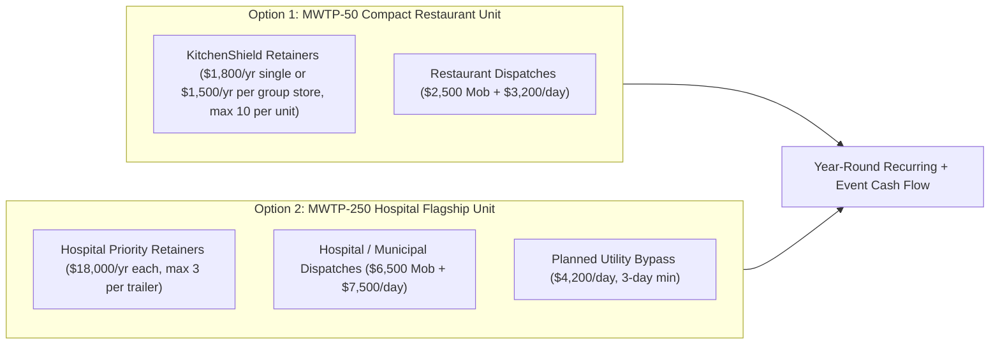

# MWTP-50 & MWTP-250 Commercial Loan Business Plan: Emergency Mobile Water Treatment & Critical Facility Pressurization Services

**Prepared For:** Commercial Lending & SBA 7(a) / Equipment Finance Underwriting  
**Asset Platforms:**
* **Phase 1 / Restaurant Fleet Unit (`MWTP-50-GN22` "KitchenShield-50"):** 35 GPM continuous / 50 GPM peak, 22-ft Compact Gooseneck (`9,990 lb GVWR` — **No Class A CDL Required**)
* **Phase 2 / Hospital Flagship Unit (`MWTP-250`):** 250 GPM rated, 36-ft Triple-Axle Gooseneck (`30,000 lb GVWR` — **Class A CDL Required**)  
**Date:** November 2026 (Revision B)

---

## 1. Executive Summary

### 1.1 Business Concept & Value Proposition
**AmeriPro Environmental Services** provides rapid-response, treated, pressurized drinking water to **commercial restaurant groups, hotels, hospitals, healthcare campuses, and municipalities** during Boil Water Advisories, water outages, and planned utility shutdowns.

When a storm, freeze, or main break compromises a city water system, critical facilities face serious disruption:
* **Restaurants, hotels, and food facilities** are typically required by the health department to stop using tap water, or close, during a Boil Water Advisory unless they have an approved alternate source — losing $8,000–$25,000+ per day in gross sales and risking perishable inventory.
* **Hospitals** can lose water for sterilization, dialysis, sanitation, and HVAC — which can force service cuts, diversions, or evacuations.

Unlike bulk water tankers, which deliver unpressurized water into storage, both the **MWTP-50** and **MWTP-250** treat water on site through 0.02 μm ultrafiltration (integrity-tested daily), validated UV, and chlorine with measured contact time, and **pressurize the building's plumbing at 60–85 PSI**. At a pre-surveyed site with a pre-installed tie-in, building water is expected about **2 hours after arrival for a restaurant (`MWTP-50`)** or **3 hours for a hospital (`MWTP-250`)**. Supply comes from a hydrant (or upstream restaurant tap on the `MWTP-50`) that holds ≥ 20 PSI residual, a potable tanker delivery, or an approved surface source, always through an air-gap break tank.

### 1.2 Phased Loan Request Options & Debt Service Highlights
To give the lender and borrower maximum flexibility, this plan underwrites **two modular equipment tiers** that can be financed sequentially (**Phase 1 `MWTP-50` first**, then **Phase 2 `MWTP-250`**) or together:

| Underwriting Option | Target Market & CDL Status | Total Project Cost | Borrower Equity (15%) | SBA 7(a) Loan Request (85%) | Annual Debt Service (8.75%, 10 Yr) | Year 1 DSCR (EBITDA / After Draw) | Year 1 Retainers vs. Fixed Costs + Debt |
| :--- | :--- | :---: | :---: | :---: | :---: | :---: | :---: |
| **Option 1A: `MWTP-50-GN22` (Using Existing Fleet 1-Ton Pickup)** | AmeriPro F.O.G. & Hood Restaurant Accounts (**No CDL**) | **$260,000** | **$39,000** | **$221,000** | **$33,238 / yr** ($2,770/mo) | **1.76×** *(1.01× after $25k draw)* | **21%** of fixed costs + debt (10-location cap) |
| **Option 1B: `MWTP-50-GN22` (With New F-350 SRW Gooseneck Truck)** | AmeriPro F.O.G. & Hood Restaurant Accounts (**No CDL**) | **$325,000** | **$48,750** | **$276,250** | **$41,547 / yr** ($3,462/mo) | **1.41×** *(0.81× after $25k draw)* | **19%** of fixed costs + debt (10-location cap) |
| **Option 2: `MWTP-250` Hospital Flagship (With Class 5 Truck)** | Acute-Care Hospitals & Municipalities (**Class A CDL**) | **$769,150** | **$115,370** | **$653,780** | **$98,328 / yr** ($8,194/mo) | **1.58×** *(1.03× after $55k draw)* | **32%** of fixed costs + debt |

* **Why Option 1 (`MWTP-50-GN22`) Is the Lowest-Risk Entry for Lender & Borrower:**
  1. **Existing Customer Base:** AmeriPro already services commercial kitchens for F.O.G. (grease traps) and exhaust hood cleaning. Bundling a $150/month single-store ($1,800/yr) or $125/month-per-store group ($1,500/yr per location) standby membership into existing accounts requires little cold-calling.
  2. **Low Break-Even:** About **seven 3-day restaurant deployments a year** cover all fixed costs and the loan payment on Option 1A even with no retainers (§5.3). Retainers — capped at 10 covered locations per unit so every customer's call order is honest — add steady cash on top.
  3. **No Class A CDL Bottleneck:** At `9,990 lb GVWR` behind a 1-ton pickup (`GCWR < 26,001 lbs`), any AmeriPro technician with a standard license and DOT medical card can tow it.
  4. **Regulatory Track Record:** Establishes AmeriPro's Georgia EPD emergency-use approval and field logs on low-complexity commercial kitchens before or alongside launching the $769k `MWTP-250` hospital flagship.

---

## 2. Use of Loan Proceeds & Collateral (Option 1 vs. Option 2)

### 2.1 Option 1 — `MWTP-50-GN22` ("KitchenShield-50") Compact Restaurant Unit
| Asset / Expenditure Category | Option 1A (Fleet Truck) | Option 1B (New Truck) | Borrower Equity (15%) | Bank Loan (85%) | Collateral & Lien Status |
| :--- | :---: | :---: | :---: | :---: | :--- |
| **MWTP-50-GN22 Compact Gooseneck Trailer** (22-ft, 9,990 lb GVWR, 20 kW diesel gen, 50A shore ATS, 4-module UF skid, 2 UV reactors, duplex booster, PLC; incl. PE engineering & 15% contingency) | $238,625 | $238,625 | $35,794 | $202,831 | **1st Priority UCC-1 & Vehicle Title Lien** |
| **Tow Vehicle: 1-Ton SRW Pickup (F-350 / Ram 3500 SRW w/ Gooseneck Ball)** | $0 *(Existing)* | $62,000 | $0 / $9,300 | $0 / $52,700 | **1st Priority Vehicle Title Lien** |
| **Initial Inventory, Spare Membranes, Adapter Tees, Hose Kit & Field Lab** | $6,375 | $7,375 | $956 / $1,106 | $5,419 / $6,269 | Blanket UCC-1 Business Assets |
| **Insurance, State Plan Review, DOT Med Card Setup & Working Capital Reserve** | $15,000 | $17,000 | $2,250 / $2,550 | $12,750 / $14,450 | Operating Reserve Account |
| **TOTAL OPTION 1 PROJECT FINANCING** | **$260,000** | **$325,000** | **$39,000 / $48,750** | **$221,000 / $276,250** | **Loan-to-Cost: 85%** |

### 2.2 Option 2 — `MWTP-250` Hospital Flagship Unit (36-ft Gooseneck)
| Asset / Expenditure Category | Total Cost | Borrower Equity (15%) | Bank Loan Proceeds (85%) | Collateral & Lien Status |
| :--- | :---: | :---: | :---: | :--- |
| **MWTP-250 Mobile Water Treatment Trailer** (titled gooseneck, 80 kW generator, 14-module UF skid, 3 UV reactors, triplex booster, Rockwell PLC; incl. engineering & contingency) | $601,450 | $90,218 | $511,232 | **1st Priority UCC-1 & Vehicle Title Lien** |
| **Tow Vehicle: Class 5 Chassis Cab (F-550 / Ram 5500 class) with Gooseneck Flatbed** | $95,000 | $14,250 | $80,750 | **1st Priority Vehicle Title Lien** |
| **Initial Chemical Inventory, Spare Membranes, Hose Kits & Field Lab** | $12,700 | $1,905 | $10,795 | Blanket UCC-1 Business Assets |
| **Insurance, State Approvals, DOT/CDL Compliance Setup, Legal & Working Capital / Standby Payroll Reserve** | $60,000 | $8,997 | $51,003 | Operating Reserve Account |
| **TOTAL OPTION 2 PROJECT FINANCING** | **$769,150** | **$115,370** | **$653,780** | **Loan-to-Cost: 85%** |

> [!NOTE]
> **Collateral, stated plainly:** Both trailers are custom integrations. Lenders typically value specialized equipment at orderly liquidation value, which may be below build cost. The strongest collateral pieces are the titled truck and trailer chassis, the diesel generator, and standard 316SS pumps and skids, which have secondary markets. Obtain an independent equipment appraisal if the lender requests one.

---

## 3. Market Analysis & Regulatory Demand Drivers

### 3.1 Why Commercial Kitchens & Hospitals Pay for This Service
1. **Commercial Kitchens & AmeriPro Account Synergy (`MWTP-50` Primary Market):**
   * Under state and county food codes (FDA Food Code adoption), a restaurant under a Boil Water Advisory must stop using tap water for food prep, ice, beverages, and warewashing unless it has an **approved alternate water source**. Most restaurants stay open on workarounds — bottled water, bagged ice, disposable service ware, and a limited menu — rather than closing.
   * The `MWTP-50` is worth the most where those workarounds break down: **high-volume full-service restaurants and hotel kitchens**, **multi-unit chains** with brand standards, **institutional kitchens** (nursing homes, assisted living, schools, correctional facilities), and **food processors and commissaries**. For these customers, a 3-day deployment ($2,500 mobilization + $3,200/day) costs less than the lost margin, workaround supplies, and spoiled inventory of running degraded or closing.
   * Because AmeriPro already visits commercial kitchens on recurring schedules for **F.O.G. (grease trap pumping)** and **exhaust hood cleaning**, AmeriPro has warm relationships with restaurant owners and direct access to map their water shutoffs and downstream sanitary cleanouts at virtually zero customer-acquisition cost.
2. **Hospital Emergency Preparedness Requirements (`MWTP-250` Primary Market):**
   * The **CMS Emergency Preparedness Rule (42 CFR § 482.15)** requires hospitals to have an emergency plan, including policies for subsistence needs such as water and for alternate sources of energy and utilities.
   * **Joint Commission** emergency management standards expect hospitals to plan how they would manage utilities, including water, for up to **96 hours** — whether by staying open, scaling back, or evacuating. This is a planning expectation, not a mandate to buy pressurization.
   * A **standby agreement with a mobile treatment provider**, documented in the hospital's Emergency Water Supply Plan with a pre-installed connection and an annual drill, is a practical way to support that plan without building a permanent backup plant.
3. **Aging Infrastructure and Boil Water Advisories:**
   * The U.S. sees roughly **240,000 water main breaks per year** (ASCE estimate) plus storms, freezes, and power-related pressure losses that trigger Boil Water Advisories.
4. **Insurance & Disaster Reimbursement:**
   * Some customers **may** recover costs under business-interruption, utility-service-interruption, or off-premises-power endorsements, which often have exclusions and waiting periods. Public and some private nonprofit facilities **may** qualify for FEMA Public Assistance after a declared disaster. Customers should confirm with their insurer — we won't promise reimbursement.

---

## 4. Revenue Model & Pricing Schedule (`MWTP-50` vs. `MWTP-250`)

### 4.1 Capacity Discipline
One storm or main break can affect multiple customers at once, and each trailer can serve **one** connection at a time:
* **`MWTP-50` Restaurant Unit:** Dedicated strictly to commercial kitchens and hospitality accounts (never pulled off a restaurant job for a hospital). Each unit carries **no more than 10 covered locations per region**, ranked in a call order written into every agreement; group stores count toward the cap. One kitchen is pressurized at a time, and coverage grows by adding units rather than selling more retainers on the same trailer.
* **`MWTP-250` Hospital Unit:** **No more than 3 hospital priority retainers per trailer per region**, ranked first-call / second-call / third-call in the contract, with that ranking disclosed to each hospital. Commercial retainers on the `MWTP-250` are "served as available" after hospital commitments.

### 4.2 Pricing Schedule & Unit Economics Comparison

| Revenue Stream | Unit | Target Client | Pricing Structure | Direct Variable Cost | Gross Margin |
| :--- | :---: | :--- | :--- | :--- | :---: |
| **1A. KitchenShield Single-Store Retainer** | `MWTP-50` | High-volume restaurants & institutional kitchens | **$1,800 / yr** ($150/mo bundled w/ F.O.G./hood invoice) | ~$100/yr (survey check) | ~94% |
| **1B. KitchenShield Group Retainer (2+ Stores)** | `MWTP-50` | Multi-unit restaurant groups & hotels | **$1,500 / yr per store** ($125/mo per store; counts toward 10-location cap) | ~$100/yr per store | ~93% |
| **2A. Restaurant Emergency Mobilization** | `MWTP-50` | Restaurant & kitchen dispatches | **$2,500 / event** — tow, ground tanks, DIT, hose sanitization | ~$450 / event | ~82% |
| **2B. Restaurant 24-Hr Treatment Day** | `MWTP-50` | Commercial kitchens (35–50 GPM) | **$3,200 / day** | **$669/day** (shore) to **$749/day** (diesel gen) | **76.6%–79.1%** |
| **3A. Hospital Priority Retainer (Max 3)** | `MWTP-250` | Regional hospitals (ranked 1st/2nd/3rd) | **$18,000 / yr** — site survey, tie-in design, annual drill | ~$1,200/yr | ~93% |
| **3B. Hospital / Municipal Mobilization** | `MWTP-250` | Hospital & municipal dispatches | **$6,500 / event** | ~$1,200 / event | ~82% |
| **3C. Hospital 24-Hr Treatment Day** | `MWTP-250` | Hospitals, municipalities (250 GPM) | **$7,500 / day** | **~$1,911 / day** (2 operators + fuel/chems) | ~75% |
| **3D. Planned Non-Emergency Rental** | `MWTP-250` | Utilities (main rehab), events | **$4,200 / day** (3-day min) | **~$1,661 / day** | ~60% |

---

## 5. Option 1 Financial Projections: `MWTP-50-GN22` Compact Restaurant Unit (Years 1–3)

### 5.1 Utilization & Retainer Assumptions (`MWTP-50-GN22`)
* **Year 1:** **8 covered locations** ($12,900 = 3 single stores @ $1,800 + 5 group stores @ $1,500, from AmeriPro's existing F.O.G./hood accounts) + **6 emergency events / 25 active treatment days** (~7% utilization). Deployments include non-retainer customers served at the same rates when the unit is free.
* **Year 2:** **10 covered locations — the per-unit cap** ($16,200 = 4 single + 6 group stores) + **10 emergency events / 45 active treatment days** (~12% utilization).
* **Year 3:** **10 covered locations** ($16,200) + **14 emergency events / 60 active treatment days** (~16% utilization). Demand beyond the cap is the trigger for a second unit.
* **Staffing:** a certified operator attends through the restaurant's service hours (~12 hours); overnight the unit runs on cellular telemetry with automatic outlet lockout and a one-hour on-call response, subject to the state's emergency-use approval.

### 5.2 `MWTP-50-GN22` Income Statement & Debt Service Coverage (Years 1–3)

| Financial Line Item (`MWTP-50-GN22` Single Unit) | Year 1 (25 Active Days) | Year 2 (45 Active Days) | Year 3 (60 Active Days) |
| :--- | :---: | :---: | :---: |
| **REVENUE** | | | |
| KitchenShield Standby Retainers (Bundled w/ F.O.G. & Hood Accounts) | $12,900 *(8 locations)* | $16,200 *(10 — cap)* | $16,200 *(10 — cap)* |
| Emergency Mobilization & Sanitization Fees ($2,500/event) | $15,000 *(6 events)* | $25,000 *(10 events)* | $35,000 *(14 events)* |
| Active Restaurant Treatment Days ($3,200/day) | $80,000 *(25 days)* | $144,000 *(45 days)* | $192,000 *(60 days)* |
| **TOTAL GROSS REVENUE** | **$107,900** | **$185,200** | **$243,200** |
| **DIRECT COST OF GOODS SOLD (COGS)** | | | |
| Diesel / Shore Power, Chemicals, Bags & Bac-T Lab ($169/day avg) | $4,225 | $7,605 | $10,140 |
| Attended Operator Shift + Overnight On-Call/Telemetry ($580/active day) | $14,500 | $26,100 | $34,800 |
| Truck Fuel & Mobilization Consumables ($450/event) | $2,700 | $4,500 | $6,300 |
| **TOTAL DIRECT COGS** | **$21,425** | **$38,205** | **$51,240** |
| **GROSS PROFIT** | **$86,475 (80.1%)** | **$146,995 (79.4%)** | **$191,960 (78.9%)** |
| **FIXED OPERATING EXPENSES (OPEX)** | | | |
| Commercial Auto, GL, Pollution & Inland Marine Insurance *(Non-CDL tier)* | $14,500 | $15,200 | $16,000 |
| Preventive Maintenance, CIP Chemicals & Analyzer Calibration | $4,200 | $4,500 | $4,800 |
| UF Membrane (4 modules) & UV Lamp Replacement Reserve | $3,200 | $3,200 | $3,200 |
| Operator On-Call Stipend, Licensing, Telemetry & Accounting | $6,100 | $6,600 | $7,000 |
| **TOTAL FIXED OPEX** | **$28,000** | **$29,500** | **$31,000** |
| **EBITDA (Cash Flow Available for Debt Service)** | **$58,475** | **$117,495** | **$160,960** |
| Less: Division Manager Allocation / Owner Draw | ($25,000) | ($35,000) | ($45,000) |
| **NET CASH AVAILABLE FOR DEBT SERVICE (After Draw)** | **$33,475** | **$82,495** | **$115,960** |
| **Option 1A Debt Service ($221,000 Loan — Existing Fleet Truck)** | **$33,238** | **$33,238** | **$33,238** |
| **Option 1B Debt Service ($276,250 Loan — With New 1-Ton Truck)** | **$41,547** | **$41,547** | **$41,547** |
| **OPTION 1A DSCR (Existing Truck: EBITDA / After Draw)** | **1.76×** *(1.01×)* | **3.53×** *(2.48×)* | **4.84×** *(3.49×)* |
| **OPTION 1B DSCR (With New Truck: EBITDA / After Draw)** | **1.41×** *(0.81×)* | **2.83×** *(1.99×)* | **3.87×** *(2.79×)* |

**Year 1 note:** after the owner draw, Year 1 coverage is thin (1.01× on Option 1A, 0.81× on Option 1B). Use the existing fleet truck (Option 1A), defer the Year 1 draw, or request interest-only payments during the build to keep Year 1 above the lender's minimum.

### 5.3 `MWTP-50-GN22` Break-Even & Downside Stress Tests
* **Annual fixed costs + debt service (Year 1):**
  * **Option 1A (Existing Truck):** $28,000 Fixed OpEx + $33,238 Debt = **$61,238 / year**.
  * **Option 1B (With New Truck):** $28,000 Fixed OpEx + $41,547 Debt = **$69,547 / year**.
* **Each 3-day restaurant deployment nets $9,403** ($2,500 mob + 3 × $3,200 − $450 mob cost − 3 × $749 daily cost).
* **Stress Test 1 — Year 1 Retainers, Few Deployments:** Year 1 retainers ($12,900) cover **46% of fixed OpEx**. The rest of fixed costs plus debt takes **six 3-day deployments (18 active days)** on Option 1A or **seven (21 days)** on Option 1B.
* **Stress Test 2 — Zero Retainers (Deployments Only):** With no retainers, **seven 3-day deployments (21 active days)** cover all fixed OpEx and debt service on Option 1A ($65,821 vs. $61,238), and **eight (24 days)** on Option 1B ($75,224 vs. $69,547).

---

## 6. Option 2 Financial Projections: `MWTP-250` Hospital Flagship Unit (Years 1–3)

### 6.1 Utilization Assumptions (`MWTP-250`)
* **Year 1:** 2 hospital retainers, 8 commercial retainers, **3 emergency events / 25 treatment days**, **15 planned rental days** (2 jobs). 40 active days ≈ 11% utilization.
* **Year 2:** 3 hospital retainers, 12 commercial, **5 events / 40 days**, **25 planned days** (3 jobs). ≈ 18% utilization.
* **Year 3:** 3 hospital retainers (cap), 15 commercial, **6 events / 50 days**, **30 planned days** (4 jobs). ≈ 22% utilization.

### 6.2 `MWTP-250` Income Statement & Cash Flow Coverage (Years 1–3)

| Financial Line Item (`MWTP-250` Single Unit) | Year 1 | Year 2 | Year 3 |
| :--- | :---: | :---: | :---: |
| **REVENUE** | | | |
| Hospital Priority Retainers ($18,000/yr) | $36,000 *(2)* | $54,000 *(3)* | $54,000 *(3)* |
| Commercial Standby Retainers ($3,500/yr) | $28,000 *(8)* | $42,000 *(12)* | $52,500 *(15)* |
| Emergency Mobilization Fees ($6,500/event) | $19,500 *(3)* | $32,500 *(5)* | $39,000 *(6)* |
| Emergency Treatment Days ($7,500/day) | $187,500 *(25 d)* | $300,000 *(40 d)* | $375,000 *(50 d)* |
| Planned Rental Days ($4,200/day) | $63,000 *(15 d)* | $105,000 *(25 d)* | $126,000 *(30 d)* |
| **TOTAL GROSS REVENUE** | **$334,000** | **$533,500** | **$646,500** |
| **DIRECT COST OF GOODS SOLD (COGS)** | | | |
| Fuel, Chemicals, Bags & Bac-T Lab ($451/active day) | $18,040 | $29,315 | $36,080 |
| Two-Operator Crew + Per Diem ($1,460/emergency day, $1,210/planned day) | $54,650 | $88,650 | $109,300 |
| Truck Fuel & Mobilization ($1,200/emergency event, $800/planned job) | $5,200 | $8,400 | $10,400 |
| **TOTAL COGS** | **$77,890** | **$126,365** | **$155,780** |
| **GROSS PROFIT** | **$256,110 (76.7%)** | **$407,135 (76.3%)** | **$490,720 (75.9%)** |
| **FIXED OPERATING EXPENSES (OPEX)** | | | |
| Auto, General Liability, Pollution & Inland Marine Insurance | $38,000 | $39,500 | $41,000 |
| Equipment Storage Yard / Heated Bay Lease | $9,600 | $9,900 | $10,200 |
| Preventive Maintenance, CIP & Calibration | $12,000 | $12,500 | $13,000 |
| Membrane & UV Replacement Reserve (5–7 yr life) | $9,000 | $9,000 | $9,000 |
| Sales, Hospital Marketing, SAM.gov / FEMA Vendor Registration | $8,500 | $9,000 | $9,500 |
| Accounting, Legal, Licensing & Telemetry | $5,200 | $5,500 | $5,800 |
| On-Call Standby Pay (2 certified operators / CDL drivers) | $12,000 | $12,500 | $13,000 |
| DOT Compliance (drug & alcohol consortium, medical cards, annual inspection, permits) | $3,500 | $3,600 | $3,700 |
| Operator Certification & Training | $2,500 | $2,600 | $2,700 |
| **TOTAL FIXED OPEX** | **$100,300** | **$104,100** | **$107,900** |
| **EBITDA (Cash Flow Available for Debt Service)** | **$155,810** | **$303,035** | **$382,820** |
| Less: Owner Base Salary / Draw | ($55,000) | ($65,000) | ($75,000) |
| **NET CASH AVAILABLE FOR BANK DEBT SERVICE** | **$100,810** | **$238,035** | **$307,820** |
| **Annual Bank Loan Payment ($653,780 @ 8.75%, 10 Yrs)** | **$98,328** | **$98,328** | **$98,328** |
| **PRE-TAX FREE CASH SURPLUS (After Debt & Salary)** | **$2,482** | **$139,707** | **$209,492** |
| **DSCR (EBITDA Basis)** | **1.58×** *(after draw: 1.03×)* | **3.08×** *(after draw: 2.42×)* | **3.89×** *(after draw: 3.13×)* |

### 6.3 `MWTP-250` Break-Even & Downside Stress Tests
* **Annual fixed costs + debt service (Year 1):** $100,300 + $98,328 = **$198,628**.
* **Case A — Retainers only (zero deployments):** A full book of 3 hospital + 15 commercial retainers brings in **$106,500 (54% of fixed costs + debt)**. Unlike the `MWTP-50`, retainers alone on the `MWTP-250` **do not** carry the loan; deployments are required.
* **Case B — Deployments only (zero retainers):** Each emergency treatment day contributes **$5,589** ($7,500 − $1,911). The trailer needs about **36 emergency treatment days per year (~10% utilization)** to cover fixed costs and debt, before mobilization fees.
* **Year 1 mitigation (if building `MWTP-250` standalone):** Request interest-only payments during the ~6-month build, raise the equity injection, defer the owner draw until the second hospital retainer is signed — **or launch Phase 1 (`MWTP-50-GN22`) first to generate immediate positive cash flow**.

---

## 7. Risk Management & Regulatory Compliance

| Identified Risk | Engineering & Operational Mitigation |
| :--- | :--- |
| **Water Quality Liability** | Credit-based barriers on both units: UF with NSF 419 challenge-tested modules and a **daily pressure-decay integrity test (`DIT-201`)**; EPA UVDGM-validated UV (`1+1` on `MWTP-50`, `2+1` on `MWTP-250`) with UVT monitoring; **chlorine contact time calculated live** (`600-gal` baffled tank on `MWTP-50`, `3,000-gal` on `MWTP-250`) for 4-log virus inactivation. Any trip closes `XV-602`. Bac-T samples to a state-certified lab per the state's emergency-use approval. |
| **Drawing from a Compromised Main** | Neither trailer ever pumps directly from the main. Hydrant or upstream BWA tap supply runs through a **pressure-sustaining valve (`PSV-100`) that holds ≥ 20 PSI residual** and an **air-gap break tank (`TK-100`)**. If residual can't be held, supply switches to potable tanker drops (only 1 drop/day needed for a restaurant on the `MWTP-50`). |
| **Regulatory Approval** | Before launch: PE-stamped basis of design; pre-application meeting and plan review with the state drinking water program (**Georgia EPD Drinking Water Program** in our home state); state-certified water treatment operators on every crew. We will not claim "pre-registration" until a state has actually issued an approval. |
| **Overselling One Asset** | Hospital retainers capped at 3 per `MWTP-250` trailer per region with ranked priority disclosed in each contract (§4.1). Deploying the dedicated `MWTP-50` for restaurants eliminates any conflict between hospital and restaurant dispatches. |
| **Commercial Driver Licensing** | **`MWTP-50-GN22`:** `9,990 lb GVWR` gooseneck behind a 1-ton pickup (`GCWR < 26,001 lbs`) → **No Class A CDL required** (standard license + DOT medical card). **`MWTP-250`:** `GCWR ≈ 49,500 lb` → **Class A CDL required** (minimum 2 CDL drivers budgeted). |
| **Chemical Safety & Hauling** | Segregated oxidizer and acid cabinets, chlorine gas detector (`AIT-901`), ventilated chemical bay, ANSI Z358.1 eyewash. Chemicals hauled within DOT materials-of-trade limits; bulk bleach bought fresh near the job. |
| **Waste Water & F.O.G. Protection** | All waste is dechlorinated (`P-503`) and discharged to the **downstream sanitary sewer cleanout** with utility/facility permission — never through a restaurant's F.O.G. grease interceptor and never to storm drains without MS4 permission. |
| **Single Points of Failure** | Standby UV reactor, duplex/triplex booster pumps, duplex air compressors, duplex chlorine pumps. On the `MWTP-50`, **dual power capability** allows running on a restaurant's **240V 50A shore receptacle** or the onboard **20 kW diesel generator**. |

---

## 8. Management & Execution Roadmap

### 8.1 Management Team
* **Jeff Ricks, Technical Director** — engineering, operations, and the company safety program.
* **State-certified water treatment operators** — on every deployment.
* **Class A CDL drivers** — for the MWTP-250 (Phase 2).
* **Consulting PE** — licensed water-treatment engineer for the basis of design and state submittals.

Personal and corporate financial statements and resumes accompany the loan application.

### 8.2 Phased Launch Timeline
* **Phase 1 — `MWTP-50-GN22` Restaurant Unit (Months 0–6):**
  1. **Months 0–2:** PE basis of design for `MWTP-50-GN22`; Georgia EPD pre-application meeting; vendor quotes; sign standby LOIs for 8–10 covered locations from AmeriPro's existing F.O.G. and hood accounts; close Option 1 SBA loan ($221k–$276k).
  2. **Months 2–5:** Fabricate 22-ft compact gooseneck, integrate 4-module UF, UV, and booster skids; perform Factory Acceptance Test (FAT) and Georgia EPD inspection.
  3. **Month 6:** Complete restaurant site surveys (mapping shutoffs, adapter tees, downstream cleanouts, and 50A shore plugs); activate monthly retainer billing (~$13,000–$16,000/yr run rate) and 24/7 dispatch readiness.
* **Phase 2 — `MWTP-250` Hospital Flagship Unit (Months 6–15):**
  1. Leverage Phase 1 state approval, operator team, and cash flow to secure 2–3 Hospital Priority LOIs ($18,000/yr each) and close Option 2 financing ($653.8k loan) for the 36-ft `MWTP-250`.
