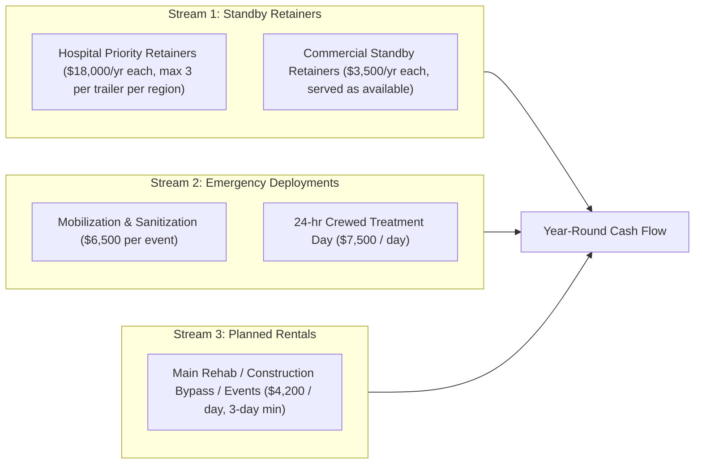

# Commercial Loan Business Plan: Emergency Mobile Water Treatment & Critical Facility Pressurization Services

**Prepared For:** Commercial Lending & SBA 7(a) / Equipment Finance Underwriting  
**Asset Platform:** MWTP-250 (250 GPM rated, 36-ft Gooseneck Mobile Water Treatment Facility, Rev B)  
**Date:** November 2026  

> [!IMPORTANT]
> **Draft status:** Prices, insurance premiums, and customer counts below are planning assumptions. Before this goes to a lender, replace them with written vendor quotes, an insurance broker's quote, and signed letters of intent (LOIs) from target customers. Items marked **[VERIFY]** need a source.

---

## 1. Executive Summary

### 1.1 Business Concept & Value Proposition
**[Company Name — e.g., an AmeriPro Environmental Services division]** provides rapid-response, treated, pressurized drinking water to **hospitals, healthcare campuses, commercial restaurant groups, food processors, and municipalities** during Boil Water Advisories, water outages, and planned utility shutdowns.

When a storm, freeze, or main break compromises a city water system, critical facilities face serious disruption:
* **Hospitals** can lose water for sterilization, dialysis, sanitation, and HVAC — which can force service cuts, diversions, or evacuations. **[VERIFY: add a sourced cost figure for hospital water-loss events before quoting one.]**
* **Restaurants, hotels and food facilities** are typically required by the health department to stop using tap water, or close, during a Boil Water Advisory unless they have an approved alternate source, losing revenue and inventory.

Unlike bulk water tankers, which deliver unpressurized water into storage, the **MWTP-250** treats water on site through 0.02 μm ultrafiltration (integrity-tested daily), validated UV, and chlorine with measured contact time, and **pressurizes the building's plumbing at 65–85 PSI**. At a pre-surveyed site with a pre-installed tie-in, building water is expected about **3 hours after arrival**. Supply comes from a hydrant that still has ≥ 20 PSI residual, a tanker shuttle, or an approved surface source, always through a break tank.

### 1.2 The Loan Request & Debt Service Highlights
* **Total Project Capital Required:** **$769,150** ($601,450 MWTP-250 trailer build incl. engineering & 15% contingency + $95,000 Class 5 chassis-cab tow truck + $12,700 initial inventory & spares + $60,000 working capital, insurance, DOT/CDL setup & standby payroll reserve).
* **Borrower Equity Injection (15%):** **$115,370**
* **SBA 7(a) / Equipment Loan Request (85%):** **$653,780**
* **Proposed Terms:** 10-year term (120 months; equipment useful life supports this) at 8.75% fixed → **$8,194/month** ($98,328/year total debt service). **[VERIFY current rate with lender.]**
* **Debt Service Coverage Ratio (DSCR), base case:**
  * **Year 1:** **1.58×** on EBITDA, **1.03× after owner draw** — below the usual 1.25× minimum. Year 1 needs an interest-only period during the build (common for SBA equipment loans), a larger equity injection, or a deferred owner draw.
  * **Year 2:** **3.08×** (2.42× after draw)
  * **Year 3:** **3.89×** (3.13× after draw)
* **Break-even:** about **36 emergency treatment days per year** with no retainers, or proportionally fewer with retainers in place (§6).

---

## 2. Use of Loan Proceeds & Collateral

| Asset / Expenditure Category | Total Cost | Borrower Equity (15%) | Bank Loan Proceeds (85%) | Collateral & Lien Status |
| :--- | :---: | :---: | :---: | :--- |
| **MWTP-250 Mobile Water Treatment Trailer** (titled gooseneck, 80 kW generator, 14-module UF skid, 3 UV reactors, triplex booster, Rockwell PLC; incl. engineering & contingency) | $601,450 | $90,218 | $511,232 | **1st Priority UCC-1 & Vehicle Title Lien** |
| **Tow Vehicle: Class 5 Chassis Cab (F-550 / Ram 5500 class) with Gooseneck Flatbed** | $95,000 | $14,250 | $80,750 | **1st Priority Vehicle Title Lien** |
| **Initial Chemical Inventory, Spare Membranes, Hose Kits & Field Lab** | $12,700 | $1,905 | $10,795 | Blanket UCC-1 Business Assets |
| **Insurance, State Approvals, DOT/CDL Compliance Setup, Legal & Working Capital / Standby Payroll Reserve** | $60,000 | $8,997 | $51,003 | Operating Reserve Account |
| **TOTAL PROJECT FINANCING** | **$769,150** | **$115,370** | **$653,780** | **Loan-to-Cost: 85%** |

> [!NOTE]
> **Collateral, stated plainly:** The trailer is a custom, one-off integration. Lenders typically value specialized equipment at orderly liquidation value, which may be well below build cost. The strongest collateral pieces are the titled truck and trailer chassis, the generator, and standard pumps and skids, which have secondary markets. Rev A's claim that the unit "appraises above the loan on Day 1" has been removed; obtain an independent equipment appraisal if the lender asks.

---

## 3. Market Analysis & Regulatory Demand Drivers

### 3.1 Why Hospitals & Commercial Facilities Pay for This Service
1. **Hospital emergency preparedness requirements:**
   * The **CMS Emergency Preparedness Rule (42 CFR § 482.15)** requires hospitals to have an emergency plan, including policies for subsistence needs such as water and for alternate sources of energy and utilities.
   * **Joint Commission** emergency management standards expect hospitals to plan how they would manage utilities, including water, for up to **96 hours** — whether by staying open, scaling back, or evacuating. This is a planning expectation, not a mandate to buy pressurization. (The Joint Commission EM chapter was renumbered in 2022; cite the current standard number. **[VERIFY]**)
   * Few hospitals can justify a permanent backup treatment plant. A **standby agreement with a mobile treatment provider**, documented in the hospital's Emergency Water Supply Plan with a pre-installed connection and an annual drill, is a credible way to meet that planning expectation.
2. **Aging infrastructure and Boil Water Advisories:**
   * The U.S. sees roughly **240,000 water main breaks per year** (ASCE estimate) plus storms, freezes, and power-related pressure losses that trigger Boil Water Advisories. **[VERIFY and cite the BWA frequency figure for our service region.]**
   * The truck-and-gooseneck configuration needs no semi-tractor, but the driver **must hold a Class A CDL** (§7). The company will keep at least two Class A drivers on staff.
3. **Reimbursement:**
   * Some customers **may** recover costs under business-interruption, utility-service-interruption, or off-premises-power endorsements, which often have exclusions and waiting periods. Public and some private nonprofit facilities **may** qualify for FEMA Public Assistance after a declared disaster. Customers should confirm with their insurer — we won't promise reimbursement.

---

## 4. Revenue Model (Retainers + Deployments + Planned Rentals)

### 4.1 Capacity Discipline — How Many Hospitals One Trailer Can Promise
One storm can hit an entire region at once, and a single trailer can serve **one** facility at a time. Hospitals write this service into their emergency plans, so overselling it is a real liability. Rules:
* **No more than 3 hospital priority retainers per trailer per region**, ranked first-call / second-call / third-call in the contract, with that ranking disclosed to each hospital.
* **Commercial retainers are "served as available"** after hospital commitments, and the contract says so.
* Adding more hospital retainers requires a second trailer (or a signed mutual-aid/rental backup).

### 4.2 Pricing Schedule & Unit Economics

| Revenue Stream | Target Client | Pricing Structure | Direct Variable Cost | Gross Margin |
| :--- | :--- | :--- | :--- | :---: |
| **1. Hospital Priority Retainer (Annual)** | Regional hospitals (capped at 3 per trailer) | **$18,000 / year** — ranked priority response, site survey, pre-installed tie-in design support, annual drill | ~$1,200/yr (drill crew + fuel) | ~93% |
| **2. Commercial Standby Retainer (Annual)** | Restaurant groups, hotels, dialysis clinics | **$3,500 / year** — site survey, connection plan, dispatch when the trailer is available | ~$150/yr | ~96% |
| **3. Emergency Mobilization & Sanitization** | All emergency dispatches | **$6,500 per event** — transport, ground tanks, hydrant/tanker setup, start-up proving, hose sanitization | ~$1,200 | ~82% |
| **4. Emergency 24-hr Treatment Day** | Hospitals, municipalities, commercial | **$7,500 / day** (~$0.02/gal at full output) | **~$1,911 / day** ($451 fuel, chemicals & lab + $960 two-operator crew + $500 per diem) | ~75% |
| **5. Planned Non-Emergency Rental** | Utilities (planned main work), food plants, events | **$4,200 / day** (3-day minimum) | **~$1,661 / day** | ~60% |

**[VERIFY pricing against competitor rental rates and customer LOIs.]** Rev A pricing ($12,000 / $4,500 / $5,500 / $3,200) does not cover realistic crew, insurance, and debt costs — see the sensitivity in §6.

---

## 5. 3-Year Pro Forma Financial Projections (Single Trailer Unit)

### 5.1 Utilization Assumptions
* **Year 1:** 2 hospital retainers, 8 commercial retainers, **3 emergency events / 25 treatment days**, **15 planned rental days** (2 jobs). 40 active days ≈ 11% utilization.
* **Year 2:** 3 hospital retainers, 12 commercial, **5 events / 40 days**, **25 planned days** (3 jobs). ≈ 18% utilization.
* **Year 3:** 3 hospital retainers (cap), 15 commercial, **6 events / 50 days**, **30 planned days** (4 jobs). ≈ 22% utilization.

### 5.2 Income Statement & Cash Flow Coverage (Years 1–3)

| Financial Line Item | Year 1 | Year 2 | Year 3 |
| :--- | :---: | :---: | :---: |
| **REVENUE** | | | |
| Hospital Priority Retainers ($18,000/yr) | $36,000 *(2)* | $54,000 *(3)* | $54,000 *(3)* |
| Commercial Standby Retainers ($3,500/yr) | $28,000 *(8)* | $42,000 *(12)* | $52,500 *(15)* |
| Emergency Mobilization Fees ($6,500/event) | $19,500 *(3)* | $32,500 *(5)* | $39,000 *(6)* |
| Emergency Treatment Days ($7,500/day) | $187,500 *(25 d)* | $300,000 *(40 d)* | $375,000 *(50 d)* |
| Planned Rental Days ($4,200/day) | $63,000 *(15 d)* | $105,000 *(25 d)* | $126,000 *(30 d)* |
| **TOTAL GROSS REVENUE** | **$334,000** | **$533,500** | **$646,500** |
| **DIRECT COST OF GOODS SOLD (COGS)** | | | |
| Fuel, Chemicals, Bags & Bac-T Lab ($451/active day) | $18,040 | $29,315 | $36,080 |
| Two-Operator Crew + Per Diem ($1,460/emergency day, $1,210/planned day) | $54,650 | $88,650 | $109,300 |
| Truck Fuel & Mobilization ($1,200/emergency event, $800/planned job) | $5,200 | $8,400 | $10,400 |
| **TOTAL COGS** | **$77,890** | **$126,365** | **$155,780** |
| **GROSS PROFIT** | **$256,110 (76.7%)** | **$407,135 (76.3%)** | **$490,720 (75.9%)** |
| **FIXED OPERATING EXPENSES (OPEX)** | | | |
| Auto, General Liability, Pollution & Inland Marine Insurance **[VERIFY — broker quote]** | $38,000 | $39,500 | $41,000 |
| Equipment Storage Yard / Heated Bay Lease | $9,600 | $9,900 | $10,200 |
| Preventive Maintenance, CIP & Calibration | $12,000 | $12,500 | $13,000 |
| Membrane & UV Replacement Reserve (5–7 yr life) | $9,000 | $9,000 | $9,000 |
| Sales, Hospital Marketing, SAM.gov / FEMA Vendor Registration | $8,500 | $9,000 | $9,500 |
| Accounting, Legal, Licensing & Telemetry | $5,200 | $5,500 | $5,800 |
| On-Call Standby Pay (2 certified operators / CDL drivers) | $12,000 | $12,500 | $13,000 |
| DOT Compliance (drug & alcohol consortium, medical cards, annual inspection, permits) | $3,500 | $3,600 | $3,700 |
| Operator Certification & Training | $2,500 | $2,600 | $2,700 |
| **TOTAL FIXED OPEX** | **$100,300** | **$104,100** | **$107,900** |
| **EBITDA (Cash Flow Available for Debt Service)** | **$155,810** | **$303,035** | **$382,820** |
| Less: Owner Base Salary / Draw | ($55,000) | ($65,000) | ($75,000) |
| **NET CASH AVAILABLE FOR BANK DEBT SERVICE** | **$100,810** | **$238,035** | **$307,820** |
| **Annual Bank Loan Payment ($653,780 @ 8.75%, 10 Yrs)** | **$98,328** | **$98,328** | **$98,328** |
| **PRE-TAX FREE CASH SURPLUS (After Debt & Salary)** | **$2,482** | **$139,707** | **$209,492** |
| **DSCR (EBITDA Basis)** | **1.58×** *(after draw: 1.03×)* | **3.08×** *(after draw: 2.42×)* | **3.89×** *(after draw: 3.13×)* |

---

## 6. Break-Even & Downside Stress Tests

* **Annual fixed costs + debt service (Year 1):** $100,300 + $98,328 = **$198,628**.
* **Case A — Retainers only (zero deployments):** A full book of 3 hospital + 15 commercial retainers brings in **$106,500 (54% of fixed costs + debt)**. Retainers alone **do not** carry the loan; deployments are required.
* **Case B — Deployments only (zero retainers):** Each emergency treatment day contributes **$5,589** ($7,500 − $1,911). The trailer needs about **36 emergency treatment days per year (~10% utilization)** to cover fixed costs and debt, before mobilization fees.
* **Case C — Rev A pricing with realistic costs:** At $12,000 / $3,500 / $4,500 / $5,500 / $3,200 pricing and the same utilization, DSCR after owner draw is **0.18× in Year 1**, 1.07× in Year 2, and 1.50× in Year 3. The original price list does not support the loan.
* **Year 1 mitigation:** request interest-only payments during the ~6-month build, raise the equity injection, or defer the owner draw until the second hospital retainer is signed.

---

## 7. Risk Management & Regulatory Compliance

| Identified Risk | Engineering & Operational Mitigation |
| :--- | :--- |
| **Water Quality Liability** | Credit-based barriers: UF with NSF 419 challenge-tested modules and a **daily pressure-decay integrity test**; EPA UVDGM-validated UV (2 duty + 1 standby) with UVT monitoring; **chlorine contact time calculated live** for 4-log virus inactivation. Any trip closes `XV-602`. Bac-T samples to a state-certified lab per the state's emergency-use approval. Pollution and professional liability coverage per broker recommendation. |
| **Drawing from a compromised main** | The trailer never pumps from the main. Hydrant supply runs through a **pressure-sustaining valve that holds ≥ 20 PSI residual** and an **air-gap break tank**, with a utility hydrant permit, meter, and backflow device. If residual can't be held, supply switches to tanker shuttle. |
| **Regulatory Approval** | Before launch: PE-stamped basis of design; pre-application meeting and plan review with the state drinking water program (**Georgia EPD Drinking Water Program** in our home state, and the equivalent agency in any other state we deploy to); state-certified water treatment operators on every crew. We will not claim "pre-registration" until a state has actually issued an approval. |
| **Overselling one asset** | Hospital retainers capped at 3 per trailer per region with ranked priority disclosed in each contract (§4.1). |
| **Commercial Driver Licensing** | Truck + trailer GCWR ≈ 49,500 lb with a 30,000 lb GVWR trailer → **Class A CDL required**. USDOT number, medical cards, drug & alcohol testing, hours-of-service, and annual inspections are budgeted. At least two Class A drivers on staff. |
| **Chemical Safety & Hauling** | Segregated oxidizer and acid cabinets, chlorine gas detector, ventilated chemical room, ANSI Z358.1 eyewash. Chemicals hauled in ≤ 8-gal containers within DOT materials-of-trade limits; bulk bleach bought fresh near the job. |
| **Waste Water** | All waste dechlorinated and discharged to sanitary sewer with the utility's permission. No coagulant-laden water to storm drains. |
| **Equipment Damage / Theft** | Inland marine coverage at replacement value, GPS/telemetry tracking, secured storage yard. |
| **Single Points of Failure** | Standby UV reactor, standby booster pump, duplex air compressors, duplex chlorine pumps. One generator: shore-power capability plus a pre-arranged rental generator source. |

---

## 8. Management & Execution

### 8.1 Management Team **[TO COMPLETE]**
Lenders will want: owner background and equity source, technical director, certified water treatment operator(s), CDL drivers, the consulting PE, and the company's safety program (OSHA safety officer). Attach personal financial statements and resumes.

### 8.2 Launch Timeline (about 9–12 months — custom trailer, generator, and UF skid lead times often run 16–26 weeks) **[VERIFY with vendors]**
1. **Months 0–2 — Engineering & approvals:** PE basis of design; state drinking water program pre-application meeting; vendor quotes; insurance quote; LOIs from 2+ hospitals.
2. **Months 2–3 — Loan closing & procurement:** Close the loan (interest-only during build if available); order chassis, generator, UF, UV and booster skids; register in SAM.gov.
3. **Months 3–8 — Fabrication & staffing:** Integration and panel build; hire and certify operators; CDL training and DOT compliance setup.
4. **Months 8–10 — Testing & state approval:** Factory acceptance test (hydrostatic, PLC interlocks, DIT, CT logic), state inspection and approval for emergency use.
5. **Months 10–12 — Site surveys & revenue activation:** Hospital site surveys and tie-in design, first drills, retainer billing begins.

---

## 9. Growth Option: MWTP-50 Compact Unit (Concept)

The MWTP-250 is far larger than a restaurant needs (15–60 GPM peak). A **25–50 GPM** unit (UF + UV + chlorine, small contact tank, booster) on a trailer of about **10,000 lb GVWR** behind a one-ton pickup would stay **under the Class A CDL threshold**, cost a fraction of the large unit, and fit AmeriPro's existing restaurant customer base (F.O.G. and hood cleaning accounts). It is a lower-risk way to build a track record with the state and customers before or alongside the MWTP-250. **[Concept only — not designed or priced.]**
