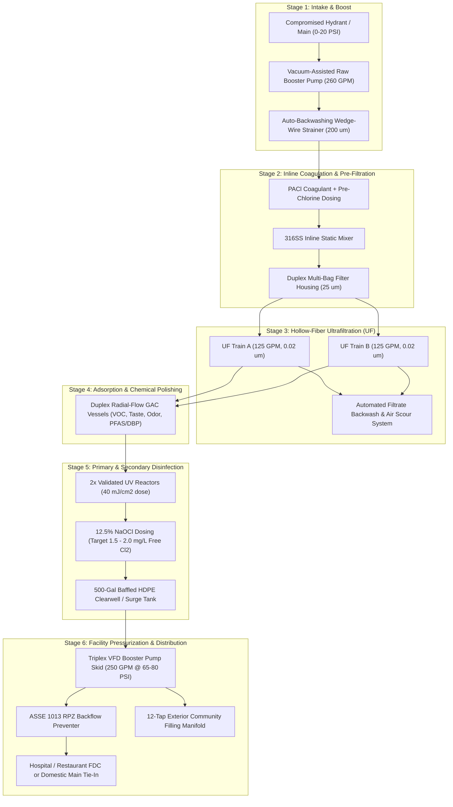

# Engineering Design Package: 36-ft Gooseneck Emergency Mobile Water Treatment Facility (MWTP-250)

## 1. Design Basis & System Overview

### 1.1 Mission Profile
This system is engineered specifically for rapid deployment following severe storms, power grid failures, or water main breaks where municipal water pressure drops below $20\text{ PSI}$ (triggering mandatory Boil Water Advisories, bacterial intrusion, and sediment mobilization) or shuts off completely.
- **Primary Targets:** Hospitals, acute-care clinics, commercial kitchens/restaurants, and emergency community distribution points.
- **Mobility Platform:** **36-ft Enclosed Triple-Axle Gooseneck Trailer** ($28\text{ ft}$ main deck + $8\text{ ft}$ gooseneck deck), towed by a Class 4/5 heavy-duty pickup truck (e.g., Ford F-450 / Ram 4500) without requiring a Class A semi-tractor.
- **Feed Water Source:** Depressurized/compromised municipal fire hydrants, building water service lines, municipal storage tanks, or low-turbidity emergency surface/well water backups.

### 1.2 Why Eliminating Reverse Osmosis (RO) Triples Your Emergency Output
Because the feed water is compromised municipal water (freshwater with low Total Dissolved Solids, $\text{TDS} < 500\text{ mg/L}$) rather than seawater, **Reverse Osmosis is not required**. Replacing RO with **Hollow-Fiber Ultrafiltration (UF) + Granular Activated Carbon (GAC) + UV + Chlorination** yields critical operational advantages in a 36-ft trailer:
1. **3x to 4x Higher Flow Rate:** Produces **250 GPM (360,000 GPD)** instead of $50\text{--}75\text{ GPM}$ in the same footprint.
2. **96% Water Recovery:** Only $4\%$ of water is used for periodic UF backwashing, compared to $25\%\text{--}40\%$ wasted as brine reject in RO systems (critical when drawing from a low-pressure hydrant).
3. **70% Lower Power Consumption:** Operates at $30\text{--}85\text{ PSI}$ instead of $200\text{--}400\text{ PSI}$, allowing a compact **45 kW diesel generator** to power the entire treatment train AND high-pressure building distribution pumps.

---

### 1.3 Capacity & Population Served at 250 GPM (360,000 GPD)

| Emergency Facility / Scenario | Standard Demand Benchmark | Peak Simultaneous Capacity Served |
| :--- | :--- | :--- |
| **Acute-Care Hospital** (Sanitation, HVAC cooling, sterilization, potable) | $150\text{--}250\text{ gal / bed / day}$ | **1,400 to 2,400 Hospital Beds** (or 3–4 full-size regional hospitals) |
| **Full-Service Restaurant / Emergency Kitchen** (Dishwashing, prep, ice, sanitation) | $2,500\text{--}4,000\text{ gal / day}$ | **90 to 140 Restaurants** (or a massive central FEMA/Red Cross kitchen + hospital) |
| **Emergency Drinking & Sanitation (FEMA Standard)** | $15\text{ gal / person / day}$ | **24,000 People / day** |
| **Survival Drinking Water Only** | $1\text{ gal / person / day}$ | **360,000 People / day** |

---

## 2. Process Flow Diagram (PFD) & Mass Balance

### 2.1 Process Architecture
The treatment train uses a **6-stage Multi-Barrier Municipal Process** with automated fail-safe monitoring:



### 2.2 Mass Balance & Hydraulic Profile (100% Load)

| Stream ID | Process Node | Flow Rate (GPM) | Daily Volume (GPD) | Pressure (PSI) | Key Water Quality Target |
| :--- | :--- | :--- | :--- | :--- | :--- |
| **S-101** | Raw Hydrant / Intake Feed | $260\text{ GPM}$ | $374,400\text{ GPD}$ | $-5\text{ to }20\text{ PSI}$ | Turbidity $\le 50\text{ NTU}$, $\text{pH } 6.5\text{--}8.5$ |
| **S-102** | Post Raw Booster & $200\ \mu\text{m}$ Strainer | $258\text{ GPM}$ | $371,520\text{ GPD}$ | $55\text{ PSI}$ | TSS $> 200\ \mu\text{m}$ removed |
| **S-103** | Post $25\ \mu\text{m}$ Bag Filter (UF Feed) | $258\text{ GPM}$ | $371,520\text{ GPD}$ | $48\text{ PSI}$ | Protects UF fibers from pipe scale/rust |
| **S-104** | UF Permeate (Post $0.02\ \mu\text{m}$ Membrane) | $250\text{ GPM}$ | $360,000\text{ GPD}$ | $30\text{ PSI}$ | **Turbidity $< 0.05\text{ NTU}$**, $6\text{-log}$ bacteria, $4\text{-log}$ virus removal |
| **S-105** | Post GAC Polishing Vessels | $250\text{ GPM}$ | $360,000\text{ GPD}$ | $20\text{ PSI}$ | Organics, VOCs, hydrocarbons, odor removed |
| **S-106** | Post UV & NaOCl Clearwell | $250\text{ GPM}$ | $360,000\text{ GPD}$ | $2\text{ PSI}$ (Atmospheric) | $99.99\%$ pathogen inactivation, Free $\text{Cl}_2 = 2.0\text{ mg/L}$ |
| **S-107** | **Finished Potable Discharge** | **$250\text{ GPM}$** | **$360,000\text{ GPD}$** | **$65\text{--}85\text{ PSI}$ (VFD)** | Meets/Exceeds EPA SDWA & Hospital Potable Standards |
| **W-201** | Strainer + UF Backwash Waste (Intermittent) | $10\text{ GPM}$ (avg) | $14,400\text{ GPD}$ | $15\text{ PSI}$ | Discharged to storm drain / sanitary sewer |

---

## 3. Major Equipment Schedule & Specifications

### 3.1 Intake & Pre-Treatment
* **Raw Water Intake Pump (`P-101`):**
  * **Type:** End-suction centrifugal with vacuum-priming assist (prevents collapsing depressurized municipal mains via low-suction cutout switch set at $-2\text{ PSI}$).
  * **Capacity:** $260\text{ GPM}$ @ $130\text{ ft}$ TDH, $7.5\text{ HP}$ VFD-controlled, 316SS wet end.
* **Automatic Self-Cleaning Strainer (`STR-101`):**
  * **Type:** Motorized brush/suction scanner screen, $200\ \mu\text{m}$ 316SS wedge-wire element, $3\text{''}$ flanged ports. Differential pressure ($\Delta P$) triggered auto-flush ($2\text{ sec}$ flush cycle without interrupting flow).
* **Duplex Pre-Filter Housing (`BF-101A/B`):**
  * **Type:** 2x 4-bag 304SS housings with changeover valve (allows bag replacement while running $100\%$ flow). Uses $25\ \mu\text{m}$ polypropylene felt bags to capture iron pipe scale dislodged during water main depressurization.

### 3.2 Hollow-Fiber Ultrafiltration Skid (`UF-201A/B`)
* **Configuration:** Dual parallel trains ($2 \times 125\text{ GPM}$), **14 total modules** ($7$ per train) + $1$ dedicated Backwash Pump (`P-202`, $180\text{ GPM}$ @ $40\text{ PSI}$, $5\text{ HP}$) + Oil-Free Air Scour Blower (`BL-201`).
* **Membrane Specs:** Outside-In or Inside-Out PVDF hollow fiber, nominal pore size **$0.02\ \mu\text{m}$**, surface area $775\text{ ft}^2$ ($72\text{ m}^2$) per module ($10,850\text{ ft}^2$ total membrane area).
* **Design Flux:** $33\text{ GFD}$ ($56\text{ LMH}$) — conservative municipal flux rate allowing extended runs between chemical cleans.
* **Redundancy:** Train A can produce $125\text{ GPM}$ continuously while Train B executes a $45\text{-second}$ automatic air-scour/backwash every $45\text{ minutes}$.

### 3.3 Carbon Adsorption & Disinfection (`GAC-301`, `UV-401`, `CHEM-501`)
* **GAC Polishing Vessels (`GAC-301A/B`):**
  * **Type:** 2x $36\text{''}$ Diameter $\times 72\text{''}$ Straight-Side FRP pressure vessels ($150\text{ PSI}$ ASME rated) operated in parallel ($125\text{ GPM}$ each).
  * **Media:** $25\text{ ft}^3$ each ($50\text{ ft}^3$ total) acid-washed coconut shell Granular Activated Carbon + underbed gravel. Removes disinfection byproducts, petrochemicals from flood runoff, and taste/odor.
* **UV Disinfection Reactors (`UV-401A/B`):**
  * **Type:** 2x Low-Pressure High-Output (LPHO) Amalgam 316L SS reactors in parallel ($130\text{ GPM}$ each).
  * **Dose:** $\ge 40\text{ mJ/cm}^2$ at $85\%$ UVT (NSF/ANSI 55 Class A / EPA UVDGM validated) with integrated UV intensity sensor.
* **Chemical Dosing Skid (`CHEM-501`):**
  * **Coagulant (`P-501`):** Dual-head peristaltic pump, $0.5\text{--}5.0\text{ GPH}$, $35\text{ gal}$ HDPE day tank (Polyaluminum Chloride - PACl, used only if raw turbidity $> 5\text{ NTU}$).
  * **Disinfection (`P-502A/B`):** Redundant solenoidal/stepper diaphragm metering pumps, flow-paced + feedback controlled by inline Free Chlorine analyzer. $55\text{ gal}$ double-walled HDPE tank of $12.5\%$ Sodium Hypochlorite ($\text{NaOCl}$).
  * **CIP / Neutralization (`P-503`):** Citric acid / Sodium Bisulfite dosing for membrane Clean-In-Place and backwash dechlorination.

### 3.4 Clearwell & Building Pressurization System (`TK-601`, `P-601A/B/C`)
* **Onboard Baffled Clearwell (`TK-601`):**
  * **Capacity:** $500\text{ Gallon}$ rectangular cross-linked polyethylene (XLPE) tank in steel seismic/transport cage with internal serpentine baffles (prevents short-circuiting and provides surge capacity for building booster pumps).
  * **Expandable External Contact Volume:** Includes quick-connect ports to circulate through an **onboard-stowed 3,000-gallon collapsible NSF-61 pillow bladder tank** deployed on the ground beside the trailer if full EPA virus CT contact time is required on cold surface water.
* **Triplex VFD Hydro-Pneumatic Distribution Skid (`P-601A/B/C`):**
  * **Pumps:** 3x Vertical Multistage Stainless Steel Centrifugal Pumps (e.g., Grundfos CR series), $125\text{ GPM}$ each ($250\text{ GPM}$ duty + $125\text{ GPM}$ standby/peak, $3 \times 7.5\text{ HP}$).
  * **Control:** Individual Variable Frequency Drives (VFDs) programmed for **constant discharge pressure ($65\text{ to }80\text{ PSI}$ adjustable)** from $5\text{ GPM}$ (nighttime hospital demand) up to $250+\text{ GPM}$ (peak surgical/kitchen/flushing demand), paired with an $85\text{-gallon}$ ASME bladder pressure tank.

### 3.5 Automated Water Quality & SCADA Control Panel (`CP-701`)
* **Controller:** Allen-Bradley CompactLogix PLC with $15\text{''}$ Nema 4X Touchscreen HMI + Cellular/Starlink remote telemetry.
* **Continuous Online Analytical Panel:**
  * Raw & Finished **Turbidity** (Hach TU5300sc laser nephelometers; automatic divert-to-waste if finished water exceeds $0.15\text{ NTU}$).
  * Finished **Free Chlorine & pH** (Amperometric sensor; auto-modulates NaOCl pump to maintain $1.5\text{--}2.0\text{ mg/L}$ residual).
  * Intake Suction Pressure, Transmembrane Pressure (TMP), and Building Discharge Pressure transducers.

---

## 4. 36-ft Gooseneck Trailer Layout & Weight Distribution

### 4.1 Spatial Architecture (Top-Down Schematic)
- **Total Length:** $36\text{ ft}$ ($8\text{ ft}$ Forward Gooseneck Deck + $28\text{ ft}$ Main Lower Deck)
- **Interior Width:** $8.0\text{ ft}$ ($96\text{''}$ inside insulated walls; $102\text{''}$ legal exterior width)
- **Interior Height:** $7.5\text{ ft}$ on main deck ($5.0\text{ ft}$ on gooseneck deck)
- **Axles:** Triple $10,000\text{ lb}$ torsion axles with electric-over-hydraulic disc brakes (**30,000 lb GVWR**) + 4-point heavy-duty hydraulic leveling outriggers ($40,000\text{ lb}$ static support capacity when parked).

```
+--------------------------------------------------------------------------------------------------+
|  8 FT GOOSENECK DECK (Elevated)  |                   28 FT MAIN LOWER DECK                       |
|                                  |                                                               |
| +---------------+ +------------+ | +-------------+  +----------------------+  +----------------+ |
| |               | |            | | |   DUPLEX    |  |  UF MEMBRANE SKID    |  | 500-GAL BAFFLED| |
| | 45 kW DIESEL  | | PLC / HMI  | | |  GAC CARBON |  |  Train A & Train B   |  |   CLEARWELL    | |
| |  GENERATOR    | | & ONLINE   | | |   VESSELS   |  |  (14x PVDF Modules)  |  |     TANK       | |
| | (Sound Atten) | | ANALYZERS  | | |  (2x 36"D)  |  |  [OVER TRIPLE AXLES] |  |   (TK-601)     | |
| |  + 100 Gal    | +------------+ | +-------------+  +----------------------+  +----------------+ |
| |  Belly Tank   |   [Side Door]  |                                                               |
| |               |=======+========|===================[32" CENTER WALKWAY]========================|
| |  + Oil-Free   |                | +-------------+  +----------------------+  +----------------+ |
| | Air Compressor| +------------+ | | INTAKE PUMP |  |  CHEMICAL DOSING &   |  |  TRIPLEX VFD   | |
| |               | |  WET LAB   | | | AUTO STRAIN |  |  BW PUMP + UV SKIDS  |  | BOOSTER PUMPS  | |
| | [Front Louver]| |   BENCH    | | | & BAG FILT  |  |  (PACl, NaOCl, CIP)  |  | + RPZ BACKFLOW | |
| +---------------+ +------------+ | +-------------+  +----------------------+  +----------------+ |
+----------------------------------+------------------+----------------------+---------------------+
                                                      |<--- TRIPLE AXLES --->|  [Rear Manifold Door]
```

### 4.2 Dry Transport vs. Wet Operating Weight Budget

> [!IMPORTANT]
> To remain well below the **30,000 lb GVWR** during highway towing behind an F-450/F-550 pickup truck, all tanks and UF housings automatically drain via pneumatic low-point butterfly valves in `< 4 minutes` prior to transport. Only the GAC carbon media remains damp inside its vessels.

| Subsystem / Zone | Location on Trailer | Dry Transport Weight (lbs) | Wet Operating Weight (lbs) |
| :--- | :--- | :--- | :--- |
| **36-ft Triple-Axle Enclosed Gooseneck Trailer** (Insulated R-12 walls, HVAC, aluminum treadplate floor, hydraulic jacks) | Full Chassis | $9,200\text{ lbs}$ | $9,200\text{ lbs}$ |
| **45 kW Diesel Generator + 100-Gal Fuel + Air Compressor** | Gooseneck Nose | $2,850\text{ lbs}$ | $2,850\text{ lbs}$ |
| **PLC Cabinet, Wet Lab, Hoses, Stowed 3,000-Gal Bladder Tank** | Front Main Deck | $950\text{ lbs}$ | $950\text{ lbs}$ |
| **Intake Pump, Auto-Strainer, Duplex Bag Filter, 316SS Piping** | Forward-Mid Deck | $1,150\text{ lbs}$ | $1,550\text{ lbs}$ |
| **Duplex 36" GAC Vessels + 50 cu.ft. Carbon Media** | Mid Deck (Forward of Axles) | $2,600\text{ lbs}$ | $4,900\text{ lbs}$ |
| **UF Membrane Skid (14 Modules, Frame, Valves, BW Pump)** | **Directly Over Triple Axles** | $2,400\text{ lbs}$ | $3,850\text{ lbs}$ |
| **Chemical Tanks (NaOCl, PACl, CIP) + UV Reactors** | Over Axles / Rear-Mid | $1,100\text{ lbs}$ | $1,750\text{ lbs}$ |
| **500-Gal Clearwell Tank + Triplex VFD Booster Skid + RPZ** | Rear Deck | $1,450\text{ lbs}$ | $5,820\text{ lbs}$ |
| **TOTAL WEIGHT** | **GVWR Limit: 30,000 lbs** | **$21,700\text{ lbs}$ (Highway Safe)** | **$30,870\text{ lbs}$ (On Jacks)** |

* **Pin Weight (Gooseneck Hitch Load):** ~$4,550\text{ lbs}$ ($21\%$ of dry weight), ideal for a Class 4/5 pickup truck ($30,000\text{--}37,000\text{ lb}$ towing capacity).

---

## 5. Electrical Load & Autonomous Power Budget

The system is designed for **100% off-grid operation** via its onboard generator, or **Shore Power** connection ($208\text{--}240\text{V}$ or $480\text{V}$, $3\text{-Phase}$, $100\text{A}$ camlock input) if the hospital's backup generator has spare capacity.

| Equipment Item | HP / Rating | Running Load (kW) | Duty Cycle | Continuous Avg (kW) |
| :--- | :--- | :--- | :--- | :--- |
| Raw Water Intake Booster Pump (`P-101`, VFD) | $7.5\text{ HP}$ | $5.2\text{ kW}$ | $100\%$ | $5.2\text{ kW}$ |
| Triplex Building Distribution Pumps (`P-601A/B`, 2 duty VFD) | $2 \times 7.5\text{ HP}$ | $10.4\text{ kW}$ | $100\%$ (at $250\text{ GPM}$) | $10.4\text{ kW}$ |
| UF Backwash Pump (`P-202`) + Air Scour Blower (`BL-201`) | $5\text{ HP} + 2\text{ HP}$ | $5.0\text{ kW}$ | $5\%$ (Intermittent) | $0.3\text{ kW}$ |
| Dual UV Disinfection Reactors (`UV-401A/B`) | $2 \times 1.2\text{ kW}$ | $2.4\text{ kW}$ | $100\%$ | $2.4\text{ kW}$ |
| Oil-Free Instrument Air Compressor + Dryer | $2.0\text{ HP}$ | $1.5\text{ kW}$ | $25\%$ | $0.4\text{ kW}$ |
| PLC, Online Analyzers, Metering Pumps, LED Lighting | $120\text{V}$ Subpanel | $1.2\text{ kW}$ | $100\%$ | $1.2\text{ kW}$ |
| Trailer HVAC / Freeze-Protection Heat Pump ($24,000\text{ BTU}$) | $2.5\text{ kW}$ | $2.5\text{ kW}$ | $70\%$ | $1.8\text{ kW}$ |
| **TOTAL ELECTRICAL DEMAND** | — | **Peak: $28.2\text{ kW}$** | — | **Avg: $21.7\text{ kW}$** |

* **Generator Sizing:** **45 kW Prime / 50 kW Standby Tier 4 Final Diesel Generator** ($48\text{--}62\%$ load factor — the ideal efficiency zone for wet-stacking prevention and motor starting headroom).
* **Fuel Autonomy:** At $21.7\text{ kW}$ average load, fuel consumption is **~$1.85\text{ gal/hr}$**. The onboard $100\text{-gallon}$ belly tank provides **54 hours (2.25 days) of continuous 250 GPM operation** before refueling (plus external auxiliary fuel tank quick-connects).

---

## 6. Hospital & Restaurant Emergency Hookup Architecture

### 6.1 Rear Exterior Connection Bulkhead
All connections are mounted behind an insulated, heated rear compartment door using **NSF-61 Certified Food-Grade Stainless Steel Camlock Fittings**:
1. **INLET A (Primary):** $4\text{''}$ Male Camlock / Storz Adapter — Connects via $4\text{''}$ NSF-61 potable lay-flat hose directly to a municipal fire hydrant ($4.5\text{''}$ pumper port) or building yard hydrant.
2. **INLET B (Secondary):** $3\text{''}$ Male Camlock — For drafting from a secondary water tender truck or surface source via suction strainer.
3. **OUTLET A (High-Flow Hospital Tie-In):** $3\text{''}$ Female Camlock (post-RPZ Backflow Preventer) — Connects via $3\text{''}$ NSF-61 high-pressure potable hose directly to the hospital's **Emergency Water Supply Tie-In Port** (or back-fed through a bypassed exterior test header / domestic meter vault).
4. **OUTLET B (Restaurant / Commercial Kitchen Tie-In):** Dual $1.5\text{''}$ & $2\text{''}$ NSF-61 Sanitary Hose Connections — Connects directly to a restaurant's main domestic water manifold (after shutting the street curb stop valve).
5. **OUTLET C (Community Distribution Manifold):** Fold-out stainless manifold along the passenger exterior wall with **12x $3/4\text{''}$ hose bibs** for filling resident water jugs and portable containers simultaneously.
6. **WASTE OUTLET:** $3\text{''}$ Camlock — Discharges strainer flush and dechlorinated UF backwash water via lay-flat hose up to $200\text{ ft}$ away into a storm drain.

### 6.2 Rapid Deployment Timeline (Arrival to Potable Water in 30 Minutes)
1. **Minutes 0–10 (Position & Stabilize):** Position trailer within $100\text{ ft}$ of a hydrant and the facility water entrance. Deploy 4-point auto-leveling hydraulic jacks and start the onboard 45 kW generator.
2. **Minutes 10–20 (Hose Connections & Flushing):** Flush the compromised fire hydrant for $2\text{ minutes}$ to clear stagnant rust. Connect $4\text{''}$ NSF-61 intake hose (with inline hydrant pressure regulator/vacuum breaker) to Trailer Inlet A, and $3\text{''}$ waste hose to storm drain.
3. **Minutes 20–25 (Auto-Fill, Integrity Test & Flush-to-Waste):** Press **"AUTO START"** on the HMI. The PLC automatically fills the GAC and UF skids, vents air, runs a $3\text{-minute}$ initial permeate flush to waste, and verifies **Turbidity $< 0.05\text{ NTU}$** and **Free Chlorine $= 2.0\text{ mg/L}$**.
4. **Minutes 25–30 (Facility Pressurization):** Isolate the building's street water main valve (to prevent treated water from leaking backward into the broken city main). Connect the sanitized $3\text{''}$ potable discharge hose from Trailer Outlet A to the facility tie-in port. Enable the **Triplex VFD Booster Skid**—ramping building pressure smoothly to **$70\text{ PSI}$**.
