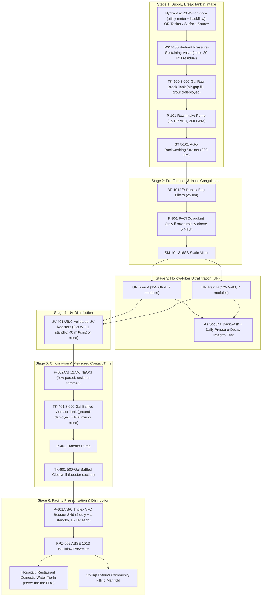

# Engineering Design Package: 36-ft Gooseneck Emergency Mobile Water Treatment Facility (MWTP-250)

**Revision B — November 2026.** Changes from Rev A: raw-water break tank (no pumping from a depressurized main), measured chlorine contact time (CT), daily UF integrity testing, onboard GAC removed, pumps and generator resized, membranes kept wet in storage, segregated chemical room, Class A CDL tow configuration, corrected weights and loads.

> [!NOTE]
> **Approvals:** Fabrication follows PE-stamped drawings, plan review by the state drinking water program (Georgia EPD Drinking Water Program in our home state), and manufacturer dimension and weight sheets for every skid.

## 1. Design Basis & System Overview

### 1.1 Mission Profile
This system is built for two emergency conditions:

1. **Boil Water Advisory (primary market):** the municipal main still has water and pressure (≥ 20 PSI residual), but the water can't be trusted after a main break, pressure loss, or storm damage. The trailer draws from a hydrant through a break tank, treats the water, and pressurizes the customer's building.
2. **Water outage (secondary market):** the main has no usable pressure. A depressurized main has no water to give, so the trailer is fed by a **tanker shuttle** or an approved **surface/well source** into the same break tank. At 250 GPM the plant needs about **15,000 gallons per hour** of raw water, so the tanker plan must be arranged in advance.

- **Primary Targets:** Hospitals, acute-care clinics, commercial kitchens/restaurants, and emergency community distribution points.
- **Mobility Platform:** **36-ft Enclosed Triple-Axle Gooseneck Trailer** (28 ft main deck + 8 ft gooseneck deck), towed by a **Class 5 chassis-cab truck** (F-550 / Ram 5500 class with gooseneck flatbed). No semi-tractor is needed, but the combination is over 26,000 lb GCWR with a trailer over 10,000 lb GVWR, so **the driver must hold a Class A CDL** and the company needs a USDOT number.
- **Feed Water Source:** Municipal hydrant at ≥ 20 PSI residual (with utility hydrant permit, hydrant meter, and backflow device), tanker shuttle, or an approved surface/well source — always into the raw-water break tank, never pumped directly from the main.

### 1.2 Why Ultrafiltration Instead of Reverse Osmosis
Because the feed water is fresh municipal or surface water (TDS < 500 mg/L), **reverse osmosis is not required**. Ultrafiltration (UF) + UV + chlorine with measured contact time gives:
1. **Higher flow in the same footprint:** 250 GPM rated, versus roughly 50–75 GPM for RO in a trailer this size.
2. **~96% water recovery:** about 4% of the feed is used for UF backwashes and strainer flushes, versus 25%–40% RO reject.
3. **Much lower pressure and power:** UF runs at 30–55 PSI instead of 200–400 PSI. The whole plant, including building booster pumps, runs on an **80 kW** generator.

---

### 1.3 Capacity at 250 GPM

**Rated output:** 250 GPM = 360,000 gallons per day. **Net output** after backwashes, strainer flushes, and daily integrity tests is about **245 GPM average (~350,000 GPD)**. During each 45-second backwash one train is offline and output briefly drops to ~125 GPM; the contact tank and clearwell cover the dip.

> [!NOTE]
> The figures below are **daily-volume equivalents** to show scale. One trailer serves **one building connection at a time**, and peak instantaneous demand (not daily volume) decides whether a facility can be carried. Hospital cooling-tower makeup is excluded — towers can use several hundred GPM on their own and should be planned separately.

| Emergency Facility / Scenario | Standard Demand Benchmark | Daily-Volume Equivalent |
| :--- | :--- | :--- |
| **Acute-Care Hospital** (domestic potable, sanitation, sterilization — cooling towers excluded) | 150–250 gal / bed / day | One hospital of up to several hundred beds, if its **peak** domestic demand is ≤ 250 GPM |
| **Full-Service Restaurant / Commercial Kitchen** | 2,500–4,000 gal / day (peak 15–60 GPM) | One restaurant per connection; the plant is far larger than one restaurant needs (see the MWTP-50 compact restaurant unit) |
| **Emergency Drinking & Sanitation (FEMA planning figure)** | 15 gal / person / day | ~23,000 people / day via the community fill manifold |
| **Survival Drinking Water Only** | 1 gal / person / day | ~350,000 people / day (distribution logistics, not the plant, is the limit) |

---

## 2. Process Flow Diagram (PFD) & Mass Balance

### 2.1 Process Architecture
The treatment train is a **6-stage multi-barrier process** with automated fail-safe monitoring:



### 2.2 Disinfection Credit Basis

Regulators grant log credit to specific, monitored steps — not to the number of stages. The design relies on the following, all subject to state approval:

| Target | Primary Barrier | How Credit Is Earned & Proven |
| :--- | :--- | :--- |
| **Cryptosporidium / Giardia** | UF membranes + UV | UF credit is set by the module's **NSF/ANSI 419** challenge-test result and proven daily by a **pressure-decay direct integrity test (DIT)**; turbidity is continuous indirect monitoring. UV at ≥ 40 mJ/cm² in **UVDGM-validated** reactors with a UVT analyzer adds Crypto/Giardia credit. |
| **Bacteria** | UF + chlorine | UF physical removal plus free chlorine. |
| **Viruses** | **Chlorine contact time (CT)** | UF and UV at 40 mJ/cm² are **not** counted for virus (EPA's 4-log virus UV dose is 186 mJ/cm² based on adenovirus, and most states give UF little or no virus credit). The PLC computes CT live from flow, temperature, pH, and outlet residual and blocks the building outlet if CT falls short. |

**CT check (4-log virus, free chlorine, pH 6–9):**
- Required CT: about **12 mg·min/L at 0.5 °C**, 8 at 5 °C, 6 at 10 °C, 3 at 20 °C.
- The baffled 3,000-gal contact tank at 250 GPM gives ~12 min hydraulic residence; at a baffle factor of 0.5, **T10 ≈ 6 min**.
- At **2.0 mg/L** outlet residual: CT ≈ 12 mg·min/L → meets 4-log virus down to near freezing. At 1.5 mg/L: CT ≈ 9 → meets at 5 °C and above.
- The onboard 500-gal clearwell alone (Rev A) gave only ~1–1.4 min T10, which is not enough. That is why the contact tank is now deployed on **every** job.

### 2.3 Mass Balance & Hydraulic Profile (100% Load)

| Stream ID | Process Node | Flow Rate (GPM) | Daily Volume (GPD) | Pressure (PSI) | Key Water Quality Target |
| :--- | :--- | :--- | :--- | :--- | :--- |
| **S-100** | Hydrant / Tanker Fill to Break Tank `TK-100` | 260 GPM | 374,400 GPD | Hydrant ≥ 20 PSI residual (held by `PSV-100`) → atmospheric | Turbidity ≤ 50 NTU, pH 6.5–8.5 |
| **S-101** | `P-101` Discharge | 260 GPM | 374,400 GPD | 55 PSI | — |
| **S-102** | Post 200 μm Strainer | 258 GPM | 371,520 GPD | 53 PSI | Solids > 200 μm removed |
| **S-103** | Post 25 μm Bags + PACl (UF Feed) | 258 GPM | 371,520 GPD | 48 PSI | Pipe scale/rust removed ahead of UF |
| **S-104** | UF Permeate | 250 GPM rated (245 avg net) | 360,000 rated / ~350,000 net | 25 PSI | **Turbidity < 0.05 NTU**; credit per NSF 419 + daily DIT |
| **S-105** | Post UV + NaOCl Injection | 250 GPM | 360,000 GPD | 18 PSI | UV dose ≥ 40 mJ/cm² |
| **S-106** | Contact Tank `TK-401` Outlet | 250 GPM | 360,000 GPD | Atmospheric | Free Cl₂ 1.5–2.0 mg/L, CT ≥ required for 4-log virus |
| **S-107** | **Finished Potable Discharge** (post `RPZ-602`) | **250 GPM** | **360,000 GPD** | Pump ~95–100 PSI → **65–85 PSI at building** | Free Cl₂ ≥ 1.0 mg/L at farthest tap; Bac-T samples per state |
| **W-201** | All Waste (strainer, UF backwash, divert, drains) | 10 GPM (avg) | 14,400 GPD | 15 PSI | **Dechlorinated**; to sanitary sewer with utility permission |

---

## 3. Major Equipment Schedule & Specifications

### 3.1 Supply, Break Tank & Pre-Treatment
* **Hydrant Pressure-Sustaining Valve (`PSV-100`) & Pressure Transmitter (`PT-100`):**
  * Installed downstream of the utility-supplied hydrant meter and backflow device. Holds the hydrant at **≥ 20 PSI residual** so the trailer can never pull the main into low or negative pressure. If residual drops below 20 PSI, `XV-100` closes and the operator switches to tanker supply.
* **Raw-Water Break Tank (`TK-100`):**
  * 3,000-gal open-top frame tank (NSF-61 liner, cover), ground-deployed, **filled through an air gap** with float/level control (`LIT-100`). The air gap is the backflow protection between the city system and the trailer. Tankers fill the same tank.
* **Raw Water Intake Pump (`P-101`):**
  * **Type:** Self-priming end-suction centrifugal, drafting from `TK-100`.
  * **Capacity:** 260 GPM @ 130 ft TDH, **15 HP** VFD (≈ 8.5 water HP / ~12 BHP at 70% efficiency — Rev A's 7.5 HP was undersized), 316SS wet end.
* **Automatic Self-Cleaning Strainer (`STR-101`):**
  * Motorized brush/suction scanner, 200 μm 316SS wedge-wire, 3" flanged. ΔP-triggered flush without interrupting flow.
* **Duplex Pre-Filter Housing (`BF-101A/B`):**
  * 2 × 4-bag 304SS housings with changeover valve. 25 μm felt bags catch pipe scale. **Bags are upstream of the coagulant** so floc can't blind them.
* **Inline Coagulation (`P-501`, `SM-101`):**
  * PACl dosed after the bags and mixed in `SM-101` immediately ahead of the UF (inline coagulation-UF). Used only when raw turbidity > 5 NTU or when treating surface water. There is **no pre-chlorination** in this design.

### 3.2 Hollow-Fiber Ultrafiltration Skid (`UF-201A/B`)
* **Configuration:** 2 parallel trains × 7 modules (14 total) + backwash pump `P-202` (180 GPM @ 40 PSI, 5 HP) + oil-free air scour blower `BL-201` + 100-gal CIP tank with 6 kW heater.
* **Membrane Specs:** PVDF hollow fiber, 0.02 μm nominal, 775 ft² (72 m²) per module (10,850 ft² total). Modules must carry **NSF/ANSI 61** and an **NSF/ANSI 419** challenge-test result.
* **Design Flux:** 33 GFD at 250 GPM with both trains online.
* **Backwash:** 45-second air scour + reverse flush per train every 45 minutes (or on TMP). The partner train stays online, so output drops to ~125 GPM for those 45 seconds.
* **Direct Integrity Test (`DIT-201`):** Daily pressure-decay test per train using regulated instrument air through `XV-207A/B`. A failed test takes that train out of service until the broken fiber is pinned. The UF trains don't earn log credit without it.
* **Storage & Transport:** **Membranes are never allowed to dry out** — PVDF fibers that dry lose permeability permanently. Between jobs the modules are filled with preservative (sodium bisulfite solution, or a glycol-based preservative in freezing weather) per the membrane maker's instructions.
* **Fit:** 2-meter-class modules plus headers are taller than Rev A's 7.5-ft ceiling. Rev B specifies a 9.5-ft main-deck interior (§4). Confirm module length and skid height from the maker's dimension sheets, or use horizontal-mount modules.

### 3.3 UV, Chlorination & Contact Time (`UV-401`, `CHEM-501`, `TK-401`)
* **Onboard GAC removed (Rev A item `GAC-301A/B`):** 50 ft³ of carbon at 250 GPM gave only ~1.5 min empty-bed contact time and ~18 gpm/ft² loading. VOC/PFAS removal needs roughly 10–20 min, which can't fit on this trailer. Removing it cuts ~2,600 lb dry / ~4,900 lb wet and frees the space the larger pumps and safety equipment need. If a job needs carbon for taste/odor, it can be added as a separate ground skid. Rev B makes **no claims** for VOC, PFAS, pesticide, or petrochemical removal.
* **UV Disinfection Reactors (`UV-401A/B/C`):**
  * 3 × 125 GPM LPHO amalgam 316L SS reactors, **2 duty + 1 standby** (Rev A had no spare — losing one reactor meant cutting flow in half).
  * ≥ 40 mJ/cm² validated under **EPA UVDGM** (NSF/ANSI 55 Class A is a residential/point-of-entry standard and is not the basis here), with UV intensity sensors and an online **UVT analyzer** (`AIT-401`).
* **Chemical Dosing Skid (`CHEM-501`):**
  * **Coagulant (`P-501`):** PACl, 0.5–5.0 GPH, flow-paced to raw turbidity.
  * **Disinfection (`P-502A/B`):** Duty/standby digital diaphragm pumps, flow-paced and trimmed by the contact-tank outlet chlorine analyzer (`AIT-402`).
  * **Waste Dechlorination (`P-503`):** Sodium bisulfite dosed into the **common waste header**, so every waste stream — strainer flush, backwash, off-spec divert, clearwell and contact-tank drains — is dechlorinated.
  * **CIP (`P-504`):** Citric acid for membrane clean-in-place. NaOCl CIP is batched from the oxidizer cabinet.
* **Contact Tank (`TK-401`):** 3,000-gal NSF-61 frame tank with internal baffle curtains and a cover, deployed on the ground beside the trailer on every job. Transfer pump `P-401` (5 HP self-priming, 260 GPM @ 40 ft) returns treated water to the onboard clearwell.

### 3.4 Segregated Chemical Room & Safety Station
* **Separate containment:** The oxidizer (12.5% NaOCl) cabinet is physically separated from the acid/reducer cabinet (citric acid, sodium bisulfite) and the PACl cabinet, each with its own spill containment. **Acid + hypochlorite releases chlorine gas; bisulfite + hypochlorite reacts violently.**
* **Ventilation & detection:** Dedicated exhaust fan for the chemical room, interlocked to a **chlorine gas detector** (`AIT-901`) with local horn/strobe and HMI alarm.
* **Eyewash/drench:** ANSI Z358.1 tempered eyewash/drench station within 10 seconds' travel of the chemical room (OSHA 29 CFR 1910.151(c)). Spill kits, Class ABC and Class B extinguishers, SDS binder, chemical PPE.
* **Hauling chemicals:** Bleach is carried in containers of **8 gal or less** and within the DOT **materials of trade** aggregate limit (49 CFR 173.6); bulk bleach is bought fresh near the job site. 12.5% bleach loses strength quickly in a hot trailer, so fresh stock also gives a more accurate dose.

### 3.5 Clearwell & Building Pressurization System (`TK-601`, `P-601A/B/C`)
* **Onboard Baffled Clearwell (`TK-601`):** 500-gal rectangular XLPE tank (~32" × 48" × 75", fits the side bay) in a steel transport cage. Serves as booster suction and surge tank — **it is not counted for CT**.
* **Triplex VFD Booster Skid (`P-601A/B/C`):**
  * 3 × 125 GPM vertical multistage 316SS pumps, **15 HP each, 2 duty + 1 standby** (Rev A's 7.5 HP pumps were undersized).
  * Sizing: 80 PSI at the building + ~12 PSI loss across a 3" RPZ at 250 GPM + ~7 PSI in 150 ft of 3" hose ≈ **~100 PSI (231 ft) at the pump** → ~14.6 water HP / ~22 BHP for two duty pumps.
  * Individual VFDs hold constant pressure **at the building** (remote pressure transmitter `PT-603` on the building side of the hose), 5–250 GPM, with an 85-gal ASME bladder tank.

### 3.6 Automated Water Quality & SCADA Control Panel (`CP-701`)
* **Controller:** Allen-Bradley CompactLogix PLC, 15" NEMA 4X touchscreen HMI, UPS, cellular/Starlink telemetry.
* **Continuous online monitoring:**
  * Raw & UF permeate **turbidity** (Hach TU5300sc; permeate diverts to waste above 0.15 NTU).
  * **UVT** and UV intensity.
  * **Free chlorine, pH & temperature** at the contact-tank outlet (`AIT-402`) for live CT calculation, and at the clearwell outlet (`AIT-601`).
  * Hydrant residual (`PT-100`), break tank level (`LIT-100`), TMP, DIT pressure decay, building pressure (`PT-602`/`PT-603`), instrument air pressure, chlorine gas detector.
* **Sampling:** Total coliform (Bac-T) sample taps at the clearwell outlet and building end; samples go to a state-certified lab per the state's emergency-use requirements.

---

## 4. 36-ft Gooseneck Trailer Layout & Weight Distribution

### 4.1 Spatial Architecture (Top-Down Schematic)
- **Total Length:** 36 ft (8 ft gooseneck + 28 ft main deck)
- **Interior Width:** 8.0 ft (96" inside insulated walls; 102" legal exterior). With a 32" center aisle each side bay is **32" deep** — equipment must be ≤ 30" deep, or straddle the aisle at the rear.
- **Interior Height:** **9.5 ft main deck** (custom tall box within 13'-6" legal height — Rev A's 7.5 ft won't clear UF modules or the clearwell). The gooseneck deck is an **exterior-access machinery compartment**, not a crew space.
- **Axles:** Triple 10,000 lb torsion axles, electric-over-hydraulic disc brakes (**30,000 lb GVWR**) + 4-point hydraulic leveling outriggers.

```
+--------------------------------------------------------------------------------------------------+
| GOOSENECK MACHINERY COMPARTMENT  |                   28 FT MAIN DECK (9.5 FT CLEAR)              |
| (fire-separated, exterior doors) |                                                               |
| +---------------+ +------------+ | +-------------+  +----------------------+  +----------------+ |
| | 80 kW DIESEL  | | DUPLEX AIR | | | PLC / HMI   |  |  UF SKID TRAINS A/B  |  | 500-GAL BAFFLED| |
| |  GENERATOR    | | COMPRESSORS| | | ANALYZERS   |  |  14 PVDF MODULES     |  |  CLEARWELL     | |
| | (Sound Atten, | | + RECEIVER | | | WET LAB     |  |  + DIT PANEL         |  |  (TK-601)      | |
| |  radiator &   | |  + DRYER   | | | + EYEWASH   |  |  [OVER TRIPLE AXLES] |  |                | |
| |  exhaust vent | +------------+ | +-------------+  +----------------------+  +----------------+ |
| |  to exterior) |                |  [Side Door]                                                  |
| | + 150 Gal     |   [Firewall]   |===================[32" CENTER WALKWAY]========================|
| |  Belly Tank   |                | +-------------+  +-----------+ +--------+  +----------------+ |
| |               |                | | INTAKE PUMP |  | UV x3     | |CHEM RM |  |  TRIPLEX VFD   | |
| | [Front Louver]|                | | AUTO STRAIN |  | BW PUMP   | |(vented,|  | BOOSTERS + RPZ | |
| |               |                | | & BAG FILT  |  | CIP TANK  | | Cl2 det)|  | + P-401 XFER  | |
| +---------------+                | +-------------+  +-----------+ +--------+  +----------------+ |
+----------------------------------+------------------+----------------------+---------------------+
   Belly boxes: TK-100 raw break tank + TK-401 contact tank (folded), hose kit, hydrant kit
                                                      |<--- TRIPLE AXLES --->|  [Rear Manifold Door]
```

### 4.2 Road vs. Wet Operating Weight Budget

> [!IMPORTANT]
> Before towing, the clearwell, piping, and ground tanks are drained and the UF modules are **filled with preservative** (not blown dry). The road weight therefore includes the water held in the modules.

| Subsystem / Zone | Location on Trailer | Road Weight (lbs) | Wet Operating Weight on Trailer (lbs) |
| :--- | :--- | :--- | :--- |
| **36-ft Triple-Axle Enclosed Gooseneck, 9.5-ft tall box** (R-12 insulation, firewall, HVAC, chemical-room exhaust, hydraulic jacks) | Full Chassis | 9,800 | 9,800 |
| **80 kW Diesel Generator + 150-Gal Fuel + Duplex Air Compressors** | Gooseneck Compartment | 4,400 | 4,400 |
| **PLC Cabinet, Analyzers, Wet Lab, Eyewash/Safety Station** | Front Main Deck | 700 | 750 |
| **Intake Pump (15 HP), Auto-Strainer, Duplex Bag Filter, 316SS Piping** | Forward-Mid Deck | 1,350 | 1,750 |
| **UF Skid (14 Modules preserved wet), DIT Panel, BW Pump, CIP Tank** | **Directly Over Triple Axles** | 3,300 | 3,900 |
| **3 UV Reactors + Segregated Chemical Room (MOT quantities)** | Over Axles / Rear-Mid | 1,100 | 1,500 |
| **500-Gal Clearwell + Triplex 15 HP Booster + P-401 + RPZ** | Rear Deck | 2,150 | 6,320 |
| **Stowed TK-100 & TK-401 Frame Tanks + Hose & Hydrant Kit** | Belly Boxes | 1,300 | 0 (deployed on ground) |
| **TOTAL WEIGHT** | **GVWR Limit: 30,000 lbs** | **24,100 lbs** | **28,420 lbs** |

* **Pin Weight:** ~5,300 lbs (≈ 22% of road weight). That is more than the payload of most one-ton and F-450-class pickups, so the tow vehicle is a **Class 5 chassis cab with a gooseneck flatbed**.
* **Licensing:** Trailer GVWR 30,000 lb + truck GVWR ≈ 19,500 lb → GCWR ≈ 49,500 lb. Over 26,000 lb GCWR with a trailer over 10,000 lb GVWR = **Class A CDL**, plus USDOT number, DOT medical cards, hours-of-service, drug & alcohol testing, and annual inspection. Disaster declarations can relax hours-of-service, but not the CDL requirement.

---

## 5. Electrical Load & Autonomous Power Budget

The plant runs **off-grid** on its onboard generator, or on **shore power** (480V 3-phase, 200A camlock input through the ATS) where a utility or temporary service is available. Hospital emergency generators feed life-safety and critical branches under NFPA 99/110, so don't plan on connecting to them without the hospital engineer's written approval. The ATS is open-transition: expect a brief interruption when it transfers.

| Equipment Item | HP / Rating | Running Load (kW) | Duty Cycle | Continuous Avg (kW) |
| :--- | :--- | :--- | :--- | :--- |
| Raw Water Intake Pump (`P-101`, VFD) | 15 HP | 9.7 kW | 100% | 9.7 kW |
| Contact Tank Transfer Pump (`P-401`, VFD) | 5 HP | 3.7 kW | 100% | 3.7 kW |
| Triplex Building Booster (`P-601`, 2 duty VFD at 250 GPM) | 2 × 15 HP | 17.8 kW | 100% | 17.8 kW |
| UF Backwash Pump (`P-202`) + Air Scour Blower (`BL-201`) | 5 HP + 2 HP | 5.2 kW | 5% | 0.3 kW |
| UV Reactors (2 duty of 3) | 2 × 1.2 kW | 2.4 kW | 100% | 2.4 kW |
| Duplex Instrument Air Compressors (lead/lag) + Dryer | 2 × 2 HP | 1.5 kW | 25% | 0.4 kW |
| PLC, Analyzers, Metering Pumps, LED Lighting | 120V Subpanel | 1.5 kW | 100% | 1.5 kW |
| Trailer HVAC + Chemical-Room Exhaust | 2.8 kW | 2.8 kW | 70% | 2.0 kW |
| Strainer Drive Motor | 0.5 HP | 0.4 kW | 5% | 0.02 kW |
| CIP Tank Heater (only during CIP, not during production) | 6 kW | 6.0 kW | 0% in production | 0 kW |
| **TOTAL ELECTRICAL DEMAND** | — | **Peak in production: 45.0 kW** (51 kW with CIP heater) | — | **Avg: 37.8 kW** |

* **Generator Sizing:** **80 kW prime Tier 4 Final diesel** — about 47% average and 56% peak load. Variable-frequency drives draw harmonic current, and generator makers typically recommend oversizing for VFD loads; the margin also covers motor starts and keeps the Tier 4 aftertreatment (DPF/DEF) above its light-load problems.
* **Fuel Autonomy:** ~3.1 gal/hr at 37.8 kW → the 150-gal belly tank gives **about 48 hours** at 250 GPM, plus external fuel-tank quick-connects.
* **Single points of failure:** One generator and one plant. For hospital service, keep shore-power capability and have a backup rental generator source on call.

---

## 6. Hospital & Restaurant Emergency Hookup Architecture

### 6.1 Rear Exterior Connection Bulkhead
All connections are behind an insulated, heated rear compartment door, using **NSF-61 stainless camlock fittings**:
1. **RAW INLET A:** 4" camlock from the break tank `TK-100` (suction).
2. **TANK FILL OUTLET:** 4" hose from the hydrant kit (utility hydrant meter + backflow + `PSV-100` + `XV-100`) to the air-gap fill on `TK-100`. Tankers discharge into the same tank.
3. **CONTACT TANK OUT/RETURN:** 4" camlocks to and from `TK-401`.
4. **OUTLET A (Hospital Tie-In):** 3" female camlock (post-RPZ) to the hospital's **pre-installed emergency domestic water connection**, surveyed and fitted during the retainer site visit.
5. **OUTLET B (Restaurant / Commercial Kitchen Tie-In):** 1.5" & 2" NSF-61 connections to a restaurant's domestic water connection, pre-surveyed with the owner, plumber, and utility.
6. **OUTLET C (Community Distribution Manifold):** Fold-out manifold with **12 × 3/4" hose bibs** for filling jugs.
7. **WASTE OUTLET:** 3" camlock — dechlorinated waste to a **sanitary sewer cleanout with the utility's permission**. Storm drains are used only with written MS4/state permission and never for coagulant-laden backwash.

> [!CAUTION]
> **Never connect to a fire department connection (FDC).** FDCs feed stagnant fire sprinkler piping, not the domestic potable system.

### 6.2 Deployment Timeline (Arrival to Building Water in About 3 Hours at a Pre-Surveyed Site)
1. **0:00–0:30 — Position, stabilize & power:** Set up traffic control, chock, level on the jacks, start the generator.
2. **0:30–1:15 — Supply & ground tanks:** Deploy `TK-100` and `TK-401`. Install the utility hydrant meter, backflow, and `PSV-100`; confirm ≥ 20 PSI residual (or start the tanker shuttle). Connect waste to sanitary sewer.
3. **1:15–2:15 — Start-up & prove:** Startup flush to waste, UF direct integrity test, fill and turn over the contact tank, confirm turbidity < 0.05 NTU, UV dose, and CT. Sanitize the delivery hose with the hose-sanitizing kit.
4. **2:15–3:00 — Facility pressurization:** Utility/facility closes the building's service valve, hose connects to the pre-installed tie-in, soft-ramp fill at 30 PSI, then normal pressure. Bac-T samples are pulled and handled per the state's emergency approval.

A first-time site without a pre-installed connection will take longer and needs a licensed plumber and the utility.
