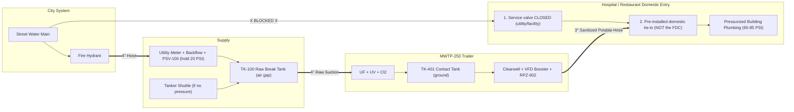

# Field Standard Operating Procedure (SOP): Hospital & Restaurant Emergency Water Tie-In (MWTP-250)

**Document ID:** `SOP-MWTP250-FIELD-01` — **Revision B (November 2026)**  
**References:** CDC/AWWA *Emergency Water Supply Planning Guide for Hospitals and Healthcare Facilities*, ASSE 1013 (RPZ backflow prevention), NSF/ANSI 61, the state drinking water program's emergency-use approval for this unit, OSHA 29 CFR 1910 (HazCom, PPE, eyewash 1910.151(c)), MUTCD (temporary traffic control).

> [!IMPORTANT]
> **Before any deployment:** the site must be **pre-surveyed** (connection point, valve locations, hose route, sewer cleanout), the **state emergency-use approval** must be in hand, and the crew must include a **state-certified water treatment operator** and a **Class A CDL driver**. Utility staff operate utility valves (curb stops, meter valves, hydrants) unless the utility authorizes us in writing.

---

## 1. Golden Rules of Building Pressurization

> [!CAUTION]
> **RULE 1 — ISOLATE THE BUILDING FROM THE STREET MAIN FIRST:** Before pumping treated water into any building, the building's service valve (curb stop / OS&Y gate valve at the meter vault) must be closed — by the utility or the facility's engineer with the utility's OK. If it's left open, treated water at 70 PSI flows backward into the depressurized city main, draining the trailer and mixing with unsafe water.
>
> **RULE 2 — NEVER TIE INTO A FIRE SPRINKLER FDC:** A building's Fire Department Connection (`FDC`) feeds stagnant fire sprinkler piping, **not** the domestic potable plumbing. Only use the **domestic water tie-in** identified in the site survey.
>
> **RULE 3 — NEVER PULL THE MAIN BELOW 20 PSI:** The trailer never pumps directly from a hydrant. Hydrant water goes through the pressure-sustaining valve (`PSV-100`, set at 20 PSI) into the break tank through an air gap. If the hydrant can't hold 20 PSI residual, stop and switch to tanker supply.

---

## 2. Site Setup & Water Supply (0:00–1:15)

### 2.1 Positioning, Traffic Control & Stabilization
1. **Traffic control:** Set cones and signs per MUTCD before anyone works near the roadway. Use hose ramps wherever hoses cross traffic or walkways.
2. **Site selection:** Park on firm pavement with room beside the trailer for two 3,000-gal ground tanks (about 12 ft × 12 ft each), within **100 ft** of the hydrant or tanker access, within **150 ft** of the building tie-in, and within **200 ft** of the approved sanitary sewer cleanout.
3. **Deploy hydraulic outriggers:**
   * Keep the truck hitched or chock all 6 trailer tires.
   * Engage the **4-point auto-leveling system** (`Control Panel Switch -> AUTO LEVEL`) and verify all four pads are firmly planted before filling the clearwell.
4. **Power up:**
   * **Generator:** Open the gooseneck compartment's exterior louvers and doors, start the **80 kW generator**, and verify 480V/208V 3-phase power at `CP-701`. Keep the crew out of the generator compartment while it runs.
   * **Shore power (optional):** Only from a utility or temporary service, or from a hospital source the hospital engineer approves in writing. The ATS is open-transition: expect a brief power interruption on transfer.
5. **Chemical room check:** Confirm the chlorine gas detector reads 0 ppm, the exhaust fan runs, and the eyewash/drench has water. Wear chemical goggles, face shield, and gloves for any chemical handling. Bulk bleach bought locally stays in its containers and is never stored next to acids.

### 2.2 Deploy the Ground Tanks
1. Set up **`TK-100` (raw break tank — blue tag)** and **`TK-401` (contact tank — white tag)** on level ground, covers on. Never swap their hoses: raw water hoses are blue, treated water hoses are white.
2. Connect `TK-100` outlet to **Trailer `RAW INLET A`** (4" suction).
3. Connect **`CT OUT`** and **`CT RETURN`** to `TK-401`.
4. Connect the **3" waste hose** from `WASTE OUTLET` to the approved **sanitary sewer cleanout**. Storm drains only with written MS4/state permission.

### 2.3 Hydrant Supply (when the main still has pressure)
1. **Utility permission:** The hydrant permit, hydrant meter, and backflow device come from the utility. Fire flow has priority: if the fire department needs the hydrant, release it.
2. **Flush the hydrant** (utility or with utility permission): open slowly for **60–120 seconds** to clear rust and sediment, then close.
3. **Install hydrant hardware in this order:** hydrant → utility meter + backflow → `PT-100` / **`PSV-100` pressure-sustaining valve (set 20 PSI)** → `XV-100` fill valve → 4" hose → **air-gap fill nozzle on `TK-100`**. The fill nozzle stays at least two pipe diameters above the tank's overflow rim.
4. **Open slowly** and confirm on the HMI that hydrant residual (`PT-100`) holds **≥ 20 PSI** while `TK-100` fills. If it won't, close the hydrant and go to §2.4.

### 2.4 Tanker Supply (water outage, or hydrant can't hold 20 PSI)
1. Tankers must be potable-water haulers per the state's approval. Record each tanker's source and chlorine residual.
2. Tankers discharge into `TK-100` through the air-gap fill. At 250 GPM the plant uses about **15,000 gal/hr**, so plan tanker cycles in advance or run at reduced flow.

---

## 3. Identifying the Building Tie-In Point (Hospital vs. Restaurant)

### Option A: Acute-Care Hospital Tie-In (100 to 250 GPM)
Every hospital under a retainer has a **pre-installed emergency domestic water connection** designed during the site survey, installed by the hospital's licensed plumber, and approved by the utility (typically a flanged or camlock connection on the building side of the meter/backflow assembly, labeled *"EMERGENCY DOMESTIC WATER INLET — POTABLE ONLY"*).
1. Locate the emergency potable connection identified in the site survey.
2. The utility or hospital engineer closes the street isolation valve upstream of the hospital's meter/backflow assembly and tags it.
3. Connect the **3" white NSF-61 potable hose** from **Trailer `OUTLET A`** to the emergency inlet (after sanitizing — §4.3).
4. **Coordinate with the hospital's water management program team and infection prevention** before re-pressurizing. Stagnant hospital plumbing is a Legionella risk; the hospital decides its own flushing and testing plan.

**No pre-installed connection?** Do not remove meter spools, meter bypass pieces, or strainer bonnets yourself. Those belong to the utility and the facility. Stop and arrange a temporary connection with the utility and the facility's licensed plumber.

### Option B: Restaurant / Commercial Kitchen Tie-In (15 to 60 GPM)
1. The connection point and adapter sizes come from the site survey (typically a union or tee on the **building side** of the meter or backflow assembly, installed by the restaurant's plumber).
2. The utility (or the owner, with the utility's OK) closes the curb stop / main shutoff.
3. Connect the **1.5" or 2" NSF-61 potable hose** from **Trailer `OUTLET B`** after sanitizing (§4.3).
4. Confirm the trailer's water feeds **upstream** of ice machines, beverage systems, and dish machines, and that the restaurant's health inspector has accepted the arrangement as an approved alternate source.

---

## 4. Start-Up, Proving & Hose Sanitization (1:15–2:15)

### 4.1 Mode 1 — Startup Flush
1. On the HMI (`CP-701`), press **`[AUTO STARTUP & FLUSH]`**.
2. The PLC runs `P-101` at 150 GPM through the strainer, bags, and UF, with permeate going **to waste** through `XV-300` (dechlorinated by `P-503`). `XV-401` and `XV-602` stay closed.
3. Continue until UF permeate turbidity (`AIT-201`) reads **< 0.05 NTU for 3 minutes**.

### 4.2 Integrity Test & Mode 1B — Fill & Prove
1. **Direct integrity test:** If today's test isn't logged, press **`[RUN DIT]`**. Each train must pass the pressure-decay test before its water can count. A failed train stays offline.
2. Press **`[FILL & PROVE]`**. Water now passes through UV and chlorination into the contact tank `TK-401` and the clearwell `TK-601`. `XV-602` stays closed.
3. The HMI releases the building outlet only when all of these are green:
   * UF permeate turbidity **< 0.05 NTU** (trip at 0.15 NTU)
   * UV dose **≥ 40 mJ/cm²** on the duty reactors
   * Contact tank turned over at least once (**≥ 3,000 gal** through it)
   * **CT ≥ required** for 4-log virus at the measured temperature and pH (`AIT-402`)
   * Finished free chlorine **1.5–2.2 mg/L** (`AIT-601`)
4. **Bac-T samples:** Pull total coliform samples at the clearwell outlet sample tap, label them, and send to the state-certified lab with the chain-of-custody form. Follow the state's emergency approval for whether water can be used before results return (often 18–24 hours); until the state says otherwise, the facility's boil-water precautions stay in place.

### 4.3 Sanitize the Potable Delivery Hose (separate from the plant)
Hoses are sanitized with the **hose-sanitizing kit**, not by raising the plant's chlorine setpoint (which would trip the 4.0 mg/L high-high interlock).
1. Batch **50 mg/L** chlorine solution in the kit tank (from the oxidizer cabinet, using the dilution chart on the kit).
2. Fill the 3" potable hose completely, cap both ends, and hold for **30 minutes**.
3. Drain the solution through the waste header (dechlorinated).
4. Connect the hose to `OUTLET A` with the building end open to a drain bucket, open `XV-602` from the HMI, and flush with finished water at 50 GPM until the free chlorine at the hose end (Hach pocket colorimeter) matches the trailer's finished residual and the water is clear (bench turbidimeter).
5. Close `XV-602`, spray the building connection and hose coupling with **200 ppm** chlorine solution, and lock the hose onto the building tie-in.

---

## 5. Slow Building Pressurization & Air Venting (2:15–3:00)

> [!WARNING]
> **Water hammer prevention:** If the building's pipes drained during the outage, slamming full pressure into empty pipes can burst joints or damage sterilizers. Always use the **2-stage soft-ramp**.

1. **Stage 1 — Low-pressure fill (30 PSI setpoint):**
   * On the HMI, set the booster setpoint (`PT-603`, building side) to **30 PSI** and enable **`[SOFT RAMP FILL]`**.
   * Open the building inlet valve slowly over **60 seconds** (quarter-turn every 15 seconds).
   * Facility staff open faucets on the **highest floor** (or the farthest prep sink in a restaurant) to bleed air until water flows steadily.
2. **Stage 2 — Normal operating pressure:**
   * **1–2 story restaurant / clinic:** **60 PSI**
   * **3–6 story hospital:** **75 to 85 PSI** at the building (the hospital's own booster pumps handle taller buildings).
3. **Leak & backflow check:** Inspect camlock gaskets, the trailer's `RPZ-602` relief port, and the closed street valve. Confirm stable pressure.
4. **Point-of-use check:** At the **farthest faucet**, record **free chlorine (≥ 1.0 mg/L)**, **pH (7.0–8.0)**, and **turbidity (< 0.10 NTU)** in the log, and pull a Bac-T sample there too.

---

## 6. Field Operator Quick-Reference Checklist

| Step | Action Item | Verified By / Target Metric |
| :---: | :--- | :--- |
| **1** | State approval in hand; certified operator + Class A driver on crew; site pre-surveyed | Paperwork in trailer binder |
| **2** | Traffic control set; trailer level on jacks; ground tanks deployed | Cones/signs up; bubble level centered |
| **3** | Generator running (or approved shore power); air compressors at 80 PSI; chemical room 0 ppm Cl₂ | 480V/208V at `CP-701`; `PT-801` ≥ 75 PSI |
| **4** | Supply: hydrant via meter/backflow/`PSV-100` into `TK-100` air gap **or** tanker shuttle | `PT-100` ≥ 20 PSI; `LIT-100` filling |
| **5** | Waste to approved sanitary sewer, dechlorination running | `P-503` running on waste flow |
| **6** | **CRITICAL:** building service valve **CLOSED** and tagged (utility/facility) | Valve shut; meter shows 0 GPM |
| **7** | Startup flush passed; DIT passed; Fill & Prove all green | `AIT-201` < 0.05 NTU; UV ≥ 40 mJ/cm²; CT ≥ required |
| **8** | Bac-T samples pulled and logged | Chain-of-custody form complete |
| **9** | Hose sanitized (50 mg/L, 30 min), flushed, connection sprayed with 200 ppm | Hose-end residual matches finished water |
| **10** | Building filled at **30 PSI**, air bled, ramped to **60–85 PSI** | `PT-603` steady; farthest tap Cl₂ ≥ 1.0 mg/L |

---

## 7. Decommissioning & Return to City Water

Once the utility restores pressure and the Boil Water Advisory is officially lifted:
1. **Confirm city water:** Facility staff and the utility confirm street pressure > 50 PSI and city chlorine residual upstream of the closed street valve.
2. **Isolate trailer discharge:** Close `XV-602` on the HMI and close the building's emergency inlet valve.
3. **Re-open the street valve:** The utility or facility slowly opens the building's service valve. The hospital follows its own flushing/testing plan.
4. **Sanitize & stow hoses:** Drain potable hoses, cap both ends, and stow them on their reels. Keep raw (blue) and potable (white) hoses in separate compartments.
5. **Drain ground tanks:** Drain `TK-401` and `TK-100` through the waste header with dechlorination running, then dry and fold them.
6. **Execute `MODE 5: DRAIN & PRESERVE`:**
   * Press **`[PREPARE FOR TRANSPORT]`** on the HMI.
   * The PLC drains the clearwell, strainer, and UF feed sides, then **fills both UF trains with membrane preservative** (glycol-based in freezing weather). Membranes are never blown dry.
   * When the HMI shows **`DRAINED & PRESERVED`**, disconnect the waste hose, secure chemicals within DOT materials-of-trade limits, retract the jacks, and weigh the rig on the first certified scale if the load has changed.
