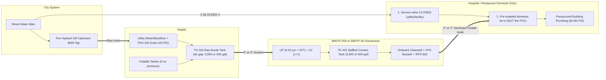

# Field Standard Operating Procedure (SOP): Hospital (MWTP-250) & Restaurant (MWTP-50) Emergency Water Tie-In

**Document ID:** `SOP-MWTP-FIELD-01` — **Revision B (November 2026)**  
**Applicable Fleet Units:**
* **`MWTP-250` (Hospital Flagship):** 36-ft Triple-Axle Gooseneck (`30,000 lb GVWR`, 250 GPM rated, 80 kW generator, towed by Class 5 truck — **Class A CDL required**).
* **`MWTP-50-GN22` ("KitchenShield-50" Restaurant Unit):** 22-ft Tandem-Axle Compact Gooseneck (`16-ft` main deck + `6-ft` gooseneck deck, **`9,990 lb GVWR`**, 35 GPM continuous / 50 GPM peak booster, 20 kW generator or 240V 50A shore power, towed by 1-ton SRW pickup — **No Class A CDL required**; standard driver's license + DOT medical card).

**References:** CDC/AWWA *Emergency Water Supply Planning Guide for Hospitals and Healthcare Facilities*, ASSE 1013 (RPZ backflow prevention), NSF/ANSI 61, the state drinking water program's emergency-use approval for these units, OSHA 29 CFR 1910 (HazCom, PPE, eyewash 1910.151(c)), MUTCD (temporary traffic control).

> [!IMPORTANT]
> **Before any deployment:** the site must be **pre-surveyed** (connection point, valve locations, hose route, downstream sanitary sewer cleanout), the **state emergency-use approval** must be in hand, and the crew must include a **state-certified water treatment operator** and a qualified driver (**Class A CDL** for the `MWTP-250`; **Standard License + DOT Medical Card** for the `MWTP-50-GN22`). Utility staff operate utility valves (curb stops, meter valves, hydrants) unless the utility authorizes us in writing.

---

## 1. Golden Rules of Building Pressurization

> [!CAUTION]
> **RULE 1 — ISOLATE THE BUILDING FROM THE STREET MAIN FIRST:** Before pumping treated water into any building, the building's service valve (curb stop / OS&Y gate valve at the meter vault) must be closed — by the utility or the facility's engineer with the utility's OK. If it's left open, treated water at 70 PSI flows backward into the depressurized city main, draining the trailer and mixing with unsafe water.
>
> **RULE 2 — NEVER TIE INTO A FIRE SPRINKLER FDC:** A building's Fire Department Connection (`FDC`) feeds stagnant fire sprinkler piping, **not** the domestic potable plumbing. Only use the **domestic water tie-in** identified in the site survey.
>
> **RULE 3 — NEVER PULL THE MAIN BELOW 20 PSI:** Neither trailer ever pumps directly from a hydrant or street service line. Raw water goes through the pressure-sustaining valve (`PSV-100`, set at 20 PSI) into the raw break tank (`TK-100`) through an air gap. If the hydrant or upstream tap can't hold 20 PSI residual, stop and switch to tanker supply.
>
> **RULE 4 — NEVER DISCHARGE BACKWASH THROUGH A RESTAURANT GREASE TRAP:** On restaurant deployments (`MWTP-50`), never connect the gray backwash/flush hose (`35–60 GPM`) to a fixture upstream of the kitchen's F.O.G. grease interceptor. High-flow flush water will wash trapped grease into the city sewer. Always discharge to the **downstream sanitary sewer cleanout** (street side of the grease trap) mapped during the AmeriPro site survey.

---

## 2. Site Setup & Water Supply (0:00–1:15)

### 2.1 Positioning, Traffic Control & Stabilization
1. **Traffic control:** Set cones and signs per MUTCD before anyone works near the roadway or drive-thru lane. Use hose ramps wherever hoses cross traffic or walkways.
2. **Site selection:**
   * **`MWTP-250` (Hospital):** Park on firm pavement with room beside the trailer for two 3,000-gal ground tanks (about `12 ft × 12 ft` each), within **100 ft** of the hydrant/tanker access, within **150 ft** of the building tie-in, and within **200 ft** of the approved sanitary sewer cleanout.
   * **`MWTP-50-GN22` (Restaurant):** Use the 22-ft gooseneck's tight turning radius to back into the pre-surveyed 2-parking-space service bay next to the kitchen utility room, leaving room beside the trailer for the 550-gal raw break tank (`5 ft × 5 ft`) and 600-gal contact tank (`5.5 ft × 5.5 ft`).
3. **Deploy stabilizer jacks / outriggers:**
   * Keep the truck hitched or chock all trailer tires.
   * Engage the **4-point leveling jacks** (`Control Panel Switch -> AUTO LEVEL` on `MWTP-250`, or 4 corner electric/hydraulic stabilizer jacks + gooseneck landing gear on `MWTP-50`) and verify all four pads are firmly planted before filling the onboard clearwell.
4. **Power up:**
   * **`MWTP-250` Generator / Shore:** Open the gooseneck compartment's exterior louvers and doors, start the **80 kW generator**, and verify 480V/208V 3-phase power at `CP-701`. (Optional shore power only from a hospital or utility source approved in writing; open-transition ATS).
   * **`MWTP-50-GN22` Shore Plug or 20 kW Generator:**
     * *Boil Water Advisory (Grid Power On):* Connect the 50-ft **240V 50A single-phase twist-lock cord** to the restaurant's pre-installed 50A exterior receptacle and select **`[50A SHORE MODE]`** on `CP-701` (caps draw at 40A / $0 diesel burn).
     * *Power Outage (or No Shore Plug):* Open the gooseneck deck louvers and start the **20 kW Tier-4 diesel generator** (`240V/120V` single-phase). Keep the crew out of the gooseneck generator bay while running.
5. **Chemical compartment check:** Confirm the chlorine gas detector (`AIT-901`) reads 0 ppm, the exhaust fan runs, and the ANSI Z358.1 eyewash/drench hose has water. Wear chemical goggles, face shield, and gloves for any chemical handling. Bulk bleach bought locally stays in its containers and is never stored next to acids.

### 2.2 Deploy the Ground Tanks
1. Set up **`TK-100` (raw break tank — blue tag)** and **`TK-401` (baffled contact tank — white tag)** on level ground, covers on (`3,000 gal` each on `MWTP-250`; `550 gal` and `600 gal` on `MWTP-50`). Never swap their hoses: raw water hoses are blue, treated water hoses are white.
2. Connect `TK-100` outlet to **Trailer `RAW INLET A`** (`4"` suction on `MWTP-250`; `2"` suction on `MWTP-50`).
3. Connect **`CT OUT`** and **`CT RETURN`** to `TK-401`.
4. Connect the **waste hose** (`3"` on `MWTP-250`; `2"` on `MWTP-50`) from `WASTE OUTLET` to the approved **downstream sanitary sewer cleanout** (downstream of any grease trap). Storm drains only with written MS4/state permission.

### 2.3A Hydrant Supply (when the main still has pressure — `MWTP-250` or `MWTP-50`)
1. **Utility permission:** The hydrant permit, hydrant meter, and backflow device come from the utility. Fire flow has priority: if the fire department needs the hydrant, release it.
2. **Flush the hydrant** (utility or with utility permission): open slowly for **60–120 seconds** to clear rust and sediment, then close.
3. **Install hydrant hardware in this order:** hydrant → utility meter + backflow → `PT-100` / **`PSV-100` pressure-sustaining valve (set 20 PSI)** → `XV-100` fill valve → blue raw hose → **air-gap fill nozzle on `TK-100`**. The fill nozzle stays at least two pipe diameters above the tank's overflow rim.
4. **Open slowly** and confirm on the HMI that hydrant residual (`PT-100`) holds **≥ 20 PSI** while `TK-100` fills. If it won't, close the hydrant and go to §2.4.

### 2.3B Restaurant Upstream Service Tap (Boil Water Advisory — `MWTP-50` Only)
When deploying the **`MWTP-50`** to a restaurant during a Boil Water Advisory where the city main has pressure (`40–70 PSI`) and no fire hydrant is immediately adjacent:
1. Close the restaurant's building isolation valves and confirm **double isolation** between raw and treated water: either **two closed valves** in series, or one valve leak-tested closed (open a downstream drain and confirm no flow for 2 minutes). Tag both.
2. Locate the **pre-installed 1.5" valved service-line tee** that the restaurant's licensed plumber installed during the site survey, between the meter and the building isolation valves, with the utility's approval. Never draw from a hose bibb or a backflow test cock — test cocks can't pass 35 GPM, and most bibbs sit downstream of the building shutoff.
3. Connect a 1.5" blue raw-water hose from the tee through the trailer's **`HYDRANT / TAP INLET`** (`PT-100` + **`PSV-100` set at 20 PSI** + `XV-100`) into the **air-gap fill nozzle on the 550-gal break tank (`TK-100`)**.
4. Verify on the HMI that upstream street pressure (`PT-100`) holds **≥ 20 PSI** at 15–35 GPM.

### 2.4 Tanker Supply (water outage, or main can't hold 20 PSI)
1. Tankers must be potable-water haulers per the state's approval. Record each tanker's source and chlorine residual.
2. Tankers discharge into `TK-100` through the air-gap fill:
   * **`MWTP-250` (Hospital at 250 GPM):** Uses up to **15,000 gal/hr** — requires a scheduled multi-tanker shuttle or reduced flow rate.
   * **`MWTP-50` (Restaurant at 4,000–8,000 gal/day):** A **single 4,000-gallon potable tanker delivery** (or 1–2 drops/day) sustains a commercial kitchen for an entire operating day.

---

## 3. Identifying the Building Tie-In Point (Hospital vs. Restaurant)

### Option A: Acute-Care Hospital Tie-In (`MWTP-250` — 100 to 250 GPM)
Every hospital under a retainer has a **pre-installed emergency domestic water connection** designed during the site survey, installed by the hospital's licensed plumber, and approved by the utility (typically a flanged or camlock connection on the building side of the meter/backflow assembly, labeled *"EMERGENCY DOMESTIC WATER INLET — POTABLE ONLY"*).
1. Locate the emergency potable connection identified in the site survey.
2. The utility or hospital engineer closes the street isolation valve upstream of the hospital's meter/backflow assembly and tags it.
3. Connect the **3" white NSF-61 potable hose** from **`MWTP-250 OUTLET A`** to the emergency inlet (after sanitizing — §4.3).
4. **Coordinate with the hospital's water management program team and infection prevention** before re-pressurizing. Stagnant hospital plumbing is a Legionella risk; the hospital decides its own flushing and testing plan.

**No pre-installed connection?** Do not remove meter spools, meter bypass pieces, or strainer bonnets yourself. Those belong to the utility and the facility. Stop and arrange a temporary connection with the utility and the facility's licensed plumber.

### Option B: Restaurant / Commercial Kitchen Tie-In (`MWTP-50-GN22` — 15 to 50 GPM)
1. The connection point and adapter sizes come from the AmeriPro site survey (typically a 1.5" or 2" camlock tee with isolation valve on the **building side** of the meter or backflow assembly, installed by the restaurant's licensed plumber).
2. The utility (or the owner/plumber, with the utility's OK) closes the curb stop or main shutoff upstream of the tie-in tee. (If using §2.3B upstream BWA tap, confirm the closed valve is *between* the upstream raw tap and the downstream potable tie-in tee!).
3. Connect the **1.5" or 2" white NSF-61 potable hose** from **`MWTP-50 POTABLE OUTLET A`** after sanitizing (§4.3).
4. Confirm the trailer's water feeds **upstream** of ice machines, beverage systems, water heaters, and dish machines, and that the restaurant's health inspector has accepted the arrangement as an approved alternate source.

---

## 4. Start-Up, Proving & Hose Sanitization (1:15–2:00)

### 4.1 Mode 1 — Startup Flush
1. On the HMI (`CP-701`), press **`[AUTO STARTUP & FLUSH]`**.
2. The PLC runs `P-101` (`150 GPM` on `MWTP-250`; `25 GPM` on `MWTP-50`) through the strainer, bags, and UF, with permeate going **to waste** through `XV-300` (dechlorinated by `P-503`). `XV-401` and `XV-602` stay closed.
3. Continue until UF permeate turbidity (`AIT-201`) reads **< 0.05 NTU for 3 minutes**.

### 4.2 Integrity Test & Mode 1B — Fill & Prove
1. **Direct integrity test:** If today's test isn't logged, press **`[RUN DIT]`**. Each train must pass the pressure-decay test before its water can count. A failed train stays offline.
2. Press **`[FILL & PROVE]`**. Water now passes through UV and chlorination into the contact tank `TK-401` and the onboard clearwell `TK-601`. `XV-602` stays closed.
3. The HMI releases the building outlet only when all of these are green:
   * UF permeate turbidity **< 0.05 NTU** (trip at 0.15 NTU)
   * UV dose **≥ 40 mJ/cm²** on the duty reactor(s)
   * Contact tank turned over at least once (**≥ 3,000 gal** on `MWTP-250`; **≥ 600 gal** on `MWTP-50`)
   * **CT ≥ required** for 4-log virus at the measured temperature and pH (`AIT-402`)
   * Finished free chlorine **1.5–2.2 mg/L** (`AIT-601`)
4. **Bac-T samples:** Pull total coliform samples at the clearwell outlet sample tap, label them, and send to the state-certified lab with the chain-of-custody form. Follow the state's emergency approval for whether water can be used before results return (often 18–24 hours); until the state says otherwise, the facility's boil-water precautions stay in place.

### 4.3 Sanitize the Potable Delivery Hose (separate from the plant)
Hoses are sanitized with the **hose-sanitizing kit**, not by raising the plant's chlorine setpoint (which would trip the 4.0 mg/L high-high interlock).
1. Batch **50 mg/L** chlorine solution in the kit tank (from the oxidizer cabinet, using the dilution chart on the kit).
2. Fill the potable hose (`3"` on `MWTP-250`; `1.5"` or `2"` on `MWTP-50`) completely, cap both ends, and hold for **30 minutes**.
3. Drain the solution through the waste header (dechlorinated).
4. Connect the hose to `OUTLET A` with the building end open to a drain bucket, open `XV-602` from the HMI, and flush with finished water (`50 GPM` on `MWTP-250`; `25 GPM` on `MWTP-50`) until the free chlorine at the hose end (Hach pocket colorimeter) matches the trailer's finished residual and the water is clear (bench turbidimeter).
5. Close `XV-602`, spray the building connection and hose coupling with **200 ppm** chlorine solution, and lock the hose onto the building tie-in.

---

## 5. Slow Building Pressurization & Air Venting (2:00–2:30)

> [!WARNING]
> **Water hammer prevention:** If the building's pipes drained during the outage, slamming full pressure into empty pipes can burst joints or damage kitchen solenoids and hospital sterilizers. Always use the **2-stage soft-ramp**.

1. **Stage 1 — Low-pressure fill (30 PSI setpoint):**
   * On the HMI, set the booster setpoint (`PT-603`, building side) to **30 PSI** and enable **`[SOFT RAMP FILL]`**.
   * Open the building inlet valve slowly over **60 seconds** (quarter-turn every 15 seconds).
   * Facility staff open faucets on the **highest floor** (or the farthest 3-comp prep sink in a restaurant) to bleed air until water flows steadily.
2. **Stage 2 — Normal operating pressure:**
   * **1–2 story restaurant / clinic (`MWTP-50`):** **60 to 70 PSI**
   * **3–6 story hospital (`MWTP-250`):** **75 to 85 PSI** at the building (the hospital's own booster pumps handle taller buildings).
3. **Leak & backflow check:** Inspect camlock gaskets, the trailer's `RPZ-602` relief port, and the closed street valve. Confirm stable pressure.
4. **Point-of-use check:** At the **farthest faucet / prep sink**, record **free chlorine (≥ 1.0 mg/L)**, **pH (7.0–8.0)**, and **turbidity (< 0.10 NTU)** in the log, and pull a Bac-T sample there too.

---

## 6. Field Operator Quick-Reference Checklist

| Step | Action Item | Verified By / Target Metric (`MWTP-250` / `MWTP-50`) |
| :---: | :--- | :--- |
| **1** | State approval in hand; certified operator + qualified driver (Class A CDL for `250`, Std + Med Card for `50`) | Paperwork in trailer binder |
| **2** | Traffic control set; trailer level on 4 jacks; ground tanks deployed (`3,000 gal` or `550/600 gal`) | Cones/signs up; bubble level centered |
| **3** | Generator running (or 240V 50A shore plug on `MWTP-50`); air at 80 PSI; chem bay 0 ppm Cl₂ | Power normal at `CP-701`; `PT-801` ≥ 75 PSI |
| **4** | Supply: hydrant or upstream BWA tap via `PSV-100` into `TK-100` air gap **or** potable tanker | `PT-100` ≥ 20 PSI; `LIT-100` filling |
| **5** | Waste to approved **downstream** sanitary sewer cleanout (bypassing grease trap!), dechlor running | `P-503` running on waste flow |
| **6** | **CRITICAL:** building service valve **CLOSED** and tagged (utility/facility) | Valve shut; street meter shows 0 GPM |
| **7** | Startup flush passed; DIT passed; Fill & Prove all green (`≥ 3,000 gal` or `≥ 600 gal` CT turnover) | `AIT-201` < 0.05 NTU; UV ≥ 40 mJ/cm²; CT ≥ required |
| **8** | Bac-T samples pulled and logged | Chain-of-custody form complete |
| **9** | Hose sanitized (50 mg/L, 30 min), flushed, connection sprayed with 200 ppm | Hose-end residual matches finished water |
| **10** | Building filled at **30 PSI**, air bled, ramped to **60–70 PSI (Restaurant)** or **75–85 PSI (Hospital)** | `PT-603` steady; farthest tap Cl₂ ≥ 1.0 mg/L |

---

## 7. Decommissioning & Return to City Water

Once the utility restores pressure and the Boil Water Advisory is officially lifted:
1. **Confirm city water:** Facility staff and the utility confirm street pressure > 50 PSI and city chlorine residual upstream of the closed street valve.
2. **Isolate trailer discharge:** Close `XV-602` on the HMI and close the building's emergency inlet valve.
3. **Re-open the street valve:** The utility or facility slowly opens the building's service valve. Follow health department post-advisory flushing guidelines for ice machines, beverage dispensers, and building lines.
4. **Sanitize & stow hoses:** Drain potable hoses, cap both ends, and stow them on their reels. Keep raw (blue) and potable (white) hoses in separate compartments.
5. **Drain ground tanks:** Drain `TK-401` and `TK-100` through the waste header with dechlorination running, then dry and fold them.
6. **Execute `MODE 5: DRAIN & PRESERVE`:**
   * Press **`[PREPARE FOR TRANSPORT]`** on the HMI.
   * The PLC drains the clearwell, strainer, and UF feed sides, then **fills the UF trains with membrane preservative** (glycol-based in freezing weather). Membranes are never blown dry.
   * When the HMI shows **`DRAINED & PRESERVED`**, disconnect the waste hose, secure chemicals within DOT materials-of-trade limits, retract the jacks, and weigh the rig on a certified scale if the load has changed.
