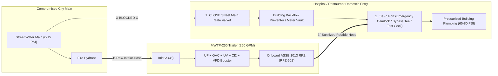

# Field Standard Operating Procedure (SOP): Hospital & Restaurant Emergency Water Tie-In (MWTP-250)

**Document ID:** `SOP-MWTP250-FIELD-01`  
**Regulatory Compliance:** AWWA C651 (Disinfection of Water Mains), CDC/FEMA *Emergency Water Supply Planning Guide for Hospitals and Healthcare Facilities*, ASSE 1013 (RPZ Backflow Prevention), NSF/ANSI 61.

---

## 1. Golden Rules of Building Pressurization

> [!CAUTION]
> **RULE 1 — ISOLATE THE STREET MAIN FIRST:** Before pumping pressurized water into any hospital or restaurant, you **MUST** close the facility's Main Municipal Curb Stop / OS&Y Gate Valve at the street meter vault. If you fail to isolate the street valve, your treated water ($70\text{ PSI}$) will flow backward into the depressurized city water main ($0\text{--}15\text{ PSI}$), draining your trailer and contaminating your supply.
>
> **RULE 2 — NEVER TIE INTO A FIRE SPRINKLER FDC FOR POTABLE USE:** A building's exterior Fire Department Connection (`FDC` Siamese connection) connects to stagnant black-iron fire sprinkler pipes, **NOT** the domestic drinking/sanitation plumbing. Only tie into the **Domestic Potable Water Manifold** (detailed in Section 3).

---

## 2. Pre-Connection Site Setup & Hydrant Tap (Minutes 0–15)

### 2.1 Trailer Positioning & Stabilization
1. **Site Selection:** Park the 36-ft Gooseneck Trailer on firm pavement within **$100\text{ ft}$** of the raw water source (fire hydrant) and within **$150\text{ ft}$** of the building's domestic water mechanical room or exterior emergency connection port.
2. **Deploy Hydraulic Outriggers:**
   * Keep the pickup truck hitched or chock all 6 trailer tires.
   * Engage the **4-Point Hydraulic Auto-Leveling System** (`Control Panel Switch -> AUTO LEVEL`).
   * Verify all 4 outrigger footpads are firmly planted before filling any onboard tanks (supports the $30,870\text{ lb}$ wet weight).
3. **Power Up:**
   * **Off-Grid Mode:** Open front gooseneck louvers, start the **45 kW Diesel Generator**, and verify $480\text{V}/208\text{V}$ 3-phase power on `CP-701`.
   * **Hospital Shore Power Mode (Optional):** If connecting to hospital backup generator power, connect the $50\text{ ft}$ 100A Camlock shore cable; the Automatic Transfer Switch (`ATS`) will seamlessly shift load off the diesel generator.

### 2.2 Tapping a Compromised / Depressurized Municipal Fire Hydrant
1. **Flush Stagnant Hydrant Barrel:**
   * Remove the $4.5\text{''}$ pumper port cap (or $2.5\text{''}$ side nozzle cap).
   * Slowly open the hydrant operating nut using the hydrant wrench for **$60\text{--}120\text{ seconds}$** to blow out rust scale and sediment stirred up by the storm outage. Close the hydrant.
2. **Install Hydrant Hardware:**
   * Thread on the **$4.5\text{''}$ NST-to-$4\text{''}$ Storz/Camlock Hydrant Gate Valve & Vacuum Breaker Assembly**.
   * Connect the **$4\text{''}$ Blue NSF-61 Potable Intake Hose** from the hydrant gate valve to **Trailer Rear Bulkhead `INLET A`**.
   * Connect the **$3\text{''}$ Red/Black Lay-Flat Waste Hose** from **Trailer Rear Bulkhead `WASTE OUTLET`** to the nearest storm drain catch basin or sanitary sewer cleanout (up to $200\text{ ft}$ away).
3. **Pressurize Intake Header:**
   * Open the hydrant fully, then slowly open the hydrant gate valve to bleed air at the trailer inlet strainer vent.
   * Confirm raw suction pressure (`PSL/PT-101`) reads between **$+2\text{ PSI}$ and $+45\text{ PSI}$**. *(Note: If the city main is completely dead at $0\text{ PSI}$ with water standing in the pipe, `P-101` vacuum-assist will draw up to $-2\text{ PSI}$ without collapsing the main).*

---

## 3. Identifying the Building Tie-In Point (Hospital vs. Restaurant)

### Option A: Acute-Care Hospital Tie-In (100 to 250 GPM)
Most modern hospitals (compliant with Joint Commission *EM.02.02.09* and CMS emergency preparedness rules) have a dedicated **Exterior Emergency Water Supply Box** ($2.5\text{''}$ or $4\text{''}$ Camlock/Flanged connection).
* **If the Hospital HAS an Dedicated Emergency Water Port:**
  1. Locate the exterior potable water connection cabinet (usually labeled *"EMERGENCY DOMESTIC WATER INLET — POTABLE ONLY"*).
  2. Close the main street water isolation valve (`OS&Y Valve #1` upstream of the hospital's domestic meter/RPZ).
  3. Connect the trailer's **$3\text{''}$ White NSF-61 High-Pressure Potable Hose** from **Trailer `OUTLET A`** to the hospital's emergency inlet port.
* **If the Hospital DOES NOT Have an Dedicated Exterior Port:**
  1. Enter the hospital's **Main Domestic Water Entry Room** or exterior **Meter/Backflow Vault**.
  2. Close the upstream street isolation valve (`Valve #1`).
  3. Remove the flanged spool piece on the **Meter Bypass Line** (or remove the top bonnet/flange of the secondary duplex strainer/meter) and bolt on the trailer's **Universal Slotted Flange-to-$3\text{''}$ Camlock Adapter** (stowed in the trailer tool locker).

### Option B: Restaurant / Commercial Kitchen Tie-In (15 to 60 GPM)
Restaurants rarely have dedicated emergency camlock ports, so tie-in is performed at the **Backflow Preventer Assembly**, **Water Meter Spool**, or **Exterior Commercial Yard Hydrant / Mop-Sink Manifold**:
1. **Close the Curb Stop / Main Meter Shutoff Valve** at the street or inside the utility closet.
2. **Preferred Tie-In Point (Meter / Backflow Union):**
   * Unthread the union on the **building side** of the $1.5\text{''}$ or $2\text{''}$ water meter (or connect to the downstream $3/4\text{''}\text{--}1\text{''}$ test cock/drain tee on the building's domestic backflow assembly using the brass NPT-to-Camlock adapter kit).
   * Connect the **$1.5\text{''}$ or $2\text{''}$ NSF-61 Potable Hose** from **Trailer `OUTLET B`** to the restaurant's domestic manifold.
3. **Cooling Tower / Ice Machine Protection:** Verify that the trailer's $0.02\ \mu\text{m}$ UF + GAC + UV water feeds upstream of the restaurant's ice machines, espresso/beverage systems, and commercial dishwashers.

---

## 4. Hose Sanitization, Flush-to-Waste & Water Quality Verification (Minutes 15–25)

Before opening the building's inlet valve, both the trailer treatment train and the potable delivery hose must be sanitized and verified:

1. **Start Trailer in `MODE 1: STARTUP FLUSH`:**
   * On the $15\text{''}$ HMI (`CP-701`), press **`[AUTO STARTUP & FLUSH]`**.
   * The PLC opens `XV-300` (Divert-to-Waste) and runs the intake, UF, GAC, UV, and NaOCl dosing skids at $150\text{ GPM}$ for **$3\text{ minutes}$**, filling the $500\text{-gallon}$ Clearwell (`TK-601`).
2. **Verify Online Compliance Readouts on HMI:**
   * **UF Permeate Turbidity (`AIT-201`):** Must read **$< 0.05\text{ NTU}$** (Trip limit: $0.15\text{ NTU}$).
   * **UV Reactor Dose (`UIT-401A/B`):** Must read **$\ge 40\text{ mJ/cm}^2$**.
   * **Clearwell Free Chlorine (`AIT-601`):** Temporarily set NaOCl dosing setpoint to **$5.0\text{ mg/L}$ (Hyper-Chlorination Flush)** for hose disinfection.
3. **Sanitize the Potable Delivery Hose ($3\text{ Minutes}$):**
   * With the $3\text{''}$ potable hose connected to **Trailer `OUTLET A`** at one end and **disconnected (open to a clean drain bucket)** at the building end, open `XV-602` and jog Booster Pump `P-601A` at $50\text{ GPM}$ for $2\text{ minutes}$.
   * Test water exiting the building end of the hose using the **Hach Pocket Colorimeter II** (from the trailer Wet Lab) to confirm Free Chlorine $\ge 2.0\text{ mg/L}$ and zero turbidity.
   * Return the HMI Free Chlorine setpoint to normal operating level (**$2.0\text{ mg/L}$**).
   * Stop `P-601A`, sanitize the building mating flange/camlock with **$200\text{ ppm}$ sodium hypochlorite spray bottle**, and lock the $3\text{''}$ potable hose onto the building tie-in port.

---

## 5. Slow Building Pressurization & Air Venting Procedure (Minutes 25–30)

> [!WARNING]
> **Water Hammer Prevention:** If a hospital or restaurant's pipes have drained empty during the outage, slamming $80\text{ PSI}$ into empty pipes will cause violent water hammer that can burst interior copper joints or damage sterilizers. Always execute the **2-Stage Soft-Ramp Pressurization**.

1. **Stage 1 — Low-Pressure Pipe Fill ($30\text{ PSI}$ Setpoint):**
   * On the HMI, set the Triplex Booster Skid (`P-601`) pressure setpoint to **$30\text{ PSI}$** and enable **`[SOFT RAMP FILL]`**.
   * Slowly open the building's emergency inlet isolation valve over **$60\text{ seconds}$** (quarter-turn every $15\text{ seconds}$).
   * Instruct facility engineering staff to open faucets/slop sinks on the **highest floor of the hospital** (or the farthest prep sink in the restaurant) to bleed trapped air out of the plumbing risers until steady water flows without sputtering.
2. **Stage 2 — Full Operating Pressure ($65\text{--}80\text{ PSI}$ Setpoint):**
   * Once air is purged and flow stabilizes, increase the HMI Booster Pressure Setpoint to match the facility's normal operating pressure:
     * **1–2 Story Restaurant / Clinic:** **$60\text{ PSI}$**
     * **3–6 Story Hospital:** **$75\text{ to }85\text{ PSI}$** (plus hospital internal booster pumps if $> 6$ stories).
3. **Leak & Backflow Check:**
   * Inspect all camlock gaskets, the trailer's `RPZ-602` relief port, and the building's closed street main valve to verify zero leakage and stable pressure.
   * Take a grab sample at a **farthest point-of-use faucet inside the hospital/restaurant** and record **Free Chlorine ($\ge 1.0\text{ mg/L}$ at tap)**, **pH ($7.0\text{--}8.0$)**, and **Turbidity ($< 0.10\text{ NTU}$)** in the Chain-of-Custody Log.

---

## 6. Field Operator Quick-Reference Checklist

| Step | Action Item | Verified By / Target Metric |
| :---: | :--- | :--- |
| **1** | Trailer parked within $100\text{ ft}$ of hydrant; **4-Point Hydraulic Jacks** deployed & leveled | Bubble level centered; jacks locked |
| **2** | **45 kW Generator** started (or 100A Shore Power connected); air compressor at $80\text{ PSI}$ | $480\text{V}/208\text{V}$ nominal on `CP-701` |
| **3** | Fire hydrant flushed $2\text{ min}$; $4\text{''}$ NSF-61 intake hose & $3\text{''}$ waste hose connected | `PSL-101` $> 0\text{ PSI}$; waste in storm drain |
| **4** | **CRITICAL:** Building **Street Main Isolation Valve CLOSED** & locked out / tagged out (LOTO) | Valve fully shut; street meter shows $0\text{ GPM}$ |
| **5** | Trailer started in `STARTUP FLUSH` mode; Clearwell filled to $85\%$ ($425\text{ gal}$) | `AIT-201` $< 0.05\text{ NTU}$; `UIT-401` $\ge 40\text{ mJ/cm}^2$ |
| **6** | Potable delivery hose flushed with chlorinated water ($2.0\text{--}5.0\text{ mg/L}$); camlocks sprayed with $200\text{ ppm}$ $\text{Cl}_2$ | Colorimeter verified at hose end |
| **7** | Building pressurized at **$30\text{ PSI}$** to bleed air at top-floor faucets, then ramped to **$70\text{--}80\text{ PSI}$** | `PT-602` steady; indoor tap $\text{Cl}_2 \ge 1.0\text{ mg/L}$ |

---

## 7. Decommissioning & Restoration to City Water (Post-Emergency)

Once the municipality restores street water pressure and officially lifts the **Boil Water Advisory**:
1. **Flush Building Residual:** Keep the trailer running while facility staff confirm municipal street pressure is $> 50\text{ PSI}$ and city chlorine residual is present upstream of the street valve.
2. **Isolate Trailer Discharge:** Close `XV-602` on the trailer HMI and shut the building's emergency tie-in valve.
3. **Re-Open Street Main Valve:** Slowly open the building's main municipal street valve (`Valve #1`) to return the hospital or restaurant to normal utility service.
4. **Sanitize & Stow Hoses:** Drain, cap, and stow all NSF-61 potable hoses on their heated hose reels so their interiors remain uncontaminated for the next emergency call.
5. **Execute `MODE 5: HIGHWAY TRANSPORT AUTO-DRAIN`:**
   * Press **`[PREPARE FOR TRANSPORT]`** on the HMI.
   * Allow $3.5\text{ minutes}$ for pneumatic dump valves (`XV-601`, `XV-302`, `XV-205A/B`) to drain $9,170\text{ lbs}$ of water out the waste hose.
   * Confirm HMI displays **`DRY WEIGHT VERIFIED (21,700 LBS)`**, disconnect the waste hose, retract the 4 hydraulic jacks, and depart.
