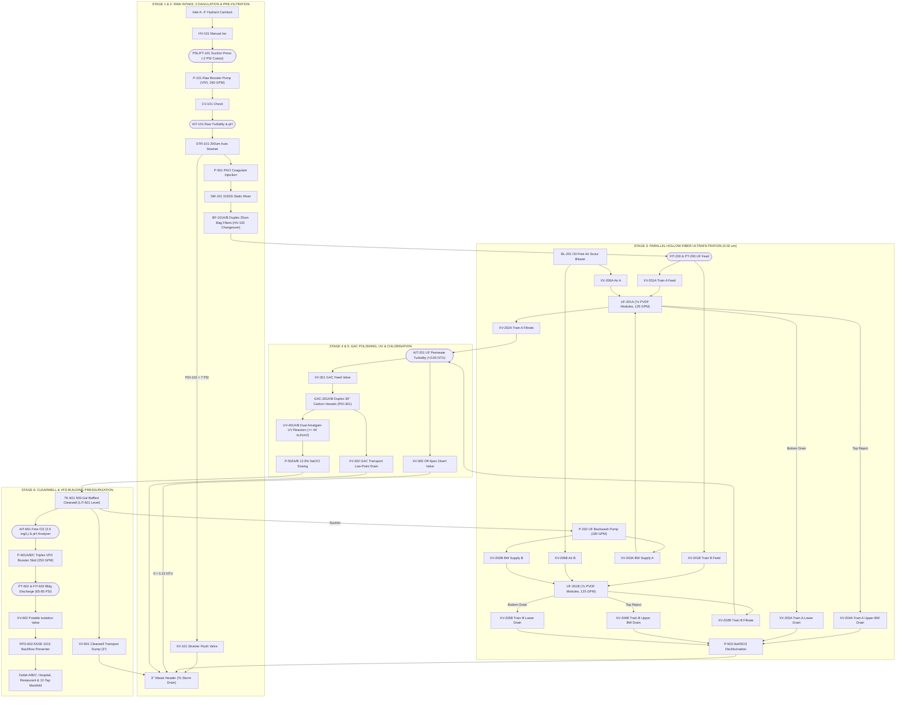

# Detailed Piping & Instrumentation Diagram (P&ID) & Automated Valve Matrix (MWTP-250)

## 1. Piping & Instrumentation Diagram (P&ID)

### 1.1 Tagging & Line Designation Legend (ISA-5.1 Standard)
* **Process Lines:**
  * `RW-4"-316SS`: 4" Raw Water Intake Header (Schedule 10 316L Stainless Steel)
  * `PF-3"-316SS`: 3" Pre-Filtered / Coagulated Feed Header
  * `UF-3"-316SS`: 3" Ultrafiltration Permeate Header
  * `PW-3"-316SS`: 3" Finished Potable Water Header (NSF-61 Certified)
  * `BW-3"-PVC80`: 3" Backwash & Drain Waste Header (Schedule 80 PVC)
  * `IA-1"-316SS`: 1" Oil-Free Instrument / Scour Air Header (80 PSI)
* **Valve Prefixes:**
  * `XV-xxx`: Pneumatically Actuated Butterfly / Ball Valve (24VDC Solenoid Pilot, Spring-Return Fail-Closed)
  * `HV-xxx`: Manual Isolation / Changeover Butterfly or Ball Valve
  * `RV-xxx`: Pressure Relief / Vacuum Breaker Valve
  * `CV-xxx`: Spring-Loaded Silent Check Valve

---

### 1.2 Master System P&ID Schematic

---

## 2. Automated Valve Register (`XV` Series)

All automated valves are **316L Stainless Steel Lug-Style Butterfly Valves** (EPDM food-grade NSF-61 seats) with **Rack-and-Pinion Pneumatic Actuators** (80 PSI instrument air, 24VDC Namur solenoid pilots, and dual open/closed limit switches wired to PLC discrete inputs).

| Valve Tag | Size | Service / Description | Normal State | Fail Position (Air/Power Loss) |
| :--- | :--- | :--- | :--- | :--- |
| **`XV-101`** | 1.5" | Auto-Strainer (`STR-101`) Differential Pressure Blowdown | **CLOSED** | Fail-Closed (FC) |
| **`XV-201A`** | 2.5" | UF Train A Raw Feed Inlet Valve | **OPEN** | Fail-Closed (FC) |
| **`XV-202A`** | 2.5" | UF Train A Permeate Outlet Valve | **OPEN** | Fail-Closed (FC) |
| **`XV-203A`** | 2.5" | UF Train A Backwash Filtrate Inlet Valve | **CLOSED** | Fail-Closed (FC) |
| **`XV-204A`** | 2.5" | UF Train A Upper Backwash Reject / Air Vent Valve | **CLOSED** | Fail-Closed (FC) |
| **`XV-205A`** | 2.0" | UF Train A Lower Shell Gravity Drain Valve | **CLOSED** | Fail-Closed (FC) |
| **`XV-206A`** | 1.0" | UF Train A Oil-Free Scour Air Inlet Valve | **CLOSED** | Fail-Closed (FC) |
| **`XV-201B`** | 2.5" | UF Train B Raw Feed Inlet Valve | **OPEN** | Fail-Closed (FC) |
| **`XV-202B`** | 2.5" | UF Train B Permeate Outlet Valve | **OPEN** | Fail-Closed (FC) |
| **`XV-203B`** | 2.5" | UF Train B Backwash Filtrate Inlet Valve | **CLOSED** | Fail-Closed (FC) |
| **`XV-204B`** | 2.5" | UF Train B Upper Backwash Reject / Air Vent Valve | **CLOSED** | Fail-Closed (FC) |
| **`XV-205B`** | 2.0" | UF Train B Lower Shell Gravity Drain Valve | **CLOSED** | Fail-Closed (FC) |
| **`XV-206B`** | 1.0" | UF Train B Oil-Free Scour Air Inlet Valve | **CLOSED** | Fail-Closed (FC) |
| **`XV-300`** | 3.0" | Off-Spec Water Divert-to-Waste Valve | **CLOSED** | **Fail-Open (FO)** |
| **`XV-301`** | 3.0" | GAC Carbon Vessels Feed Isolation Valve | **OPEN** | Fail-Closed (FC) |
| **`XV-302`** | 2.0" | GAC Vessels Low-Point Underdrain Transport Dump | **CLOSED** | Fail-Closed (FC) |
| **`XV-601`** | 3.0" | 500-Gal Clearwell Tank Low-Point Transport Dump | **CLOSED** | Fail-Closed (FC) |
| **`XV-602`** | 3.0" | Final Potable Distribution Isolation Valve | **OPEN** | Fail-Closed (FC) |

---

## 3. Automated PLC Valve & Pump Truth Matrix

Legend:
- **`O`** = Valve OPEN / **`C`** = Valve CLOSED / **`P`** = Pulsing (2 sec every 15 min or on ΔP)
- **`RUN`** = Pump/Unit Running / **`OFF`** = Stopped

| Tag | Description | Mode 1: Startup Flush (3 min) | Mode 2: Normal Filtration (250 GPM) | Mode 3A: UF Train A Backwash (45s) | Mode 3B: UF Train B Backwash (45s) | Mode 4: Off-Spec Alarm Divert | Mode 5: Highway Transport Auto-Drain |
| :--- | :--- | :---: | :---: | :---: | :---: | :---: | :---: |
| **`XV-101`** | Strainer Blowdown | `P` | `P` | `C` | `C` | `C` | `O` |
| **`XV-201A`** | UF-A Feed Inlet | `O` | `O` | **`C`** | `O` | `O` | `C` |
| **`XV-202A`** | UF-A Permeate Out | `O` | `O` | **`C`** | `O` | `O` | `C` |
| **`XV-203A`** | UF-A BW Supply | `C` | `C` | **`O`** | `C` | `C` | `C` |
| **`XV-204A`** | UF-A Top BW Drain | `C` | `C` | **`O`** | `C` | `C` | `O` (Vent) |
| **`XV-205A`** | UF-A Bottom Drain | `C` | `C` | `O` (Last 10s) | `C` | `C` | **`O`** |
| **`XV-206A`** | UF-A Air Scour | `C` | `C` | **`O`** (First 20s) | `C` | `C` | `O` (Purge) |
| **`XV-201B`** | UF-B Feed Inlet | `O` | `O` | `O` | **`C`** | `O` | `C` |
| **`XV-202B`** | UF-B Permeate Out | `O` | `O` | `O` | **`C`** | `O` | `C` |
| **`XV-203B`** | UF-B BW Supply | `C` | `C` | `C` | **`O`** | `C` | `C` |
| **`XV-204B`** | UF-B Top BW Drain | `C` | `C` | `C` | **`O`** | `C` | `O` (Vent) |
| **`XV-205B`** | UF-B Bottom Drain | `C` | `C` | `C` | `O` (Last 10s) | `C` | **`O`** |
| **`XV-206B`** | UF-B Air Scour | `C` | `C` | `C` | **`O`** (First 20s) | `C` | `O` (Purge) |
| **`XV-300`** | Off-Spec Divert | **`O`** | `C` | `C` | `C` | **`O`** | `O` |
| **`XV-301`** | GAC Feed Valve | `C` | **`O`** | **`O`** | **`O`** | **`C`** | `C` |
| **`XV-302`** | GAC Bottom Drain | `C` | `C` | `C` | `C` | `C` | **`O`** |
| **`XV-601`** | Clearwell 3" Dump | `C` | `C` | `C` | `C` | `C` | **`O`** |
| **`XV-602`** | Potable Bldg Out | `C` | **`O`** | **`O`** | **`O`** | **`C`** | `C` |
| **`P-101`** | Raw Booster VFD | `RUN` | `RUN` (100%) | `RUN` (50%) | `RUN` (50%) | `RUN` | `OFF` |
| **`P-202`** | UF Backwash Pump | `OFF` | `OFF` | **`RUN`** | **`RUN`** | `OFF` | `OFF` |
| **`BL-201`** | Air Scour Blower | `OFF` | `OFF` | **`RUN`** | **`RUN`** | `OFF` | `RUN` (30s) |
| **`P-601`** | Triplex Bldg VFD | `OFF` | **`RUN`** | **`RUN`** | **`RUN`** | **`OFF`** | `OFF` |

---

## 4. Instrumentation & Fail-Safe Interlock Schedule

> [!CAUTION]
> **Hospital Potable Safety Interlocks:** Under no circumstances can untreated or off-specification water enter the hospital or restaurant distribution manifold (`OUTLET A/B`). If any water quality sensor breaches its High/Low trip threshold, **`XV-602` closes immediately** and **`XV-300` fails open to waste**.

| Instrument Tag | Parameter Measured | Normal Operating Range | Alarm / Interlock Trip Point | Automated PLC Action on Trip |
| :--- | :--- | :--- | :--- | :--- |
| **`PSL/PT-101`** | Raw Hydrant Suction Pressure | +2 to +45 PSI | **Low-Low:** < -2.0 PSI for 3 sec | Throttles back `P-101` VFD speed; trips `P-101` OFF if -4 PSI reached to prevent collapsing city water main. |
| **`AIT-101`** | Raw Water Turbidity | 0.5 to 50 NTU | **High:** > 5.0 NTU | Automatically starts PACl Coagulant metering pump (`P-501`) flow-paced to turbidity. |
| **`PDI-102`** | Auto-Strainer ΔP | 1.0 to 5.0 PSI | **High:** > 7.0 PSI | Opens `XV-101` and runs motorized strainer brush for 3 seconds. |
| **`PDIT-201A/B`** | UF Transmembrane Pressure (TMP) | 4.0 to 18.0 PSI | **High:** > 22.0 PSI (or 45 min timer) | Initiates automatic 45-second Air Scour & Backwash sequence on the fouled train while the partner train stays online. |
| **`AIT-201`** | UF Permeate Turbidity (Laser) | 0.015 to 0.050 NTU | **High-High:** > 0.15 NTU for 5 sec | **CRITICAL INTERLOCK:** Closes `XV-301` & `XV-602`, opens `XV-300` (divert to waste), alerts operator of UF fiber breach. |
| **`UIT-401A/B`** | UV Reactor Intensity Sensor | 45 to 90 mJ/cm² | **Low-Low:** < 40 mJ/cm² | Closes `XV-602` potable outlet, activates standby UV lamp bank at 100% power, sounds SCADA alarm. |
| **`LIT-601`** | 500-Gal Clearwell Ultrasonic Level | 65% to 92% (325–460 gal) | **High:** > 95% / **Low-Low:** < 20% | PID modulates `P-101` raw intake speed to maintain 85% level; trips `P-601` & `P-202` on Low-Low (< 20%) for dry-run protection. |
| **`AIT-601`** | Finished Free Chlorine & pH | Cl₂: 1.5–2.2 mg/L | **Low-Low:** < 0.8 mg/L or **High-High:** > 4.0 mg/L | Switches to redundant NaOCl pump (`P-502B`); if not corrected in 30 sec, closes `XV-602` so unchlorinated/over-chlorinated water cannot enter the building. |
| **`PT-602`** | Building Distribution Pressure | 65 to 80 PSI (Configurable) | **High-High:** > 95 PSI | PID controls `P-601A/B/C` VFDs; trips lead pump off if > 95 PSI to protect hospital/restaurant interior plumbing. |

---

## 5. Automated Sequence Step-by-Step Descriptions

### 5.1 UF Train Air-Scour Backwash Sequence (45 Seconds Total)
Every 45 minutes of runtime (or when Transmembrane Pressure `PDIT-201` reaches 22 PSI), the PLC cleans one UF train while the other continues supplying 125 GPM to the clearwell:
1. **Step 1 — Isolate & Top-Vent (5 sec):** Close feed valve `XV-201A` and permeate valve `XV-202A`. Open top drain `XV-204A` to relieve shell pressure.
2. **Step 2 — Oil-Free Air Scour (15 sec):** Start blower `BL-201` and open air valve `XV-206A`. Compressed air bubbles vigorously agitate the outside of the hollow fibers, shaking loose caked sediment and biofilm.
3. **Step 3 — Upper Reverse Filtrate Flush (15 sec):** Close `XV-206A` (stop air). Open backwash supply `XV-203A` and start backwash pump `P-202` (180 GPM drawn from the Clearwell) + sodium bisulfite dechlorination pump `P-503`. Clean water flows *inside-out* through the 0.02 μm pores, sweeping dislodged solids out top drain `XV-204A`.
4. **Step 4 — Lower Gravity Sweep (10 sec):** Open bottom drain `XV-205A` while `P-202` runs to flush heavy sand/iron scale from the bottom header.
5. **Step 5 — Return to Service:** Stop `P-202`, close `XV-203A`, `XV-204A`, and `XV-205A`. Open `XV-201A` and `XV-202A`.

### 5.2 One-Button "Highway Transport Auto-Drain" Sequence (3.5 Minutes)
Before retracting the hydraulic leveling jacks and towing the trailer behind the pickup truck, the operator presses **"PREPARE FOR TRANSPORT"** on the HMI:
1. All water pumps (`P-101`, `P-202`, `P-601`) and chemical pumps lock out.
2. Pneumatic dump valves `XV-601` (3" Clearwell drain), `XV-302` (2" GAC underdrain), `XV-205A/B` (UF lower drains), and `XV-101` (Strainer drain) open simultaneously, gravity-draining 9,170 lbs of water out the 3" waste hose in 3 minutes.
3. Air scour valves `XV-206A/B` pulse for 30 seconds to blow residual water out of the UF headers (preventing freeze damage in winter transport).
4. Once `LIT-601` confirms Clearwell level = 0%, the HMI displays **"DRY WEIGHT VERIFIED (21,700 LBS) — SAFE TO RETRACT JACKS & TOW."**
