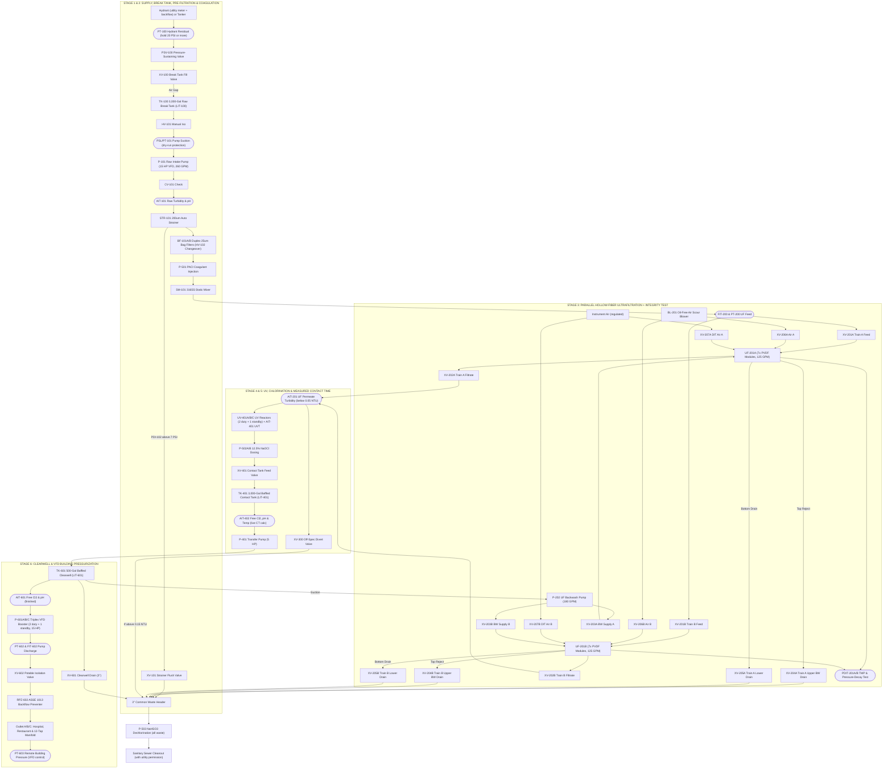

# MWTP-250 Detailed Piping & Instrumentation Diagram (P&ID) & Automated Valve Matrix

**Revision B — November 2026.** Adds the raw break tank, contact tank, UF direct integrity test, third UV reactor, and duplex instrument air; removes the GAC vessels (`XV-301`, `XV-302`); reorders coagulant injection after the bag filters; moves dechlorination to the common waste header.

## 1. Piping & Instrumentation Diagram (P&ID)

### 1.1 Tagging & Line Designation Legend (ISA-5.1 Standard)
* **Process Lines:**
  * `RW-4"-316SS`: 4" Raw Water Header (break tank to intake pump; Schedule 10 316L)
  * `PF-3"-316SS`: 3" Pre-Filtered / Coagulated UF Feed Header
  * `UF-3"-316SS`: 3" Ultrafiltration Permeate Header
  * `CT-4"-HOSE`: 4" NSF-61 hose to/from ground contact tank `TK-401`
  * `PW-3"-316SS`: 3" Finished Potable Water Header (NSF-61)
  * `BW-3"-PVC80`: 3" Common Waste Header (Schedule 80 PVC, dechlorinated)
  * `IA-1"-316SS`: 1" Oil-Free Instrument / Scour / Integrity-Test Air Header (80 PSI)
* **Valve Prefixes:**
  * `XV-xxx`: Pneumatically actuated butterfly/ball valve (24VDC solenoid pilot, spring return)
  * `HV-xxx`: Manual isolation / changeover valve
  * `PSV-xxx`: Pressure-sustaining valve
  * `RV-xxx`: Pressure relief / vacuum breaker
  * `CV-xxx`: Spring-loaded silent check valve

---

### 1.2 Master System P&ID Schematic

---

## 2. Automated Valve Register (`XV` Series)

All automated valves are **316L stainless lug-style butterfly or ball valves** (NSF-61 EPDM seats) with rack-and-pinion pneumatic actuators (80 PSI instrument air, 24VDC Namur solenoids, open/closed limit switches to PLC inputs). **Instrument air is duplex:** two oil-free compressors (lead/lag) with a receiver sized to hold all valves in position for at least 10 minutes if both compressors stop. Low air pressure alarms at 65 PSI and starts the lag compressor.

| Valve Tag | Size | Service / Description | Normal State | Fail Position (Air/Power Loss) |
| :--- | :--- | :--- | :--- | :--- |
| **`XV-100`** | 4.0" | Raw Break Tank Fill (closes on low hydrant residual or high tank level) | **MODULATING / OPEN** | Fail-Closed (FC) |
| **`XV-101`** | 1.5" | Auto-Strainer (`STR-101`) Blowdown | **CLOSED** | Fail-Closed (FC) |
| **`XV-201A`** | 2.5" | UF Train A Feed Inlet | **OPEN** | Fail-Closed (FC) |
| **`XV-202A`** | 2.5" | UF Train A Permeate Outlet | **OPEN** | Fail-Closed (FC) |
| **`XV-203A`** | 2.5" | UF Train A Backwash Supply | **CLOSED** | Fail-Closed (FC) |
| **`XV-204A`** | 2.5" | UF Train A Upper Backwash Reject / Vent | **CLOSED** | Fail-Closed (FC) |
| **`XV-205A`** | 2.0" | UF Train A Lower Drain | **CLOSED** | Fail-Closed (FC) |
| **`XV-206A`** | 1.0" | UF Train A Scour Air | **CLOSED** | Fail-Closed (FC) |
| **`XV-207A`** | 0.5" | UF Train A Integrity-Test Air | **CLOSED** | Fail-Closed (FC) |
| **`XV-201B`** | 2.5" | UF Train B Feed Inlet | **OPEN** | Fail-Closed (FC) |
| **`XV-202B`** | 2.5" | UF Train B Permeate Outlet | **OPEN** | Fail-Closed (FC) |
| **`XV-203B`** | 2.5" | UF Train B Backwash Supply | **CLOSED** | Fail-Closed (FC) |
| **`XV-204B`** | 2.5" | UF Train B Upper Backwash Reject / Vent | **CLOSED** | Fail-Closed (FC) |
| **`XV-205B`** | 2.0" | UF Train B Lower Drain | **CLOSED** | Fail-Closed (FC) |
| **`XV-206B`** | 1.0" | UF Train B Scour Air | **CLOSED** | Fail-Closed (FC) |
| **`XV-207B`** | 0.5" | UF Train B Integrity-Test Air | **CLOSED** | Fail-Closed (FC) |
| **`XV-300`** | 3.0" | Off-Spec UF Permeate Divert-to-Waste | **CLOSED** | **Fail-Open (FO)** |
| **`XV-401`** | 3.0" | Contact Tank `TK-401` Feed | **OPEN** | Fail-Closed (FC) |
| **`XV-601`** | 3.0" | Clearwell Low-Point Drain | **CLOSED** | Fail-Closed (FC) |
| **`XV-602`** | 3.0" | Final Potable Distribution Isolation | **OPEN** | Fail-Closed (FC) |

**20 automated valves total.**

---

## 3. Automated PLC Valve & Pump Truth Matrix

Legend:
- **`O`** = Valve OPEN / **`C`** = Valve CLOSED / **`P`** = Pulsing (2 sec every 15 min or on ΔP) / **`M`** = Modulating on level
- **`RUN`** = Pump/Unit Running / **`OFF`** = Stopped

| Tag | Description | Mode 1: Startup Flush | Mode 1B: Fill & Prove | Mode 2: Normal (250 GPM) | Mode 3A: UF-A Backwash (45s) | Mode 3B: UF-B Backwash (45s) | Mode 4: Off-Spec Divert | Mode 5: Drain & Preserve | Mode 6: Daily DIT (Train A) |
| :--- | :--- | :---: | :---: | :---: | :---: | :---: | :---: | :---: | :---: |
| **`XV-100`** | Break Tank Fill | `M` | `M` | `M` | `M` | `M` | `M` | `C` | `M` |
| **`XV-101`** | Strainer Blowdown | `P` | `P` | `P` | `C` | `C` | `C` | `O` | `C` |
| **`XV-201A`** | UF-A Feed | `O` | `O` | `O` | **`C`** | `O` | `O` | `C` | **`C`** |
| **`XV-202A`** | UF-A Permeate | `O` | `O` | `O` | **`C`** | `O` | `O` | `C` | **`C`** |
| **`XV-203A`** | UF-A BW Supply | `C` | `C` | `C` | **`O`** | `C` | `C` | `C` | `C` |
| **`XV-204A`** | UF-A Top Drain | `C` | `C` | `C` | **`O`** | `C` | `C` | `O` then `C` | `C` |
| **`XV-205A`** | UF-A Bottom Drain | `C` | `C` | `C` | `O` (last 10s) | `C` | `C` | `O` then `C` | **`O`** (drain feed side) |
| **`XV-206A`** | UF-A Scour Air | `C` | `C` | `C` | **`O`** (s 5–20) | `C` | `C` | `C` | `C` |
| **`XV-207A`** | UF-A DIT Air | `C` | `C` | `C` | `C` | `C` | `C` | `C` | **`O`** (pressurize, then hold) |
| **`XV-201B`** | UF-B Feed | `O` | `O` | `O` | `O` | **`C`** | `O` | `C` | `O` |
| **`XV-202B`** | UF-B Permeate | `O` | `O` | `O` | `O` | **`C`** | `O` | `C` | `O` |
| **`XV-203B`** | UF-B BW Supply | `C` | `C` | `C` | `C` | **`O`** | `C` | `C` | `C` |
| **`XV-204B`** | UF-B Top Drain | `C` | `C` | `C` | `C` | **`O`** | `C` | `O` then `C` | `C` |
| **`XV-205B`** | UF-B Bottom Drain | `C` | `C` | `C` | `C` | `O` (last 10s) | `C` | `O` then `C` | `C` |
| **`XV-206B`** | UF-B Scour Air | `C` | `C` | `C` | `C` | **`O`** (s 5–20) | `C` | `C` | `C` |
| **`XV-207B`** | UF-B DIT Air | `C` | `C` | `C` | `C` | `C` | `C` | `C` | `C` |
| **`XV-300`** | Off-Spec Divert | **`O`** | `C` | `C` | `C` | `C` | **`O`** | `O` | `C` |
| **`XV-401`** | Contact Tank Feed | `C` | **`O`** | **`O`** | **`O`** | **`O`** | **`C`** | `C` | `O` |
| **`XV-601`** | Clearwell Drain | `C` | `C` | `C` | `C` | `C` | `C` | **`O`** | `C` |
| **`XV-602`** | Potable Bldg Out | `C` | **`C`** | **`O`** | **`O`** | **`O`** | **`C`** | `C` | `O` |
| **`P-101`** | Raw Intake VFD | `RUN` (150 GPM) | `RUN` | `RUN` (100%) | `RUN` (50%) | `RUN` (50%) | `RUN` | `OFF` | `RUN` (50%) |
| **`P-202`** | UF Backwash Pump | `OFF` | `OFF` | `OFF` | **`RUN`** | **`RUN`** | `OFF` | `OFF` | `OFF` |
| **`BL-201`** | Air Scour Blower | `OFF` | `OFF` | `OFF` | **`RUN`** | **`RUN`** | `OFF` | `OFF` | `OFF` |
| **`P-401`** | CT Transfer Pump | `OFF` | `RUN` (on level) | `RUN` | `RUN` | `RUN` | `RUN` (until low) | `OFF` | `RUN` |
| **`P-601`** | Triplex Bldg VFD | `OFF` | `OFF` | **`RUN`** | **`RUN`** | **`RUN`** | **`OFF`** | `OFF` | `RUN` |
| **`P-503`** | Waste Dechlor | `RUN` | `OFF` | on waste flow | `RUN` | `RUN` | `RUN` | `RUN` | `OFF` |

**Mode 1B (Fill & Prove)** is the step Rev A was missing. Permeate goes through UV and chlorination into the contact tank and clearwell, but `XV-602` stays closed until the PLC confirms: both UF trains passed today's DIT, permeate < 0.05 NTU for 3 minutes, UV dose ≥ 40 mJ/cm², and the contact tank has turned over at least once (≥ 3,000 gal through) with CT ≥ required. Only then does the HMI allow Mode 2.

---

## 4. Instrumentation & Fail-Safe Interlock Schedule

> [!CAUTION]
> **Potable Safety Interlocks:** Untreated or off-spec water must never reach the building outlets (`OUTLET A/B/C`). If any water-quality interlock trips, **`XV-602` closes** and the HMI shows the cause. `XV-300` fails open to waste on air or power loss.

| Instrument Tag | Parameter Measured | Normal Operating Range | Alarm / Interlock Trip Point | Automated PLC Action on Trip |
| :--- | :--- | :--- | :--- | :--- |
| **`PT-100`** | Hydrant Residual Pressure (upstream of `PSV-100`) | ≥ 20 PSI | **Low:** < 22 PSI / **Low-Low:** < 20 PSI | `PSV-100` holds 20 PSI mechanically; on Low-Low `XV-100` closes and HMI prompts **"SWITCH TO TANKER SUPPLY."** The trailer never pulls the main below 20 PSI. |
| **`LIT-100`** | Raw Break Tank Level | 40% to 90% | **High:** > 95% / **Low-Low:** < 15% | High closes `XV-100`; Low-Low stops `P-101` (dry-run protection). |
| **`PSL/PT-101`** | `P-101` Suction Pressure | Positive head from tank | **Low-Low** (loss of prime) | Trips `P-101`. |
| **`AIT-101`** | Raw Water Turbidity | 0.5 to 50 NTU | **High:** > 5.0 NTU | Starts PACl pump `P-501`, flow-paced. Above 50 NTU: alarm — source not suitable without upstream pretreatment. |
| **`PDI-102`** | Auto-Strainer ΔP | 1.0 to 5.0 PSI | **High:** > 7.0 PSI | Opens `XV-101` and runs strainer brush for 3 seconds. |
| **`PDIT-201A/B`** | UF Transmembrane Pressure | 4.0 to 18.0 PSI | **High:** > 22.0 PSI (or 45 min timer) | Starts the 45-second backwash on that train. |
| **`PDIT-201A/B` (DIT)** | Pressure-Decay Rate (daily test) | Below maker's limit for the required log credit | **Fail:** decay above limit | Train held offline; HMI: **"UF TRAIN INTEGRITY FAIL — PIN FIBERS / ISOLATE MODULE."** Plant continues at 125 GPM on the passing train. |
| **`AIT-201`** | UF Permeate Turbidity | 0.015 to 0.050 NTU | **High-High:** > 0.15 NTU for 5 sec | Opens `XV-300` to waste, closes `XV-401` & `XV-602`, alerts operator of possible fiber breach. |
| **`UIT-401A/B/C` + `AIT-401`** | UV Intensity & UVT | Validated dose ≥ 40 mJ/cm² | **Low-Low:** dose < 40 mJ/cm² | Starts standby reactor `UV-401C`; if dose is still low, cuts `P-101` flow to what the healthy reactors can treat; if still low, closes `XV-602`. |
| **`AIT-402`** | Contact-Tank Outlet Free Cl₂, pH, Temp | Cl₂ 1.5–2.0 mg/L | **CT Low:** calculated CT < required for 4-log virus | Raises NaOCl dose; if CT is still short after one tank turnover, closes `XV-602`. |
| **`LIT-401`** | Contact Tank Level | 80% to 95% | **Low:** < 70% | Low level shortens contact time — CT calculation uses actual volume; Low-Low stops `P-401`. |
| **`LIT-601`** | Clearwell Level | 65% to 92% | **High:** > 95% / **Low-Low:** < 20% | PID trims `P-101`/`P-401` to hold 85%; trips `P-601` & `P-202` on Low-Low (dry-run protection). |
| **`AIT-601`** | Finished Free Cl₂ & pH | Cl₂: 1.5–2.2 mg/L | **Low-Low:** < 0.8 mg/L or **High-High:** > 4.0 mg/L | Switches to standby NaOCl pump `P-502B`; if not corrected in 30 sec, closes `XV-602`. (4.0 mg/L is the EPA maximum residual disinfectant level.) |
| **`PT-602` / `PT-603`** | Pump Discharge / Remote Building Pressure | Building 65 to 85 PSI | **High-High:** building > 90 PSI or pump > 110 PSI | VFDs control on `PT-603`; trip lead pump on High-High to protect building plumbing. |
| **`PT-801`** | Instrument Air Header | 75 to 90 PSI | **Low:** < 65 PSI / **Low-Low:** < 55 PSI | Starts lag compressor; Low-Low alarms **"AIR LOSS — VALVES WILL FAIL SAFE"** (receiver gives ≥ 10 min warning). |
| **`AIT-901`** | Chemical-Room Chlorine Gas | 0 ppm | **High:** ≥ 0.5 ppm | Exhaust fan to high, horn/strobe, stop chemical transfers, HMI alarm. |

---

## 5. Automated Sequence Step-by-Step Descriptions

### 5.1 UF Train Air-Scour Backwash Sequence (45 Seconds Total)
Every 45 minutes of runtime (or when TMP reaches 22 PSI), the PLC cleans one train while the other keeps supplying 125 GPM:
1. **Step 1 — Isolate & Top-Vent (5 sec):** Close `XV-201A` and `XV-202A`. Open top drain `XV-204A`.
2. **Step 2 — Air Scour (15 sec):** Start `BL-201`, open `XV-206A`.
3. **Step 3 — Reverse Filtrate Flush (15 sec):** Close `XV-206A`. Open `XV-203A`, start `P-202` (180 GPM from the clearwell). Waste leaves through `XV-204A` into the common waste header, where `P-503` dechlorinates it.
4. **Step 4 — Lower Sweep (10 sec):** Open `XV-205A` while `P-202` runs.
5. **Step 5 — Return to Service:** Stop `P-202`, close `XV-203A`, `XV-204A`, `XV-205A`. Open `XV-201A` and `XV-202A`.

### 5.2 Daily UF Direct Integrity Test (per train, about 10 minutes)
1. Isolate the train (`XV-201A`, `XV-202A` closed) and drain the feed side through `XV-205A`.
2. Open `XV-207A` to pressurize the feed side with regulated instrument air to the maker's test pressure, then close it.
3. Hold and log the pressure decay on `PDIT-201A` for the maker's test period.
4. Pass: refill and return to service. Fail: hold offline, alarm, record. Test results are logged for the state.

### 5.3 One-Button "Drain & Preserve for Transport" Sequence (about 15 minutes)
Before retracting the jacks and towing, the operator presses **"PREPARE FOR TRANSPORT"** on the HMI:
1. All water pumps (`P-101`, `P-202`, `P-401`, `P-601`) and chemical pumps lock out.
2. Clearwell drain `XV-601` and strainer drain `XV-101` open; ground tanks `TK-100` and `TK-401` are drained to sewer through the waste header (with dechlorination) and folded by the crew.
3. UF feed sides drain through `XV-205A/B`, then close.
4. **Preservation fill:** The CIP pump fills both UF trains with membrane preservative from the CIP tank (sodium bisulfite solution; glycol-based preservative when freezing weather is possible), then all UF valves close. **Membranes are never blown dry.**
5. Once `LIT-601` reads 0% and the preservation step logs complete, the HMI shows **"DRAINED & PRESERVED — VERIFY ROAD WEIGHT ON SCALE BEFORE TOWING."**
