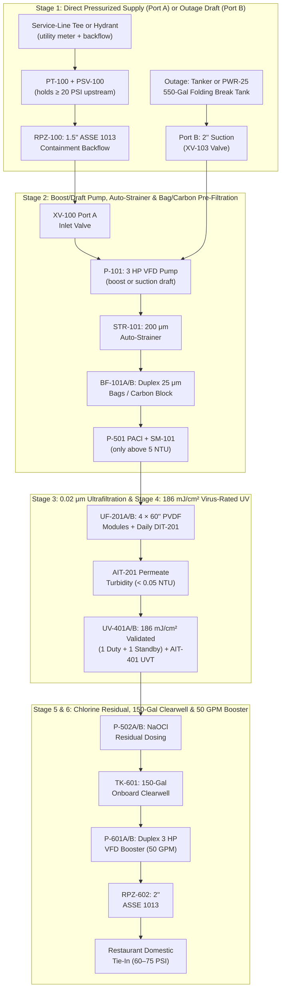
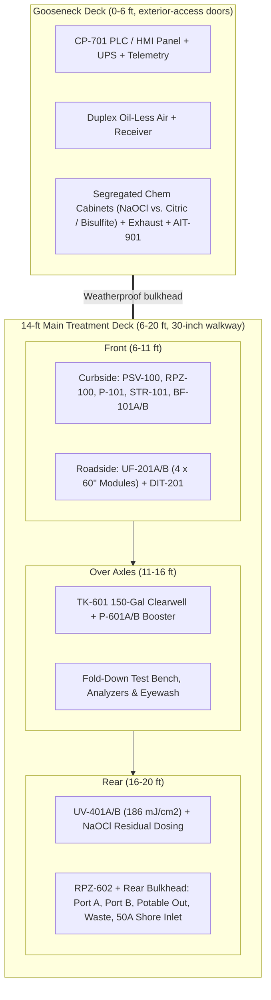

# MWTP-50C ("KitchenShield-50C") — Split-Power Restaurant Water Treatment System

**Document ID:** `ENG-MWTP50C-01` — **Revision C (November 2026)**  
**System:** Two trailers that work together:
* **`MWTP-50C` Water Trailer** — 20-ft tandem-axle compact gooseneck, **no onboard generator**, 35 GPM continuous / 50 GPM peak at 60–75 PSI, runs on a **240V 50A shore-power cord**.
* **`PWR-25` Generator & Outage-Kit Trailer** — towable 25 kVA diesel generator with its own fuel, a 50A output panel, and the outage kit (folding break tank and tanker suction hoses). It goes out **only on power-outage or zero-pressure jobs**.

**Target Customers:** High-volume full-service restaurants, hotel kitchens, multi-unit restaurant groups, institutional kitchens (nursing homes, assisted living, schools, correctional facilities), and food processors — including existing AmeriPro F.O.G. and hood-cleaning accounts.

---

## 1. Why Split the Power Off the Water Trailer?

A restaurant kitchen needs city power to cook. When its power is out, the kitchen is closed no matter what water it has — so on almost every restaurant job the building already has power, and an onboard generator would sit unused. Moving the generator to its own trailer, and making two Rev C process changes, gives:

1. **A lighter, simpler water trailer.** No diesel, no fuel tank, no generator compartment, no transfer switch. On-site weight drops from 9,820 lb (MWTP-50) to **8,660 lb**, a **1,330 lb margin** under the 9,990 lb GVWR.
2. **No ground tanks on Boil Water Advisory jobs.** Pressurized supply feeds the plant directly through an RPZ backflow preventer, and **virus-rated UV** (186 mJ/cm²) replaces the 600-gal chlorine contact tank. The trailer plugs in, connects two hoses, and runs — about **1.5 hours** from arrival to building water.
3. **A generator AmeriPro controls.** Rental generators are hardest to find right after hurricanes and ice storms. An owned `PWR-25` is always available, and **one generator trailer can back up two or three water trailers**, because most restaurant jobs use the restaurant's own power.
4. **A healthier generator.** Between emergencies the `PWR-25` can work on other AmeriPro jobs or run monthly against a load bank, so it starts when it's needed.
5. **No CDL on either trailer.** Both are rated under 10,000 lb and each is towed by a standard 1-ton pickup.

> [!NOTE]
> **Approvals:** UV virus credit at a validated 186 mJ/cm² follows the EPA UV Disinfection Guidance Manual and the adenovirus dose table in the LT2 rule. The state drinking water program (Georgia EPD in our home state) confirms acceptance of UV as the virus barrier, and of RPZ direct feed in place of an air-gap break tank, during the pre-application meeting. Fabrication follows PE-stamped drawings.

---

## 2. What Changed from the MWTP-50 (Rev B)

| Item | `MWTP-50` (Rev B) | `MWTP-50C` (Rev C, Split Power) |
| :--- | :--- | :--- |
| **Trailer** | 22-ft gooseneck (16 + 6 ft) | **20-ft gooseneck (14 + 6 ft)** |
| **Power** | Onboard 20 kW generator + 50A shore inlet + ATS | **50A shore inlet only**; `PWR-25` generator trailer on outage jobs |
| **Raw water supply (BWA)** | Air-gap fill into 550-gal ground break tank | **Direct feed through `PSV-100` + 1.5" RPZ (`RPZ-100`)** |
| **Raw water supply (outage)** | Tanker into ground break tank | **Draft from the tanker**, or the folding break tank carried on `PWR-25` |
| **Virus barrier** | Chlorine contact time in 600-gal baffled ground tank | **UV validated at 186 mJ/cm²** (duty + standby) |
| **Chlorine** | CT disinfection + residual | **Residual only** (1.0–2.0 mg/L) |
| **Ground tanks on BWA jobs** | Two (break + contact) | **None** |
| **Gooseneck deck** | Generator, fuel, air | **PLC panel, duplex air, segregated chemical cabinets** (exterior-access, vented) |
| **Road / on-site weight** | 8,670 / 9,820 lb | **7,310 / 8,660 lb** |
| **Arrival to building water** | ~2 hours | **~1.5 hours** (BWA); ~2 hours with generator |
| **Turnkey cost** | $238,625 | **$219,420** water trailer + **$34,500** `PWR-25` = **$253,920** |

---

## 3. Process Design

### 3.1 Treatment Train

### 3.2 Disinfection Credit Basis

| Target | Barrier | How Credit Is Earned & Proven |
| :--- | :--- | :--- |
| **Cryptosporidium / Giardia** | UF + UV | UF credit from the modules' NSF/ANSI 419 challenge test, proven by a daily pressure-decay integrity test (`DIT-201`). UV at 186 mJ/cm² adds well over 4-log credit for both. |
| **Bacteria** | UF + UV + chlorine residual | Physical removal plus UV inactivation; free chlorine residual protects the building piping. |
| **Viruses** | **UV at a validated 186 mJ/cm²** | EPA's LT2 UV dose table credits **4-log virus** (based on adenovirus, the most UV-resistant) at 186 mJ/cm². Reactors are third-party validated under the UVDGM for this dose at the design flow and UVT. The PLC calculates delivered dose live from lamp intensity, UVT and flow. |

**Why chlorine is residual-only:** with UV carrying the virus credit, chlorine's job is to keep the building's plumbing protected. No contact tank is needed. Target free chlorine is 1.5–2.0 mg/L leaving the clearwell and at least 1.0 mg/L at the farthest tap.

### 3.3 UV Sizing (`UV-401A/B`)
* **Dose:** ≥ 186 mJ/cm² validated reduction-equivalent dose at **40 GPM** and **85% UVT** (municipal water during a Boil Water Advisory typically runs 90–98% UVT).
* **Configuration:** two identical reactors, **one duty + one 100% standby**, each able to carry full flow alone.
* **Power:** about 1.1 kW for the duty reactor (low-pressure high-output amalgam lamps).
* **Monitoring:** UV intensity sensor per reactor, online UVT analyzer (`AIT-401`), and flow from `FIT-200`.

### 3.4 Direct Feed Through an RPZ (`RPZ-100`)
* The service-line tee (installed by the restaurant's plumber at the site survey) or the hydrant (through the utility's meter and backflow device) feeds **Port A**.
* **`PSV-100`** holds the upstream line at **20 PSI or more**, so the plant can never pull the city main or the restaurant's service down.
* **`RPZ-100`** (1.5" ASSE 1013) is the trailer's own containment backflow protection — it replaces the air gap that the ground break tank provided. Its relief port drains through the floor with a flow switch (`FS-100`) that alarms on discharge.
* **`P-101`** runs in **boost mode**: with 40–70 PSI city pressure it only adds what the UF feed needs, so it draws less power than in Rev B. A suction pressure switch (`PSL-101`) downstream of the RPZ protects the pump.
* Building isolation stays **double-block**: two closed building valves (or one valve leak-tested closed on each deployment) between the supply tee and the treated-water tie-in.

### 3.5 Outage Mode (Zero Main Pressure)
* **Port B** (2" suction, `XV-103`) lets `P-101` **draft straight from a potable tanker**, so the tanker itself is the break tank.
* When a tanker can't stay on site, the **550-gal folding break tank carried on `PWR-25`** is set up and filled by tanker drops. Port A stays closed and capped.
* A typical restaurant uses 4,000–8,000 gal/day, so one 4,000-gal tanker drop covers most of a service day.

---

## 4. Valve Register (17 Automated Valves)

| Tag | Size | Service | Normal | Fail Position |
| :--- | :---: | :--- | :---: | :---: |
| `XV-100` | 1.5" | Port A pressurized inlet (after `RPZ-100`) | Open (BWA) | Fail-Closed |
| `XV-103` | 2.0" | Port B outage suction (tanker / folding tank) | Closed (BWA) | Fail-Closed |
| `XV-101` | 1.0" | Strainer blowdown | Pulsing | Fail-Closed |
| `XV-201A/B` | 1.5" | UF sub-train A/B feed | Open | Fail-Closed |
| `XV-202A/B` | 1.5" | UF sub-train A/B permeate | Open | Fail-Closed |
| `XV-204A/B` | 1.5" | UF sub-train A/B top backwash drain | Closed | Fail-Closed |
| `XV-205A/B` | 1.5" | UF sub-train A/B bottom drain | Closed | Fail-Closed |
| `XV-203` | 1.5" | Shared backwash supply (from clearwell via `P-601B`) | Closed | Fail-Closed |
| `XV-206` | 0.5" | Shared air scour | Closed | Fail-Closed |
| `XV-207` | 0.5" | Shared integrity-test air | Closed | Fail-Closed |
| `XV-300` | 1.5" | Off-spec permeate divert to waste | Closed | **Fail-Open** |
| `XV-601` | 2.0" | Clearwell drain | Closed | Fail-Closed |
| `XV-602` | 2.0" | Potable outlet isolation | Open | Fail-Closed |

During a backwash or integrity test, the sub-train under test is isolated by its own feed and permeate valves while the shared backwash, air scour or test-air valve opens. The other sub-train keeps running at about 25 GPM.

---

## 5. Interlocks & Alarms

| Tag | Measurement | Trip Point | Automatic Action |
| :--- | :--- | :--- | :--- |
| `PT-100` | Upstream supply pressure | < 22 PSI alarm / < 20 PSI low-low | `PSV-100` holds 20 PSI; on low-low `XV-100` closes and the HMI prompts **"SWITCH TO PORT B — TANKER / OUTAGE KIT."** |
| `PSL-101` | Pump suction (after `RPZ-100`) | < 10 PSI (boost) / loss of prime (draft) | Slows, then trips `P-101`. |
| `FS-100` | `RPZ-100` relief discharge | Sustained flow | Alarm — check RPZ; continue only if relief stops. |
| `PDIT-201` | UF TMP / daily pressure decay | TMP > 22 PSI / decay above limit | Backwash / hold sub-train offline; plant runs ~25 GPM on the passing sub-train. |
| `AIT-201` | UF permeate turbidity | > 0.15 NTU for 5 s | Opens `XV-300` to waste, closes `XV-602`. |
| `UIT-401A/B`, `AIT-401` | Calculated UV dose (intensity, UVT, flow) | < 186 mJ/cm² | Starts standby reactor; if still low, cuts flow to the validated limit; if still low, **closes `XV-602`** (virus credit lost). |
| `AIT-601` | Free chlorine & pH (clearwell outlet) | < 0.5 or > 4.0 mg/L | Switches to standby pump `P-502B`; closes `XV-602` if not corrected in 30 s. |
| `LIT-601` | Clearwell level | Low-low < 20% | Trips boosters and backwash. |
| `PT-603` | Building pressure (remote) | > 90 PSI | Trips lead booster. |
| `CT-SHORE` | Shore-power current | > 38.5 A | Sheds HVAC compressor until load drops. |
| `AIT-901` | Chemical cabinet Cl₂ gas | ≥ 0.5 ppm | Exhaust fan to high, alarm, stop chemical transfers. |
| `PWR-LOSS` | Supply voltage | Loss of shore or `PWR-25` power | All valves fail safe (`XV-602` closed, `XV-300` open); PLC on UPS sends a telemetry alarm to the on-call operator. |

---

## 6. Water Trailer Layout (`MWTP-50C`: 14-ft Main Deck + 6-ft Gooseneck Deck)

* **Main box:** 14 ft × 8.0 ft exterior (7.5 ft inside) × 7.5 ft interior height, about **10 ft 3 in** overall road height.
* **Gooseneck deck (exterior access):** PLC panel `CP-701` behind a weatherproof side door, duplex air compressors and receiver, and the **segregated chemical cabinets** (oxidizer separate from acid/reducer) with their own exhaust fan and `AIT-901`. Keeping chemicals in the nose — outside the operator space — also puts weight over the hitch.
* **Main deck:** inlet skid and UF up front, clearwell and boosters over the axles, UV and the rear camlock bulkhead at the back, with a fold-down test bench and eyewash beside the side door.

### 6.1 Rear Bulkhead Ports
1. **`PORT A` (1.5" camlock, blue):** pressurized raw supply from the service-line tee or hydrant → `PT-100` → `PSV-100` → `RPZ-100`.
2. **`PORT B` (2" camlock, blue):** outage suction from a tanker or the folding break tank.
3. **`POTABLE OUT` (2" & 1.5" camlock, white NSF-61):** pressurized kitchen supply after `RPZ-602` and `XV-602`.
4. **`WASTE` (2" camlock, gray):** dechlorinated backwash and flush water to the **downstream** sanitary sewer cleanout — never upstream of the grease interceptor.
5. **`SHORE 50A`:** CS6375 / NEMA 14-50 twist-lock inlet for the restaurant receptacle or the `PWR-25` cord.

---

## 7. Weights (Both Trailers Under 10,000 lb — No CDL)

### 7.1 `MWTP-50C` Water Trailer

| Subsystem | Road (lbs) | On-Site (lbs) | Location |
| :--- | :---: | :---: | :--- |
| **20-ft aluminum gooseneck** (insulation, HVAC, jacks, exterior-access nose cabinet; dual 5,200 lb axles plated 9,990 lb GVWR; **certified tare ≤ 3,300 lb**) | 3,300 | 3,300 | Full frame |
| **Gooseneck deck:** PLC panel, duplex air, segregated chemical cabinets + chemicals (materials-of-trade limits) | 870 | 870 | Gooseneck (0–6 ft) |
| **Inlet skid:** `PSV-100`, `RPZ-100`, `P-101`, `STR-101`, `BF-101A/B` | 450 | 520 | Front curbside |
| **UF skid:** 4 × 60" modules (preserved wet in transit) + `DIT-201` | 890 | 1,020 | Front roadside |
| **UV-401A/B** (186 mJ/cm²) + residual dosing | 360 | 420 | Rear |
| **Clearwell (150 gal, 85% level on site) + duplex booster + `RPZ-602`** | 590 | 1,650 | Over axles |
| **Piping, 17 valves, hoses & 50 ft 50A cord reel** | 600 | 600 | Distributed |
| **Fold-down bench, analyzers & eyewash** | 250 | 280 | Over axles |
| **TOTAL** | **7,310 lbs** | **8,660 lbs** | **9,990 lb GVWR** |

* **Margins:** 2,680 lb (27%) on the road; 1,330 lb on site.
* **Pin weight:** with the control panel, air and chemical cabinets in the nose, about **1,170 lb (16%)** on the road — inside the 15–25% range a gooseneck needs. Confirmed on a certified scale after fit-out.

### 7.2 `PWR-25` Generator & Outage-Kit Trailer

| Item | Weight (lbs) |
| :--- | :---: |
| Towable 25 kVA diesel generator on factory trailer (sound-attenuated, integrated fuel tank, 110% spill containment base), fuel full | ~3,100 |
| 50A distribution panel, 2 × 50 ft #6/4 SOOW cords, ground rod kit | 120 |
| Outage kit box: 550-gal folding break tank, 2" suction hoses, tanker adapters | 260 |
| Fuel transfer pump & spill kit | 60 |
| **TOTAL** | **~3,540 lbs** (under 10,000 lb — no CDL) |

---

## 8. Electrical Design (240V Single-Phase, Shore Cord Only)

| Load | Rating | Running kW (35 GPM) | Peak kW |
| :--- | :---: | :---: | :---: |
| `P-101` inlet pump (VFD, boost mode) | 3 HP | 1.20 | 2.20 |
| `P-601A/B` duplex booster (VFD) | 2 × 3 HP | 2.10 | 4.40 |
| `UV-401A` duty reactor (186 mJ/cm²) | ~1.1 kW | 1.10 | 1.10 |
| Duplex air compressors | 1.5 HP | 0.35 | 1.20 |
| PLC, analyzers, dosing pumps, lighting | 120V | 0.50 | 0.65 |
| HVAC heat pump / freeze heater | 12,000 BTU | 2.20 | 2.80 |
| **TOTAL** | — | **7.45 kW (~31 A @ 240V)** | **12.35 kW (~51 A)** |

* **On restaurant shore power (BWA jobs):** a 50A receptacle carries 40A continuous (9.6 kW). The PLC sheds the HVAC compressor during booster peaks and backwashes, which keeps the peak at **9.55 kW**. The restaurant's electricity cost is roughly 180 kWh/day.
* **On `PWR-25` (outage jobs):** a 25 kVA generator runs at about 37% average load. Fuel burn is roughly **0.8 gal/hr (~19 gal/day)**, so its integrated tank covers more than two days between refuelings.
* **Grounding:** on shore power the neutral-to-ground bond is at the restaurant's service panel. On `PWR-25` the generator is a separately derived system with its neutral bonded at the generator and a ground rod at the generator trailer; the water trailer's panel keeps neutral and ground separate in both cases.
* **Site survey item:** each covered location gets a **240V 50A receptacle** installed by the restaurant's electrician (typically $800–$2,000), included in the survey scope.

---

## 9. Bill of Materials & Turnkey Cost

### 9.1 `MWTP-50C` Water Trailer

| Category | Description | Cost (USD) | % of Hardware |
| :--- | :--- | :---: | :---: |
| **1.0** | 20-ft aluminum gooseneck (14 + 6 ft), insulation, HVAC, jacks, exterior-access nose cabinet | $28,500 | 18.3% |
| **2.0** | Inlet: `PSV-100` kit, 1.5" `RPZ-100` + relief flow switch, 3 HP `P-101`, auto-strainer, duplex bag/carbon housings | $14,400 | 9.2% |
| **3.0** | UF skid: 4 × 60" PVDF modules (2,200 ft²) + automated `DIT-201` | $26,500 | 17.0% |
| **4.0** | UV-401A/B validated at 186 mJ/cm² (duty + standby), UVT analyzer, residual dosing pumps, segregated chemical cabinets | $30,200 | 19.4% |
| **5.0** | 150-gal clearwell, duplex 3 HP VFD booster, 2" `RPZ-602` | $14,800 | 9.5% |
| **6.0** | 316L piping, 17 actuated valves, rear bulkhead, sanitized hose kit | $15,500 | 9.9% |
| **7.0** | PLC/HMI with UPS & telemetry, turbidimeter, chlorine/pH analyzer, Cl₂ gas sensor, eyewash | $19,900 | 12.8% |
| **8.0** | 50A shore inlet with surge protection & cord reel; duplex oil-less air | $6,000 | 3.9% |
| — | **SUBTOTAL — MAJOR EQUIPMENT** | **$155,800** | **100.0%** |
| **9.0** | Integration, TIG welding, panel wiring, factory acceptance test | $22,000 | — |
| **10.0** | Engineering: PE basis of design, stamped P&IDs, UV validation & state submittal | $13,000 | — |
| **11.0** | Contingency (15% of 1.0–10.0) | $28,620 | — |
| — | **WATER TRAILER TURNKEY** | **$219,420** | — |

### 9.2 `PWR-25` Generator & Outage-Kit Trailer

| Item | Description | Cost (USD) |
| :--- | :--- | :---: |
| **G1** | Towable 25 kVA diesel generator, Tier 4 Final, sound-attenuated, 240V single-phase / 3-phase selectable, integrated fuel tank & spill base | $27,500 |
| **G2** | 50A output panel with GFCI, 2 × 50 ft #6/4 SOOW cords, ground rod kit | $1,800 |
| **G3** | 550-gal folding NSF-61 break tank (outage kit) | $2,400 |
| **G4** | 2" suction hoses, tanker adapters & camlocks | $1,200 |
| **G5** | Lockable kit box | $900 |
| **G6** | Fuel transfer pump & spill kit | $700 |
| — | **`PWR-25` TOTAL** | **$34,500** |

### 9.3 System Cost Comparison

| Configuration | One Water Unit | Two Water Units |
| :--- | :---: | :---: |
| **`MWTP-50` (Rev B, generator on board)** | $238,625 | $477,250 |
| **`MWTP-50C` + one shared `PWR-25`** | **$253,920** | **$473,340** |

For a single unit, Rev C costs about $15,000 more. From the second unit on, it costs less, because one `PWR-25` backs up the whole restaurant fleet.

---

## 10. Field Operation

### 10.1 Boil Water Advisory Job (Restaurant Has Power) — about 1.5 Hours
1. **Position & level** the water trailer behind the kitchen (2 parking spaces), set the jacks, and plug the 50A cord into the restaurant's receptacle.
2. **Isolate the building:** utility or facility closes both building valves (double isolation) and tags them.
3. **Connect Port A** to the pre-installed service-line tee, the **waste hose** to the downstream sewer cleanout, and the **sanitized potable hose** to the domestic tie-in.
4. **Start-up:** flush to waste until permeate is below 0.05 NTU, run the UF integrity test, and confirm UV dose ≥ 186 mJ/cm² and chlorine residual 1.5–2.0 mg/L.
5. **Pressurize** the building at 30 PSI, bleed air at the farthest fixture, then raise to 60–75 PSI. Pull Bac-T samples per the state's emergency approval.

### 10.2 Power-Outage or Zero-Pressure Job — about 2 Hours
1. A second pickup brings the **`PWR-25`**. Park it at least 10 ft from building openings and the dining area, downwind where possible; drive the ground rod; run the 50A cord to the water trailer's shore inlet.
2. **Zero main pressure:** set up the folding break tank from the `PWR-25` kit box (or park the tanker beside the trailer) and connect it to **Port B**. Port A stays capped.
3. Continue with steps 2–5 of §10.1.

### 10.3 Staffing
A state-certified operator attends through the kitchen's service hours (about 12 hours). Overnight the unit runs on cellular telemetry with automatic outlet lockout and a one-hour on-call response, subject to the state's emergency-use approval. On outage jobs, the `PWR-25` driver delivers and leaves; the operator handles refueling checks.

---

## 11. Unit Economics (One Water Trailer + One `PWR-25`)

**Pricing** is the same as the `MWTP-50`: $1,800/yr single-location retainer or $1,500/yr per store for groups (**max 10 covered locations per water trailer**), $2,500 mobilization, $3,200 per 24-hour day. Outage jobs add a **generator add-on: $750 delivery + $400/day**.

### 11.1 Financing

| Option | Project Cost | 15% Equity | 85% Loan (8.75%, 10 yr) | Annual Debt Service |
| :--- | :---: | :---: | :---: | :---: |
| **A — Existing AmeriPro pickups** (water trailer + `PWR-25` + $21,375 spares & working capital) | $275,295 | $41,294 | $234,001 | **$35,196** ($2,933/mo) |
| **B — New 1-ton pickup** (+ $62,000 truck, $24,375 spares & working capital) | $340,295 | $51,044 | $289,251 | **$43,500** ($3,625/mo) |

### 11.2 Year 1 (8 Covered Locations, 6 Events / 25 Active Days, 2 Outage Events)

| Line Item | Year 1 |
| :--- | :---: |
| Retainers (3 single + 5 group stores) | $12,900 |
| Mobilization (6 events × $2,500) | $15,000 |
| Treatment days (25 × $3,200) | $80,000 |
| Generator add-on (2 outage events × [$750 + 3 days × $400]) | $3,900 |
| **Gross revenue** | **$111,800** |
| Direct costs: labor $580/day, chemicals & Bac-T $89/day, diesel on 6 generator days, $450/mobilization, $300 per generator delivery | ($20,481) |
| Fixed overhead ($28,000 water trailer + $2,500 `PWR-25` insurance, registration & service) | ($30,500) |
| **EBITDA** | **$60,819** |
| **DSCR — Option A** (after $25k owner draw) | **1.73×** *(1.02×)* |
| **DSCR — Option B** (after $25k owner draw) | **1.40×** *(0.82×)* |

Year 1 coverage is about the same as the `MWTP-50` (1.76× / 1.41×). The advantages of Rev C show up in operations — lighter trailer, faster setup, no ground tanks on most jobs, a generator that is always available — and in the lower cost of each additional water trailer.

---

## 12. Recommendation

Build the `MWTP-50C` + `PWR-25` if AmeriPro plans to grow past one restaurant unit, or can use the generator on other work between emergencies. For a single unit that will rarely see outage jobs, the `MWTP-50` (Rev B) and `MWTP-50C` cost about the same; the `MWTP-50C`'s lighter, simpler water trailer and faster setup make it the better field unit. The hospital `MWTP-250` keeps its onboard 80 kW generator and its contact tank: hospital jobs are where power and water fail together, and virus-rated UV at 250 GPM is large and costly.
