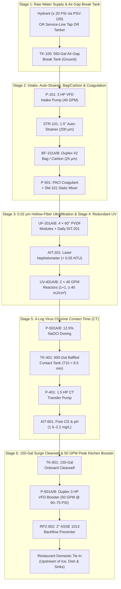
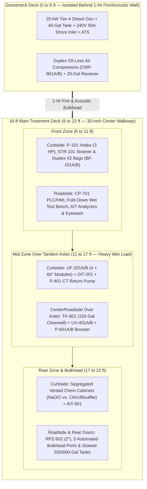

# MWTP-50 ("KitchenShield-50") — Compact Restaurant Mobile Water Treatment Unit

**Document ID:** `ENG-MWTP50-REST-01` — **Revision B (November 2026)**  
**Target Customer Base:** Commercial Kitchens, Full-Service Restaurants, Fast-Casual Chains, Hotel Kitchens, and Existing AmeriPro F.O.G. (Fats, Oils & Grease) / Exhaust Hood Cleaning Accounts  
**Rated Capacity:** **35 GPM Continuous Treatment (50,400 GPD)** | **50 GPM Peak Kitchen Booster Delivery (60–75 PSI)**  
**Mobility Platform:** **22-ft Tandem-Axle Compact Gooseneck Trailer (`16-ft` Main Deck + `6-ft` Gooseneck Deck)** — **9,990 lb GVWR (No Class A CDL Required)**

---

## 1. Strategic & Operational Rationale

### 1.1 Why a Dedicated 35–50 GPM Compact Gooseneck Unit for Restaurants?
While the flagship **MWTP-250 (250 GPM, 36-ft gooseneck, $601k build cost)** is engineered for multi-story acute-care hospitals, a typical full-service restaurant or commercial kitchen uses **2,500 to 8,000 gallons per day** (an average of **4 to 12 GPM** during operating hours) with short **25 to 50 GPM peak bursts** when the commercial dish machine, 3-compartment prep sinks, wok stations, and restroom flushometers operate simultaneously.

Building the **MWTP-50 ("KitchenShield-50")** first — or alongside the MWTP-250 — provides five decisive operational and commercial advantages for AmeriPro:

1. **No Class A CDL Required (Under 10,000 lb Trailer GVWR & Under 26,001 lb GCWR):**
   * Federal FMCSA regulations (`49 CFR § 383.91`) require a **Class A CDL** only when the combined Gross Combination Weight Rating (`GCWR`) is **26,001 lbs or more** inclusive of a towed unit with a `GVWR` of **more than 10,000 lbs**.
   * By packaging the MWTP-50 on a **22-ft tandem-axle compact gooseneck trailer (`16-ft` main deck + `6-ft` gooseneck deck)** factory-plated at **9,990 lb GVWR** and towing it with a standard **3/4-ton or 1-ton single-rear-wheel (SRW) pickup truck** (`F-250/F-350` or `Ram 2500/3500`, `10,000–11,500 lb GVWR` with factory gooseneck ball), the combined `GCWR` is **19,990 to 21,490 lbs**.
   * Federal rules count the truck's GCWR as the greater of the manufacturer's rating or the sum of the two GVWRs, and some 1-ton pickups carry a manufacturer GCWR above 26,000 lbs. That's still fine: a Class A CDL is only triggered when the towed unit is rated **over 10,000 lbs**, and this trailer is plated at 9,990 lbs.
   * **Result:** Any trained AmeriPro service technician or water operator with a **standard driver's license** and a basic **DOT medical card** (required for commercial combinations over 10,001 lb GCWR) can legally tow and position the trailer — eliminating the Class A CDL driver bottleneck.
2. **Tight Alley & Drive-Thru Maneuverability (Compact Gooseneck Advantage):**
   * Because the gooseneck coupler pivots directly over the 1-ton pickup's rear axle, the truck can make **near-90° jackknife turns** to back the 16-ft main box into tight restaurant service alleys, grease-trap lanes, and drive-thru corridors where a bumper-pull trailer would bind or swing wide.
   * Putting the **20 kW diesel generator, 40-gal fuel tank, and air compressors** on the **6-ft elevated gooseneck deck** behind a **1-hour fire and acoustic bulkhead wall** places **1,730 lbs (20%)** directly over the pickup's rear axle for sway-free highway handling and keeps engine noise and heat out of the treatment room.
3. **Fits in 2–3 Restaurant Parking Spaces:**
   * A 36-ft hospital trailer plus two 3,000-gallon pillow tanks takes up 4–6 parking stalls. The MWTP-50 and its compact 550-gal / 600-gal folding ground tanks fit into **two to three standard parking spaces** behind the kitchen next to the grease trap and backflow preventer.
4. **Can Run on Restaurant 240V 50A Shore Power OR Its Own 20 kW Generator:**
   * Because the MWTP-50's average electrical draw is only **8.25 kW (~34 Amps at 240V single-phase)**, during a **Boil Water Advisory** (when grid power is still on) the trailer can plug directly into a **240V 50A NEMA 14-50 / CS6365 receptacle** installed during the site survey — running silently with **zero diesel exhaust and zero fuel cost** right outside the dining patio. When grid power is out, the onboard **20 kW Tier-4 diesel generator** on the gooseneck deck carries the full load automatically.
5. **Direct Cross-Sell to Existing AmeriPro Restaurant Accounts:**
   * AmeriPro already services commercial kitchens for **F.O.G. (grease trap pumping)** and **exhaust hood cleaning**. The general manager, kitchen layout, back alley, sewer cleanout, and water shutoff are already known to AmeriPro's route teams.
6. **60% Lower Capital Cost ($238,625 vs. $601,450):**
   * Lower capital risk makes it easy to finance, faster to build, and an ideal platform to establish AmeriPro's **state drinking-water emergency-use approval** and operating track record.

---

## 2. Sizing Basis: Commercial Kitchen Hydraulic Profile

| Kitchen Fixture / Sub-System | Typical Flow Rate | Duty Cycle | Why Untreated / Boil-Water Tap Fails |
| :--- | :---: | :---: | :--- |
| **High-Temp / Chemical Dish Machine** | 12–18 GPM (fill/rinse bursts) | Intermittent (every 90 sec) | Requires ≥ 20 PSI dynamic flow (60 PSI line pressure); solenoid screens clog from main-break sediment. |
| **3-Compartment & Prep Sinks** | 8–15 GPM | Continuous during prep | Health code prohibits washing produce or dishes in unapproved water during a BWA. |
| **Ice Machines, Soda Fountain & Espresso** | 2–5 GPM | Continuous make-up | Ice and fountain drinks are direct ingestion hazards; 0.02 μm UF + UV + Cl₂ protects carbon filters and ice plates. |
| **Customer & Staff Restrooms** | 10–20 GPM (flushometer peaks) | Intermittent bursts | Tankless flushometer valves require **≥ 35–45 PSI at 15+ GPM** just to close properly. |
| **Combined Restaurant Profile** | **8–20 GPM Average** / **35 GPM Continuous** / **50 GPM Peak (3-min burst)** | **4,000–12,000 Gal/Day** | **MWTP-50 treats 35 GPM continuously and buffers 50 GPM peak bursts from its onboard 150-gal clearwell.** |

---

## 3. Non-CDL Weight & Axle Balance (`MWTP-50-GN22`)

> [!IMPORTANT]
> **How the MWTP-50 Stays Under 10,000 lb GVWR Both on the Road and On-Site:**
> The raw-water break tank (`TK-100`, 550 gal) and the baffled chlorine contact tank (`TK-401`, 600 gal) are **collapsible NSF-61 ground tanks deployed beside the trailer**, so 9,590 lbs of water rests on the pavement rather than on the trailer frame. On site, the onboard **150-gal clearwell (`TK-601`)** runs at its 85% control level (about 1,060 lbs of water), bringing the trailer to **9,820 lbs** — inside the **9,990 lb rating**. On the road the trailer weighs **8,670 lbs**, a 1,320 lb (13%) margin.
>
> **Builder spec:** the trailer's certified empty (tare) weight, including insulation, firewall, HVAC and jacks, must not exceed **3,600 lbs** (aluminum frame and skin). The builder's certified tare is checked before any equipment is ordered, and the rig is weighed on a certified scale after fit-out.

| Subsystem / Component | Road Transport Weight (lbs) | On-Site Operating Weight (lbs) | Location in Trailer |
| :--- | :---: | :---: | :--- |
| **22-ft Aluminum Gooseneck Trailer (`16-ft` Main + `6-ft` Neck, Insulation, 1-Hr Firewall, HVAC & Jacks; Dual 5,200 lb Torsion Axles Plated at 9,990 lb GVWR)** | 3,600 | 3,600 | Full Frame + 4 Corners |
| **Gooseneck Power & Air Deck: 20 kW Tier-4 Diesel Gen + 40-Gal Fuel + Duplex Air** | 1,450 | 1,450 | Gooseneck Deck (`0–6 ft`) |
| **Stage 1 & 2: Raw Intake Pump (`P-101`), Auto-Strainer (`STR-101`) & Duplex Bag Filters (`BF-101A/B`)** | 380 | 450 | Front Curbside (`6–11 ft`) |
| **Stage 3: Compact Hollow-Fiber UF Skid (4 × 60" Modules, Preserved Wet in Transit) + `DIT-201`** | 890 | 1,020 | Mid Curbside (`11–16 ft`) |
| **Stage 4 & 5: Duty/Standby 40 GPM UV (`UV-401A/B`), Segregated Chem Cabinets & Dosing Skid** | 420 | 470 | Mid Roadside (`11–16 ft`) |
| **Stage 6: 150-Gal Onboard Clearwell (`TK-601`), Duplex 3 HP Booster (`P-601A/B`) & 2" RPZ (`RPZ-602`)** | 590 | 1,650 | Over Axles (`12–17 ft`) |
| **316L SS Schedule 10/40 Piping, 12 Actuated Valves (`XV`), Hoses & Stowed Ground Tanks** | 720 | 560 | Distributed / Rear Reels |
| **Control Panel (`CP-701`), Analyzers (`AIT-201/401/402/601/901`), Fold-Down Test Bench & Eyewash** | 420 | 420 | Front Roadside (`6–11 ft`) |
| **Chemicals (Materials-of-Trade Limits: 15 gal 12.5% NaOCl, 5 gal Citric, 5 gal Bisulfite)** | 200 | 200 | Rear Curbside (`17–21 ft`) |
| **TOTAL ON-TRAILER WEIGHT** | **8,670 lbs** | **9,820 lbs** | **9,990 lb Max GVWR** |
| *Gooseneck Coupler Pin Weight (20% Road)* | *1,730 lbs* | *Supported by 4 Jacks* | *1-Ton SRW Truck Bed Ball* |
| *Tandem Axle Load (2 × 5,200 lb Axles = 10,400 lb Raw Capacity, Plated at 9,990 lb GVWR)* | *6,940 lbs* | *Supported by 4 Jacks* | *3,470 lbs per axle on road* |
| **Ground-Deployed Tanks (`TK-100` 550 gal + `TK-401` 600 gal)** | *(Stowed above: 160 lbs)* | **9,590 lbs (On Ground)** | **Next to Trailer on Pavement** |

---

## 4. Six-Stage Treatment Process & Disinfection Credit Basis

The MWTP-50 applies the exact same **multi-barrier UF + UV + Free Chlorine CT** engineering and regulatory rigor as Revision B of the MWTP-250, scaled to **35 GPM continuous treatment** and **50 GPM peak delivery**.

### Stage 1: Raw Water Supply (Three Restaurant Feed Options)
1. **Option 1A — Boil Water Advisory via a Pre-Installed Service-Line Tap (No Hydrant Required):**
   * During a Boil Water Advisory where the street main still has normal pressure (`40–70 PSI`), a restaurant only needs **15–35 GPM** (5,000–10,000 gal/day).
   * During the site survey, the restaurant's licensed plumber installs a **1.5" valved tee with a capped camlock** on the service line **between the meter and the building isolation valves**, with the water utility's approval. Hose bibbs and backflow test cocks are not used — test cocks can't pass 35 GPM, and most exterior bibbs sit downstream of the building shutoff.
   * **Double isolation:** the tie-in design puts **two closed valves** between the raw supply tee and the treated-water tie-in (the building isolation valve plus a second valve, or one valve leak-tested closed on each deployment), so raw advisory water and treated water can't mix through a single leaking valve.
   * Raw water from the tee runs through the trailer's **1.5" Pressure-Sustaining Valve (`PSV-100`, set at 20 PSI)** into the **550-gal Air-Gap Break Tank (`TK-100`)**.
2. **Option 1B — Fire Hydrant Supply (≥ 20 PSI Residual):**
   * Uses a 2.5" hydrant adapter, utility meter/backflow assembly, and `PSV-100` (set at 20 PSI) feeding `TK-100` through an air gap.
3. **Option 1C — Potable Tanker Delivery (When Main Has Zero Pressure):**
   * Because a typical restaurant only consumes **4,000 to 8,000 gallons per day**, a **single 4,000-gallon potable water tanker drop** (or a 2,000-gal nursery tank paired with `TK-100`) can keep a restaurant kitchen running for an entire shift during a complete water main break!

### Stage 2: Raw Intake & Pre-Filtration (35–40 GPM)
* **Raw Intake Pump (`P-101`):** Single 3 HP 316SS end-suction centrifugal pump on a VFD (40 GPM @ 55 PSI), drawing from `TK-100` via 2" camlock suction hose (`LIT-100` provides low-level pump protection).
* **Automatic Self-Cleaning Strainer (`STR-101`):** 1.5" motorized brush strainer (`200 μm` 316SS screen) to catch rust scale and pipe debris stirred up by main breaks.
* **Duplex #2 Bag / Cartridge Housings (`BF-101A/B`):** Two 316L SS single-bag #2 housings in parallel (1 Duty + 1 Standby, `25 μm` nominal).
  * *Restaurant Taste & Odor Bonus:* Either housing can accept a **high-flow radial-flow activated carbon block cartridge** (`#2` size, NSF-42/61) when operating on chlorinated city water during a Boil Water Advisory, polishing off musty pipe odors before coffee/ice/beverage use without the weight of heavy GAC pressure vessels.
* **Coagulant Micro-Flocculation (`P-501` + `SM-101`):** Peristaltic dosing pump injects 0.5–5 mg/L NSF-60 polyaluminum chloride (`PACl`) **downstream** of the bag filters into a 1.5" 316L SS static mixer (`SM-101`) when raw turbidity exceeds 5 NTU.

### Stage 3: Compact Hollow-Fiber Ultrafiltration (`UF-201A/B`)
* **Module Count & Vertical Clearance:** **4 × 60-inch (1.5 m) industrial PVDF hollow-fiber UF modules** (`0.02 μm` nominal pore size, outside-in flow, ~550 ft² active area per module = **2,200 ft² total membrane area**), arranged in **2 independent sub-trains of 2 modules each (`Train A` & `Train B`)**.
  * Using 60-inch modules instead of 79-inch hospital modules allows the entire UF skid to stand vertically with a **6.5-ft overall frame height**, fitting comfortably inside a standard **7.5-ft interior height trailer**!
* **Conservative Flux:** At **35 GPM net (37 GPM gross)** across 2,200 ft², the operating flux is **24.2 GFD** — keeping transmembrane pressure (`TMP`) at `8–22 PSI` and allowing one sub-train (2 modules) to sustain 25 GPM while the other sub-train backwashes for 40 seconds.
* **Automated Direct Integrity Testing (`DIT-201`):** Built-in oil-less air manifold runs an EPA Membrane Filtration Guidance Manual pressure-decay test at startup and every 24 hours (`≥ 4.0-log` Giardia and Cryptosporidium removal credit, NSF/ANSI 419 challenge-tested).
* **Continuous Laser Nephelometer (`AIT-201`):** Hach TU5300sc online laser turbidimeter monitors UF filtrate (`< 0.05 NTU` normal; automatic divert to waste at `> 0.15 NTU` for 5 seconds).

### Stage 4: 100% Redundant UV Disinfection (`UV-401A/B`)
* **Configuration:** **2 × 40 GPM 316L SS low-pressure high-output (LPHO) amalgam UV reactors (`UV-401A` Duty + `UV-401B` 100% Standby)**, third-party validated under the **EPA UV Disinfection Guidance Manual (UVDGM)** for **≥ 40 mJ/cm² RED** at 40 GPM and 85% UVT.
* **Online UVT Monitor (`AIT-401`) & Duty-Swap:** If `UV-401A` UV intensity drops or a lamp faults, `UV-401B` opens and takes over automatically without interrupting kitchen water pressure.

### Stage 5: Chlorination, Segregated Chemical Cabinets & 600-Gal Contact Tank (`TK-401`)
* **Segregated Chemical Storage & Ventilation:**
  * Two separate, vented, bunded polyethylene safety cabinets at the rear curbside wall (`17–21 ft`):
    * **Cabinet A (Oxidizer):** 15-gal day tank of 12.5% sodium hypochlorite (`NaOCl`) + dual redundant peristaltic dosing pumps (`P-502A/B`).
    * **Cabinet B (Acid / Reductant):** 5-gal citric acid tote (`P-504` for UF CIP) and 5-gal sodium bisulfite tote (`P-503` for waste dechlorination), physically separated so an oxidizer and acid leak can never mix to generate chlorine gas.
  * Equipped with a **wall-mounted `Cl₂` gas sensor (`AIT-901`)**, continuous 150 CFM exterior exhaust fan, and an **ANSI Z358.1 plumbed eyewash/drench hose** supplied with tempered clearwell water.
* **Measured 4-Log Virus `CT` Verification (`TK-401`):**
  * Chlorinated permeate flows through a 2" white NSF-61 hose into **`TK-401`**, a **600-gallon collapsible baffled NSF-61 potable contact tank** deployed on the ground beside the trailer (footprint: `5.5 ft × 5.5 ft`).
  * **CT Math at 35 GPM Rated Flow:**
    * **Hydraulic Detention Time (`HDT`):** `600 gal ÷ 35 GPM = 17.1 min`
    * **Effective Contact Time (`T10` with `0.50` serpentine baffling factor):** `17.1 min × 0.50 = 8.57 min`
    * **Achieved `CT` at `1.5 mg/L` Free Chlorine:** `1.5 mg/L × 8.57 min = 12.85 mg·min/L`
    * Even in near-freezing water (**0.5 °C, pH 6–9**), the EPA SWTR 4-log virus requirement is **12.0 mg·min/L** (and at typical 15 °C restaurant tap water, required CT is only **4.0 mg·min/L**, giving a **3.2× safety margin**).
  * **Contact Tank Transfer Pump (`P-401`):** A dedicated 1.5 HP 316SS VFD pump draws CT-verified water from `TK-401` past the **`AIT-601` Free Chlorine & pH Analyzer** into the onboard clearwell `TK-601`.

### Stage 6: Onboard 150-Gal Surge Clearwell & 50 GPM Duplex Kitchen Booster
* **Onboard Clearwell (`TK-601`):** **150-gallon heavy-wall NSF-61 HDPE tank** with internal anti-slosh baffles, mounted directly over the tandem axles.
  * *Why 150 gallons on board?* While the treatment plant runs steadily at 35 GPM through the contact tank, a restaurant kitchen experiences short 1–3 minute bursts of **45–50 GPM** when the dish machine fills while toilets flush and prep sinks run. The 150-gal clearwell provides a 10-minute surge cushion for a 15 GPM deficit so the contact tank (`TK-401`) never gets pulled faster than its rated `T10` flow!
* **Duplex VFD Booster Skid (`P-601A/B`):** **2 × 3 HP vertical multi-stage 316SS centrifugal pumps** (`2 × 25 GPM = 50 GPM` combined capacity @ `60–75 PSI`, or `30 GPM` single-pump redundancy), modulated by remote building pressure transducer **`PT-603`**.
* **Potable Cross-Connection Protection (`RPZ-602`):** **2" ASSE 1013 Lead-Free Bronze/316SS Reduced Pressure Zone (RPZ) backflow preventer** inside the heated trailer prior to the 2" and 1.5" rear potable discharge bulkheads.

---

## 5. Trailer Layout (`MWTP-50-GN22`: 16-ft Main Deck + 6-ft Gooseneck Deck)

* **Main Box Dimensions:** `16 ft` main deck length × `8.0 ft` exterior width (`7.5 ft` interior width) × `7.5 ft` interior ceiling height (about `10 ft 3 in` overall road height). Many drive-thru clearance bars are 9'0"–9'6", so the trailer stays out of drive-thru lanes and covered canopies; overhead clearance is checked on every site survey.
* **Gooseneck Nose Deck (`0–6 ft`):** `6 ft` elevated deck over the pickup bed (`22 ft` total trailer length), separated from the main treatment room by a **1-hour fire-rated & acoustic bulkhead wall** (`< 65 dBA` inside the treatment bay).
* **Stabilization:** Four heavy-duty 5,000-lb electric/hydraulic corner stabilizer jacks + dual 12,000-lb gooseneck landing gear.

### Rear Camlock Bulkhead Panel (5 Color-Coded Ports)
1. **`RAW INLET A` (2" Male Camlock — Blue):** Suction from `TK-100` (550-gal ground break tank).
2. **`HYDRANT / TAP INLET` (1.5" Male Camlock — Blue):** Raw city water inlet through onboard `PT-100` + `PSV-100` (20 PSI sustaining valve) + `XV-100` out to `TK-100` air-gap fill nozzle.
3. **`CT OUT` / `CT RETURN` (2" Camlock Pair — White):** Loop to and from the 600-gal baffled ground contact tank `TK-401`.
4. **`POTABLE OUTLET A` (2" & 1.5" Male Camlock — White, NSF-61):** Pressurized kitchen supply (60–75 PSI) downstream of `RPZ-602` and fail-safe block valve `XV-602`.
5. **`WASTE / BACKWASH OUTLET` (2" Male Camlock — Gray):** Dechlorinated UF backwash and flush discharge to the restaurant's sanitary sewer cleanout (never to the grease trap, so high-flow flush water doesn't emulsify or wash out the grease interceptor!).

> [!CAUTION]
> **F.O.G. / Grease Interceptor Protection Rule:** Never discharge UF backwash or startup flush water (`35–60 GPM`) into the kitchen's upstream grease interceptor inlet! High-flow clear water will wash trapped fats, oils, and grease through the interceptor into the city sewer. Always connect the 2" gray waste hose to the **downstream sanitary sewer cleanout** (on the street side of the grease trap) identified during the AmeriPro site survey.

---

## 6. Dual-Mode Electrical Power Budget (240V Single-Phase)

Unlike the MWTP-250 (which requires 480V 3-phase for 15 HP motors), every motor on the MWTP-50 is **≤ 3 HP** and driven by a **VFD that accepts 240V single-phase input and outputs 230V 3-phase to the motor**. This allows the entire trailer to run on **standard 240V single-phase power**!

| Electrical Load | Motor / Lamp Rating | Normal Running kW (35 GPM) | Peak kW (50 GPM Burst / Backwash) |
| :--- | :---: | :---: | :---: |
| **Raw Intake Pump (`P-101`, VFD)** | 3.0 HP | 1.60 kW | 2.20 kW |
| **CT Transfer Pump (`P-401`, VFD)** | 1.5 HP | 0.85 kW | 1.10 kW |
| **Duplex Kitchen Booster (`P-601A/B`, VFD)** | 2 × 3.0 HP | 2.10 kW (1 pump @ 35 GPM) | 4.40 kW (2 pumps @ 50 GPM) |
| **UV Reactor (`UV-401A` Duty)** | 1 × 450 W | 0.45 kW | 0.45 kW |
| **Instrument Air Compressor (`CMP-801A`, Intermittent)** | 1.5 HP | 0.35 kW (avg) | 1.20 kW |
| **PLC, Analyzers, Dosing Pumps & LED Lighting** | 120V Branch | 0.50 kW | 0.65 kW |
| **Roof Heat Pump HVAC / Electric Freeze Heater** | 13,500 BTU | 2.40 kW | 3.10 kW |
| **TOTAL ELECTRICAL DEMAND** | — | **8.25 kW (~34.4 A @ 240V)** | **13.10 kW (~54.6 A @ 240V)** |

### Two Power Operating Modes
1. **Mode A — 240V 50A Shore Power Plug (Boil Water Advisory with Grid Power On):**
   * Plugs into a pre-installed exterior **240V 50A twist-lock receptacle** at the restaurant.
   * When switched to `50A SHORE MODE` on the HMI, the PLC caps simultaneous peak draw at **40 Amps (9.6 kW)** by pausing HVAC compressor cycling during brief 45-second backwashes — running **100% silently with $0 fuel burn**.
2. **Mode B — Onboard 20 kW Tier-4 Diesel Generator (Power Outage or No Shore Plug):**
   * Ultra-quiet liquid-cooled **20 kW (1,800 RPM) Tier-4 Final diesel generator** (`62 dBA @ 23 ft`) mounted on the 6-ft elevated gooseneck deck.
   * **Fuel Consumption:** At 8.25 kW average load (~41% load), burns **0.85 gal/hr**. The **40-gallon belly tank** provides **47 hours of continuous runtime** between refuelings.

---

## 7. Itemized Bill of Materials (BOM) & Turnkey Cost Breakdown (`MWTP-50-GN22`)

*Note: Budget estimates for one **MWTP-50-GN22** unit. Obtain formal vendor quotes prior to final loan underwriting.*

| Category | Subsystem Description | Equipment Cost (USD) | % of Hardware |
| :--- | :--- | :---: | :---: |
| **1.0** | **22-ft Tandem-Axle Compact Gooseneck Trailer (`16-ft` Main + `6-ft` Neck, 9,990 lb GVWR), FRP Walls, 1-Hr Firewall & 4 Corner Jacks** | $31,000 | 18.1% |
| **2.0** | **Stage 1 & 2: Hydrant/Tap Kit (`PSV-100`), 550-Gal Break Tank (`TK-100`), 3 HP Intake (`P-101`), 1.5" Auto-Strainer & Duplex #2 Bag/Carbon Housings** | $15,200 | 8.9% |
| **3.0** | **Stage 3: Compact Hollow-Fiber UF Skid (4 × 60" PVDF Modules, 2,200 ft²) + Automated `DIT-201` Skid** | $26,500 | 15.5% |
| **4.0** | **Stage 4 & 5: 2 × 40 GPM UV Reactors (`UV-401A/B`), Dosing Pumps, Segregated Chem Cabinets, 600-Gal Contact Tank (`TK-401`) & `P-401`** | $23,400 | 13.7% |
| **5.0** | **Stage 6: 150-Gal Onboard Clearwell (`TK-601`), Duplex 3 HP VFD Booster (`P-601A/B`) & 2" ASSE 1013 RPZ (`RPZ-602`)** | $14,800 | 8.6% |
| **6.0** | **316L SS Process Piping (1.5"–2"), 12 Actuated Ball Valves (`XV`), Camlock Bulkhead & Sanitized Hose Kit** | $16,500 | 9.6% |
| **7.0** | **UL-508A PLC/HMI (`CP-701`), Online Laser Turbidimeter (`AIT-201`), Free Cl₂/pH (`AIT-402/601`), Cl₂ Gas Sensor & Eyewash** | $22,400 | 13.1% |
| **8.0** | **20 kW Tier-4 Diesel Generator (1,800 RPM), 40-Gal Tank, 50A Shore Inlet/ATS & Duplex Oil-Less Air (`CMP-801A/B`)** | $21,700 | 12.7% |
| — | **SUBTOTAL — MAJOR EQUIPMENT & MATERIALS** | **$171,500** | **100.0%** |
| **9.0** | **System Integration, 316L SS Sanitary/Socket TIG Welding, Panel Wiring & Factory Acceptance Test (FAT)** | $24,000 | — |
| **10.0** | **Engineering: PE Basis-of-Design Report, Stamped P&IDs & State Emergency-Use Plan Submittal** | $12,000 | — |
| **11.0** | **Contingency (15% of items 1.0–10.0)** | $31,125 | — |
| — | **TOTAL TURNKEY BUILD COST (Single `MWTP-50-GN22` Unit)** | **$238,625** | — |

---

## 8. Commercial Model & Unit Economics for AmeriPro Restaurant Accounts

### 8.1 Total Capital Requirement & SBA Financing
Because AmeriPro may already have 3/4-ton or 1-ton pickups in its fleet, we show both **with a dedicated new 1-ton SRW tow truck** (with factory gooseneck prep) and **using an existing fleet truck**:

| Financing Scenario | Turnkey Trailer | Tow Vehicle (F-350 SRW Gooseneck) | Working Capital & Spares | Total Project Cost | 15% Equity | 85% SBA Loan (8.75%, 10 Yr) | Annual Debt Service |
| :--- | :---: | :---: | :---: | :---: | :---: | :---: | :---: |
| **Option A: With Dedicated New 1-Ton Truck** | $238,625 | $62,000 | $24,375 | **$325,000** | $48,750 | $276,250 | **$41,547 / yr** ($3,462/mo) |
| **Option B: Using Existing AmeriPro Pickup** | $238,625 | $0 (Fleet) | $21,375 | **$260,000** | $39,000 | $221,000 | **$33,238 / yr** ($2,770/mo) |

### 8.2 Who Buys This, and Restaurant-Friendly Pricing
**Most restaurants don't have to close during a Boil Water Advisory.** Health departments usually let them stay open on workarounds — bottled water, bagged ice, disposable service ware, and a limited menu — with ice machines, fountain drinks and some prep shut down. The `MWTP-50` is worth the most where those workarounds break down or cost more than the deployment:
* **High-volume full-service restaurants and hotel kitchens** (warewashing, ice and beverage volume that bottled water can't cover).
* **Multi-unit chains and franchise groups** with brand standards that don't allow a degraded menu.
* **Institutional kitchens** — nursing homes, assisted living, schools, and correctional facilities — that can't send residents elsewhere.
* **Food processors and commissaries** whose production lines stop without potable water.

1. **Annual "KitchenShield" Standby Retainer (Bundled with AmeriPro F.O.G. / Hood Accounts):**
   * **$1,800 / year** per single location ($150/month added to the monthly hood/grease invoice).
   * **$1,500 / year per location** for multi-unit groups of 2 or more stores ($125/month per store).
   * **Capacity cap:** each `MWTP-50` unit carries **no more than 10 covered locations per region**, ranked in call order that is written into every agreement. One unit serves one kitchen at a time, so a regional advisory reaches retainer holders in that order; more covered locations means another unit (§8.4).
   * *Includes:* Initial plumbing & backflow site survey, pre-installed raw-supply tee and camlock adapter kit, pre-written Health Department Alternate Water Operations Plan, and annual check.
2. **Emergency Mobilization & Hose Sanitization Fee:**
   * **$2,500 flat fee** (covers towing, ground tank setup, 50 mg/L hose disinfection, DIT test, and initial Bac-T lab sample).
3. **Active Emergency Treatment Rate:**
   * **$3,200 per 24-hour day.** Non-retainer customers can also call for service at the same rates when a unit is free.
   * **Staffing model:** a state-certified operator is on site through the restaurant's service hours (about 12 hours). Overnight, when the kitchen is closed, the unit runs **unattended on cellular telemetry** with automatic outlet lockout (`XV-602`) on any alarm and an on-call operator who responds within one hour. The state's emergency-use approval sets the final attendance requirement.
   * **Direct Daily Operating Cost to AmeriPro:** **$749 / day** on generator ($480 attended operator shift + $100 overnight on-call/telemetry = $580/day labor; 20 gal diesel = $80/day; chemicals & Bac-T lab = $89/day), or **$669 / day** on restaurant shore power → **76.6%–79.1% direct margin ($2,451–$2,531/day net contribution)**.

### 8.3 Standalone 3-Year Pro-Forma & DSCR (Single `MWTP-50-GN22` Unit)

| Financial Metric | Year 1 (8 Covered Locations, 25 Active Days) | Year 2 (10 Locations — Cap, 45 Active Days) | Year 3 (10 Locations — Cap, 60 Active Days) |
| :--- | :---: | :---: | :---: |
| **Annual Standby Retainers ($1,800 single / $1,500 per group store)** | $12,900 *(3 single + 5 group)* | $16,200 *(4 single + 6 group)* | $16,200 *(4 single + 6 group)* |
| **Mobilization Fees ($2,500 × deployments)** | $15,000 (6 events) | $25,000 (10 events) | $35,000 (14 events) |
| **Active Treatment Days ($3,200 / day)** | $80,000 (25 days) | $144,000 (45 days) | $192,000 (60 days) |
| **GROSS REVENUE** | **$107,900** | **$185,200** | **$243,200** |
| **Direct Deployment COGS ($749/day + $450/mob)** | ($21,425) | ($38,205) | ($51,240) |
| **Fixed Overhead (Insurance, Storage, Annual Membrane/UV Service)** | ($28,000) | ($29,500) | ($31,000) |
| **NET OPERATING INCOME (EBITDA)** | **$58,475** | **$117,495** | **$160,960** |
| **Annual Debt Service (Option A w/ New Truck: $276.25k Loan)** | $41,547 | $41,547 | $41,547 |
| **DEBT SERVICE COVERAGE RATIO (DSCR — Option A)** | **1.41×** | **2.83×** | **3.87×** |
| **DEBT SERVICE COVERAGE RATIO (DSCR — Option B Existing Truck)** | **1.76×** | **3.53×** | **4.84×** |

> [!TIP]
> **What carries the loan:** Retainers are steady, but with the 10-location cap they cover about **20% of fixed costs plus debt service** — deployments carry the rest. About **seven 3-day restaurant deployments a year** (Option B, existing truck) cover all fixed costs and the loan payment with no retainers at all. Every deployment also builds AmeriPro's state regulatory track record toward the hospital-grade `MWTP-250`.

### 8.4 Growing Into a Fleet
Because one unit serves one kitchen at a time, coverage grows by adding units, not by selling more retainers on the same trailer. Each additional `MWTP-50` ($238,625 turnkey, towed by an existing fleet pickup) adds **10 more covered locations** and its own deployment capacity, and can be financed on its own track record. A fleet of two or three units also lets AmeriPro keep one unit available for walk-in emergency calls during a regional advisory.
