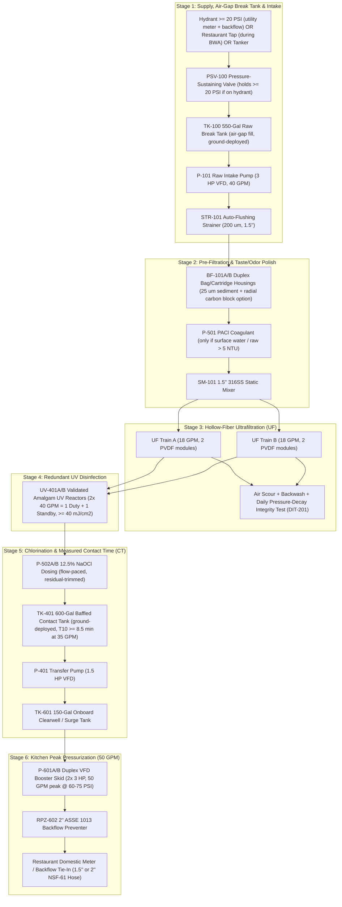

# Engineering Design Package, BOM & Unit Economics: MWTP-50 Compact Restaurant Water Treatment Trailer

**Model:** `MWTP-50-BP18` (35 GPM Continuous Treatment / 50 GPM Peak Kitchen Booster)  
**Target Market:** Full-service restaurants, multi-unit franchise groups, hotel kitchens, commissaries, dialysis/urgent-care clinics, and small food processors (AmeriPro F.O.G. & hood-cleaning accounts).  
**Regulatory & Design Standard:** Applies all **Rev B** engineering safeguards (air-gap break tank, ≥ 20 PSI hydrant residual protection, NSF/ANSI 419 UF with daily pressure-decay integrity test, EPA UVDGM-validated UV, measured 4-log virus chlorine contact time, and dechlorinated sewer waste) in a **Non-CDL 18-ft Bumper-Pull Trailer (9,990 lb GVWR)**.

> [!IMPORTANT]
> **Basis-of-design status:** Like the MWTP-250, this package is a concept design. Before fabrication it requires (1) a basis-of-design review and stamped drawings by a licensed water-treatment PE, (2) a pre-application meeting and plan review with the state drinking water program (Georgia EPD Drinking Water Program in our home state), and (3) written vendor dimension, weight, and price quotes. Items marked **[VERIFY]** depend on those.

---

## 1. Why the MWTP-50 Fits AmeriPro’s Restaurant Base Better Than the MWTP-250

| Design Parameter | MWTP-250 (Hospital / Municipal Unit) | MWTP-50 (Restaurant / Commercial Kitchen Unit) | Why It Matters for Restaurants |
| :--- | :--- | :--- | :--- |
| **Treatment Flow / Peak Flow** | 250 GPM continuous (360,000 GPD) | **35 GPM continuous (50,400 GPD) / 50 GPM peak booster** | A busy full-service restaurant uses **2,500–5,000 GPD** with short **15–45 GPM peaks** when dishwashers, flushometer toilets, and prep sinks run together. 35 GPM treatment + 50 GPM booster covers even a large 300-seat restaurant or 2–3 adjacent strip-mall kitchens. |
| **Trailer Footprint** | 36-ft Triple-Axle Gooseneck + Class 5 Truck (~58 ft combined) | **18-ft Tandem-Axle Bumper-Pull** + 3/4-Ton Pickup (~38 ft combined) | Fits in **2 standard parking spaces** or tight restaurant service alleys without blocking drive-thrus or customer parking. |
| **GVWR / GCWR & Driver License** | 30,000 lb Trailer + 19,500 lb Truck = 49,500 lb GCWR (**Class A CDL Required**) | **9,990 lb Trailer GVWR** + 10,000–11,500 lb Truck GVWR = **≤ 21,490 lb GCWR** (**Standard Non-CDL Driver’s License**) | Under FMCSA 49 CFR § 383.91, keeping trailer GVWR ≤ 10,000 lbs and combined GCWR ≤ 26,000 lbs means **any trained AmeriPro water operator/technician can tow it without a Class A CDL**. |
| **Ground Tank Footprint** | Two 3,000-gal frame tanks (`TK-100` + `TK-401`) | **550-Gal Raw Break Tank (`TK-100`)** + **600-Gal Baffled Contact Tank (`TK-401`)** | Compact 6-ft diameter collapsible frame tanks set up in a single parking stall in 15 minutes; drain and fold in 20 minutes. |
| **Setup Time (Pre-Surveyed Site)** | ~3.0 Hours | **~60 to 90 Minutes** | Smaller hoses (`1.5"`–`2"`) and smaller 550/600-gal tanks fill and turn over for CT verification 5× faster than 3,000-gal tanks. |
| **Turnkey Build Cost (w/ 15% Cont.)** | **$601,450** | **$192,050** (< 1/3 the capital cost) | Can build **3 MWTP-50 units** (covering 3 restaurants simultaneously) for less than the cost of a single MWTP-250. |
| **Daily Fuel + Consumables OpEx** | $450.85 / day (80 kW gen @ 3.1 gal/hr) | **$148.50 / day** (20 kW gen @ 0.85 gal/hr, or runs on a **50A 240V shore plug**) | Small enough to plug into a restaurant’s existing **240V 50A range/welder/RV receptacle**, cutting generator fuel to $0 when power is on during a Boil Water Advisory! |

---

## 2. Process Flow Diagram (PFD) & Disinfection Credit Basis

### 2.1 6-Stage Process Architecture (35 GPM Treatment / 50 GPM Peak)



### 2.2 Three Practical Raw-Water Feed Modes for Restaurants
1. **Mode A — Restaurant’s Own Tap During a Boil Water Advisory (Most Common):**
   * During a Boil Water Advisory, the restaurant’s domestic service line usually still has normal flow (25–50 GPM) and pressure (35–60 PSI), just microbiological risk.
   * We close the downstream valve entering the kitchen, divert the restaurant's raw tap water (upstream of the shutoff) into `TK-100` via an air gap, treat it through UF + UV + CT, and feed it back into the kitchen side of the union at 65 PSI. **No fire hydrant permit required!**
2. **Mode B — Nearby Fire Hydrant (≥ 20 PSI Residual):**
   * Connected through utility hydrant meter + backflow + `PSV-100` (set at 20 PSI) into `TK-100`.
3. **Mode C — Total Water Main Outage (Tanker Shuttle):**
   * Because a single restaurant only uses **2,500–4,000 gallons per day**, **one 4,000-gallon potable/raw tanker drop per day** into a ground bladder tank keeps the restaurant open all day—unlike a hospital that would need 25+ tankers/day.

### 2.3 Disinfection Credit & Live 4-Log Virus CT Verification
* **Cryptosporidium & Giardia:** 4 × PVDF 0.02 μm hollow-fiber UF modules (**NSF/ANSI 419** challenge-tested) verified daily by an automated **Pressure-Decay Direct Integrity Test (`DIT-201`)**, plus **EPA UVDGM-validated** UV (`UV-401A/B`, ≥ 40 mJ/cm² with online UVT sensor `AIT-401`).
* **4-Log Virus Credit via Chlorine CT (`TK-401`):**
  * At 35 GPM continuous treatment flow, the **600-gallon baffled contact tank (`TK-401`)** provides **17.1 minutes** of hydraulic residence time.
  * With internal serpentine baffle curtains (baffle factor = 0.5), **`T10 = 8.5 minutes`**.
  * At a **1.5 mg/L** free chlorine residual (pH 6–9), achieved **CT = `12.8 mg·min/L`** — which meets EPA 4-log virus inactivation all the way down to **0.5 °C (near freezing)** (`12.0 mg·min/L` required at 0.5 °C; `6.0` at 10 °C; `3.0` at 20 °C).
  * Meanwhile, the onboard **150-gallon clearwell (`TK-601`)** absorbs short **50 GPM peak bursts** (e.g., 3 minutes of simultaneous toilet flushing + dishwasher fill) while the UF/CT train runs steady at ≤ 35 GPM so contact time is never compromised.

---

## 3. Equipment Schedule & Sizing (MWTP-50)

* **Intake & Pre-Filtration:**
  * `TK-100`: 550-gal collapsible open-top frame tank (NSF-61 liner, cover, air-gap float/level `LIT-100`).
  * `P-101`: 3.0 HP 316SS self-priming centrifugal pump with VFD (40 GPM @ 110 ft TDH).
  * `STR-101`: 1.5" automatic self-cleaning 200 μm wedge-wire strainer.
  * `BF-101A/B`: Duplex 304SS housings taking standard #2 25 μm felt bags (or radial-flow NSF-42 carbon cartridges during Boil Water Advisories on chlorinated city water to polish taste/odor before ice/beverage machines, upstream of `P-501`).
* **Ultrafiltration Skid (`UF-201A/B`):**
  * **4 × PVDF 0.02 μm Hollow-Fiber Modules** (2 per train, ~500–600 ft² each = ~2,200 ft² total area; e.g., compact 1.5-meter / 60-inch vertical modules that fit comfortably under a **7.5-ft trailer ceiling**).
  * **Flux:** 23 GFD at 35 GPM (very conservative flux; single train can carry 25 GPM during a 45-second backwash).
  * **Backwash & DIT:** 2.0 HP 316SS backwash pump (`P-202`, 45 GPM @ 40 PSI), 1.0 HP oil-free air scour blower (`BL-201`), 35-gal CIP tank (`TK-203`, 3 kW heater), and automated pressure-decay panel (`DIT-201`). Stored wet in bisulfite/glycol preservative between jobs.
* **UV, Chemical Room & Contact Tank:**
  * `UV-401A/B`: **2 × 40 GPM LPHO Amalgam UV Reactors (1 Duty + 100% Standby)**, EPA UVDGM validated ≥ 40 mJ/cm², with online UVT monitor (`AIT-401`).
  * `CHEM-501`: Segregated oxidizer (`NaOCl`) and acid/reducer (`NaHSO3` waste dechlorination + citric acid) cabinets with individual containment, exhaust fan, chlorine gas detector (`AIT-901`), and plumbed **ANSI Z358.1 eyewash/drench station**.
  * `TK-401` & `P-401`: 600-gal baffled NSF-61 contact tank deployed beside trailer + 1.5 HP self-priming transfer pump (`P-401`, 40 GPM @ 40 ft) feeding the onboard clearwell.
* **Clearwell & Kitchen Pressurization (`TK-601`, `P-601A/B`, `RPZ-602`):**
  * `TK-601`: 150-gal rectangular XLPE baffled clearwell in steel frame.
  * `P-601A/B`: **Duplex VFD Vertical Multistage 316SS Booster Skid (2 × 3.0 HP)** — 1 pump holds 0–35 GPM; both pumps run in parallel for **50 GPM peak bursts at 65–75 PSI**, controlled by remote building pressure sensor `PT-603`, with a 35-gal ASME bladder tank.
  * `RPZ-602`: 2" lead-free ASSE 1013 Reduced Pressure Zone backflow preventer.

---

## 4. 18-ft Bumper-Pull Trailer Layout & Non-CDL Weight Budget

### 4.1 Spatial Architecture (Top-Down Schematic)
* **Chassis:** **18-ft × 8-ft Enclosed Tandem-Axle Bumper-Pull Trailer** + 3-ft V-Nose (21 ft total box length; 7.5 ft interior height).
* **Axles & Hitch:** Dual **5,200 lb torsion axles** with electric brakes, derated/plated at **9,990 lb GVWR** (2-5/16" heavy-duty adjustable pintle/ball coupler + 4-corner drop-leg stabilizer jacks).

```
                 +-----------------------------------------------------------------------------------+
                 |                      18-FT TANDEM-AXLE MAIN BOX (8.0 FT WIDE)                     |
    3-FT V-NOSE  | +----------------+  +-----------------------+  +--------------+  +--------------+ |
   (Fire-Sep Gen)| | PLC / 12" HMI  |  |  UF SKID TRAINS A/B   |  | SEGREGATED   |  | 150-GAL      | |
  +------------+ | | LASER TURB,    |  |  (4x 60" PVDF Modules |  | CHEM CABINETS|  | CLEARWELL    | |
 / 20 kW DIESEL| | | CL2 & UVT      |  |   + DIT-201 Panel)    |  | (Vented +    |  | TANK         | |
/   GENERATOR  | | | + EYEWASH      |  |  [OVER TANDEM AXLES]  |  |  Cl2 Sensor) |  | (TK-601)     | |
|  + 40-Gal    | | +----------------+  +-----------------------+  +--------------+  +--------------+ |
|  Fuel Tank   | |   [Side Door]                                                                     |
|  + Duplex    | |=================================[30" CENTER AISLE]================================|
\  1 HP Air    | | +----------------+  +-----------------------+  +--------------+  +--------------+ |
 \ Compressors | | | P-101 INTAKE   |  | 2x 40 GPM UV REACTORS |  | STOWED TK-100|  | DUPLEX 3 HP  | |
  +------------+ | | AUTO STRAINER  |  | (1 Duty + 1 Standby)  |  | & TK-401     |  | VFD BOOSTERS | |
                 | | & DUPLEX BAGS  |  | + P-202 BW & CIP TANK |  | FRAME TANKS  |  | + 2" RPZ-602 | |
                 | +----------------+  +-----------------------+  +--------------+  +--------------+ |
                 +-----------------------------------------------------------------------------------+
                                          |<-- TANDEM AXLES -->|                    [Rear Bulkhead]
```

### 4.2 Non-CDL Weight Budget (9,990 lb GVWR Limit)

> [!IMPORTANT]
> Keeping the wet road weight around **8,250 lbs** leaves **1,740 lbs of safety margin** below the **9,990 lb GVWR** threshold, and keeps the on-site operating weight (with the 150-gal clearwell full and both 550/600-gal tanks deployed on the ground) at **9,450 lbs** — so even the fully wet trailer stays under its 9,990 lb axle rating! **[VERIFY all weights with vendor sheets.]**

| Subsystem / Zone | Location | Road Weight (lbs) | Wet Weight on Trailer (lbs) |
| :--- | :--- | :---: | :---: |
| **18-ft + 3-ft V-Nose Tandem-Axle Trailer** (Insulated R-10, aluminum frame/floor, V-nose firewall, HVAC, stabilizer jacks) | Full Chassis | 3,450 | 3,450 |
| **20 kW Tier-4 Diesel Generator + 40-Gal Fuel + Duplex 1 HP Air** | V-Nose Compartment | 1,480 | 1,480 |
| **PLC/HMI Cabinet, Online Analyzers (Turbidity, Cl₂, UVT) & Eyewash** | Front Curbside | 380 | 410 |
| **Intake Pump (3 HP), 1.5" Auto-Strainer, Duplex Bags & SS Piping** | Front Streetside | 460 | 580 |
| **UF Skid (4 Modules preserved wet), DIT Panel, BW Pump, 35-Gal CIP** | **Center Over Axles** | 980 | 1,180 |
| **2 × 40 GPM UV Reactors + Segregated Chemical Cabinets (MOT stock)** | Center / Rear-Mid | 490 | 640 |
| **150-Gal Clearwell (`TK-601`) + Duplex 3 HP Boosters + `P-401` + 2" RPZ** | Rear Deck | 660 | 1,710 |
| **Stowed 550-Gal (`TK-100`) & 600-Gal (`TK-401`) Tanks + Hose Kit** | Rear-Mid Rack | 350 | 0 (on ground) |
| **TOTAL TRAILER WEIGHT** | **GVWR: 9,990 lbs** | **8,250 lbs (Road Safe)** | **9,450 lbs (On Site)** |

* **Tongue Weight:** ~1,070 lbs (~13% of road weight) — easily handled by a standard **Class 2b/3 Pickup (Ford F-250 / F-350 SRW or Ram 2500 / 3500 SRW)** with a 10,000–11,500 lb GVWR.
* **Why No CDL Is Required:** Truck GVWR (10,000–11,500 lb) + Trailer GVWR (9,990 lb) = **19,990–21,490 lb GCWR** (< 26,001 lb federal CDL threshold, and trailer ≤ 10,000 lb GVWR). *(Note: Over 10,001 lb combined GCWR in commercial interstate/intrastate commerce still requires a USDOT number and a DOT medical card for the driver, which takes a simple 30-minute physical exam rather than a Class A CDL school/test.)*

---

## 5. Electrical Load & Dual Power Options (Generator or 50A 240V Plug)

| Equipment Item | Rating | Running (kW) | Duty Cycle | Avg Load (kW) |
| :--- | :--- | :---: | :---: | :---: |
| Raw Intake Pump (`P-101`, VFD) | 3.0 HP | 2.1 kW | 100% | 2.1 kW |
| Contact Tank Transfer Pump (`P-401`, VFD) | 1.5 HP | 1.1 kW | 100% | 1.1 kW |
| Duplex Kitchen Booster (`P-601A/B`, 1 duty avg / 2 peak) | 2 × 3.0 HP | 4.2 kW peak | 60% avg | 2.5 kW |
| UF Backwash Pump (`P-202`) + Air Scour Blower (`BL-201`) | 2 HP + 1 HP | 2.2 kW | 5% | 0.1 kW |
| UV Reactor (1 duty of 2) | 0.45 kW | 0.45 kW | 100% | 0.45 kW |
| Duplex 1 HP Oil-Free Air Compressors + Dryer | 1.0 HP duty | 0.8 kW | 20% | 0.2 kW |
| PLC, Analyzers, Metering Pumps, LED Lighting | 120V | 0.8 kW | 100% | 0.8 kW |
| Trailer Heat Pump HVAC (12,000 BTU) + Chem Exhaust | 1.4 kW | 1.4 kW | 70% | 1.0 kW |
| **TOTAL ELECTRICAL DEMAND** | — | **Peak: 13.1 kW** | — | **Avg: 8.25 kW** |

* **Power Option 1 — Restaurant 240V 50A Shore Power (`12.0 kW` continuous):** Because average load is only **8.25 kW (~34 Amps at 240V single-phase)**, during a Boil Water Advisory where grid power is still on, the trailer can plug directly into a **NEMA 14-50 (50A 240V)** receptacle or subpanel!
* **Power Option 2 — Onboard 20 kW Tier-4 Diesel Generator:** Consumes just **~0.85 gal/hr** at 8.25 kW average load. The 40-gallon fuel tank provides **47 hours (~2 days)** of continuous operation before refueling.

---

## 6. Bill of Materials (BOM) & Capital Cost Breakdown (MWTP-50)

| Cat | Subsystem Description | Spec Summary | Budget Cost |
| :--- | :--- | :--- | :---: |
| **1.0** | **18-ft + 3-ft V-Nose Tandem-Axle Trailer (9,990 lb GVWR)** | Aluminum-frame insulated box (R-10), V-nose generator firewall, 12k BTU HVAC, chem exhaust, stabilizer jacks | **$22,500** |
| **2.0** | **Stage 1 & 2: Hydrant/Tap Kit, 550-Gal Break Tank & Pre-Filter** | `PSV-100` (1.5"), `TK-100` (550 gal), `P-101` (3 HP VFD), 1.5" auto-strainer, duplex #2 bag/carbon housings, static mixer | **$14,800** |
| **3.0** | **Stage 3: 4-Module PVDF Hollow-Fiber UF Skid + Daily DIT** | 4 × 60" PVDF 0.02 μm modules (NSF 61/419), 304SS frame, `P-202` BW pump, `BL-201` air scour, 35-gal CIP, `DIT-201` panel | **$26,400** |
| **4.0** | **Stage 4 & 5: Dual 40 GPM UV, Chem Room & 600-Gal Contact Tank** | 2 × 40 GPM UVDGM UV reactors (1 duty + 1 standby), UVT sensor, 5 dosing pumps, segregated cabinets, `TK-401` (600 gal baffled) + `P-401` | **$24,600** |
| **5.0** | **Stage 6: 150-Gal Clearwell, Duplex 3 HP Booster & 2" RPZ** | 150-gal XLPE tank, 2 × 3 HP VFD vertical multistage 316SS booster skid (50 GPM peak), 35-gal bladder, 2" ASSE 1013 RPZ | **$13,900** |
| **6.0** | **316L SS Piping, 16 Pneumatic Valves (`XV`) & 1.5"/2" Hose Kits** | 16 × 1"–2" pneumatic valves, 316L manifolds, 100 ft 2" supply hose, 150 ft 1.5"/2" NSF-61 potable hose, sanitizing kit | **$16,800** |
| **7.0** | **PLC/SCADA, Online Analyzers (Turb, Cl₂, UVT) & Safety Station** | CompactLogix PLC + 12" HMI, 2 × Hach TU5300sc turbidity, 2 × Cl₂/pH/temp panels, eyewash, Cl₂ gas sensor (`AIT-901`) | **$31,200** |
| **8.0** | **20 kW Diesel Generator, 50A Shore ATS & Duplex 1 HP Air** | 20 kW Tier-4 120/240V single-phase diesel gen + 40-gal tank, 50A ATS, duplex 1 HP oil-free scroll compressors + dryer | **$18,800** |
| — | **SUBTOTAL — EQUIPMENT & MATERIALS** | — | **$169,000** |
| **9.0** | **System Integration, TIG Welding, UL-508A Panel & FAT Testing** | Smaller 1.5"/2" skid assembly and wiring | **$24,000** |
| **10.0** | **Engineering: PE Basis-of-Design & State Plan Review** | Shared regulatory framework with MWTP-250 | **$12,000** |
| **11.0** | **Contingency (15% of items 1.0–10.0)** | First-unit build contingency | **$30,750** |
| — | **TOTAL TURNKEY BUILD COST (Single MWTP-50 Trailer)** | — | **$235,750** |

---

## 7. Commercial Unit Economics & SBA Loan Profile (MWTP-50)

### 7.1 Total Project Financing (Trailer + 3/4-Ton Pickup + Working Capital)
* **MWTP-50 Turnkey Trailer:** $235,750 *(or $0 additional truck cost if towed by an existing AmeriPro F-250/F-350 service truck!)*
* **Dedicated Ford F-250 / F-350 SRW 4x4 Tow Truck (Optional):** $62,000
* **Initial Spares, Hose Adapters & Working Capital Reserve:** $22,250
* **Total Project Cost:** **$320,000** (or **$258,000** using an existing AmeriPro pickup)
  * **15% Equity Injection:** **$48,000**
  * **85% SBA / Equipment Loan ($272,000 @ 8.75%, 10 Yrs):** **$3,409 / month** (**$40,908 / year** — less than half the debt service of the MWTP-250!).

### 7.2 Restaurant-Focused Revenue & Pricing Model
Because the MWTP-50 is deployed by a **single non-CDL certified water operator** (with a helper only during the initial 90-minute setup) and burns only **$148.50/day** in diesel, Chemicals & Bac-T lab tests, we can offer restaurant-friendly pricing that still earns a **78%+ gross margin**:

| Revenue Stream | Target Client | Price | Direct Variable Cost | Gross Margin |
| :--- | :--- | :---: | :---: | :---: |
| **1. Restaurant Priority Standby Membership** | Single-unit restaurants or up to 3 strip-plaza units (capped at **6 priority accounts per trailer**) | **$3,500 / year** ($295/mo) | ~$150/yr (utility closet survey + pre-fitted union adapter) | **95.7%** |
| **2. Multi-Unit Hospitality Group Retainer** | Regional franchise groups / hotels (5–10 locations, served as available, 1 active site per trailer) | **$7,500 / year** | ~$400/yr | **94.7%** |
| **3. Emergency Mobilization & Sanitization** | Boil Water Advisory / Outage dispatch | **$2,500 / event** | ~$450 (setup helper + lab test) | **82.0%** |
| **4. Emergency 24-Hr Active Treatment Rate** | Single restaurant (or split by 2–3 adjacent strip-plaza restaurants at $1,200/day each!) | **$3,200 / day** | **~$689 / day** ($149 fuel/chem/lab + $540 operator shift coverage) | **78.5%** |
| **5. Planned Plumbing / Backflow / Event Rental** | Scheduled kitchen remodel bypass, food festivals, catering events | **$1,800 / day** | **~$589 / day** | **67.3%** |

### 7.3 3-Year Pro Forma Summary (Single MWTP-50 Trailer)

| Line Item | Year 1 (35 Active Days) | Year 2 (55 Active Days) | Year 3 (70 Active Days) |
| :--- | :---: | :---: | :---: |
| **Standby Retainers** ($3,500 single / $7,500 group) | $43,000 *(8 single + 2 grp)* | $68,500 *(12 single + 3 grp)* | $83,000 *(14 single + 4 grp)* |
| **Emergency Mobilizations** ($2,500/event) | $15,000 *(6 BWA events)* | $22,500 *(9 BWA events)* | $30,000 *(12 BWA events)* |
| **Emergency Active Treatment Days** ($3,200/day) | $80,000 *(25 days)* | $128,000 *(40 days)* | $160,000 *(50 days)* |
| **Planned / Event Rental Days** ($1,800/day) | $18,000 *(10 days)* | $27,000 *(15 days)* | $36,000 *(20 days)* |
| **TOTAL GROSS REVENUE** | **$156,000** | **$246,000** | **$309,000** |
| **Less: Direct COGS** (Fuel, Chem, Lab, Operator Labor) | ($25,840) | ($40,460) | ($51,580) |
| **GROSS PROFIT** | **$130,160 (83.4%)** | **$205,540 (83.6%)** | **$257,420 (83.3%)** |
| **Less: Fixed OpEx** (Insurance $18k, Maint/Reserve $8k, Yard $4.8k, Standby/Marketing $11.2k) | ($42,000) | ($44,000) | ($46,000) |
| **EBITDA (Cash Available for Debt Service)** | **$88,160** | **$161,540** | **$211,420** |
| **Annual Bank Debt Service ($272k @ 8.75%, 10 Yrs)** | **$40,908** | **$40,908** | **$40,908** |
| **NET FREE CASH SURPLUS (Before Owner Draw)** | **+$47,252** | **+$120,632** | **+$160,512** |
| **DEBT SERVICE COVERAGE RATIO (DSCR - EBITDA)** | **2.16×** | **3.95×** | **5.17×** |

* **Retainer Coverage:** By Year 3, recurring retainers alone (**$83,000/yr**) cover **95% of all Fixed OpEx + Bank Loan Payments ($86,908/yr)** before the trailer ever leaves the yard!
* **Break-Even Deployment Days (With Zero Retainers):** At $2,511 net contribution per emergency day ($3,200 − $689), the MWTP-50 breaks even on all fixed costs + debt in just **33 active days per year (9% utilization)**.
